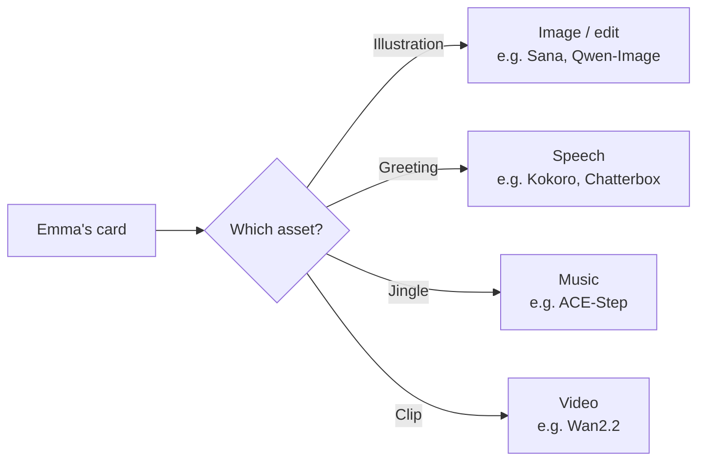
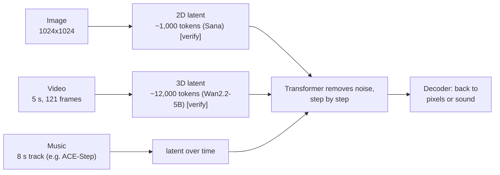
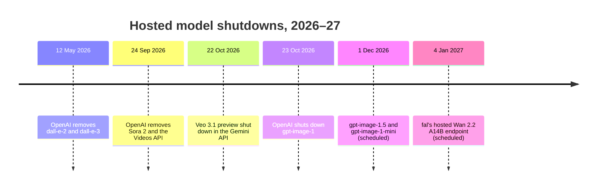

# 01 - Landscape: Modalities and Model Families

Say a toy store wants to send every child on its mailing list a personalized holiday card: an illustration, a spoken greeting, maybe a short animated clip. Take Emma, a fictional 7-year-old who wishes for a telescope. Before writing any code, we have to choose which models make each asset, what they cost to run, and what their licences allow.

Here is Emma's card made with five open models on Nebius Serverless AI, one request per asset:

<table>
  <tr>
    <td width="50%"></td>
    <td width="50%"><a href="https://drive.google.com/file/d/1UmhniMAGMvvpEsSNNmyGTsS9mDvxFgle/view"></a></td>
  </tr>
  <tr>
    <td><b>Illustration.</b> Sana, 512x512, 20 steps, seed 7, <code>1.2 s</code></td>
    <td><b>Clip.</b> Wan2.2-I2V-A14B, animated from this frame (made <a href="#what-consistent-means-in-this-module">below</a>), 640x480, 81 frames at 16 fps (5 s), 20 steps, <code>40.7 s</code>. <a href="https://drive.google.com/file/d/1UmhniMAGMvvpEsSNNmyGTsS9mDvxFgle/view">Watch the clip</a></td>
  </tr>
  <tr>
    <td><b>Greeting.</b> Kokoro-82M, voice af_bella, <code>0.4 s</code>: "Happy holidays, Emma! We heard you wished for a telescope. May all your nights be full of stars." <a href="https://drive.google.com/file/d/1ZCgQ6BFjjlCTAICdrJxbjwZVqma1loDD/view">Listen</a><br><audio src="assets/3_greeting.mp3" controls></audio></td>
    <td><b>Jingle.</b> ACE-Step 1.5, 8 s, 8 steps, <code>2.3 s</code>. <a href="https://drive.google.com/file/d/1jr_yo7LW_ekJlzaixGnw5k9xrXgxj8F6/view">Listen</a><br><audio src="assets/4_jingle.mp3" controls></audio></td>
  </tr>
</table>

Times are one request each, measured from a laptop, network included `[measured: 2026-11-13, Sana and Kokoro on L40S; Qwen-Image-Edit-2511, ACE-Step and Wan2.2 on H100]`. These samples use other models, GPUs and settings than the measured table further down, so don't compare their times with it.

In this lesson we map the generative media modalities, see why video costs the most, compare open and closed models, and check what a licence really allows. You're done when you have written a five-line **model decision record** for your [Homework 1](../cohorts/2026/homework/01-consistent-media-generation-on-serverless-gpus/homework.md) idea: one asset you want to create (a card, a product shot, a voice greeting, a jingle). No idea yet? Use Emma's card.

Keep this template open while you read:

```text
1. Modality and model:      <task>, <model from the table at the end>
2. GPU:                     <the recommended GPU for that model>
3. Licence:                 <link to the model card>, commercial use: <yes / with conditions / no>
4. Cost driver (estimate):  <the closest row in the measured table and why this modality costs what it costs>
5. API to compare in HW1:   <a hosted API for the same or a similar model, with its pricing link>
```

## Modalities

Every generative media task maps an input (a prompt, a reference image, a script) to a media file:

| Task | Typical inputs | Output | What you inspect |
|---|---|---|---|
| **Text-to-image** | Prompt, size, seed | Image (`PNG`) | Subject, style, composition, no unwanted text |
| **Image editing** | Source image(s) + instruction, seed | Image (`PNG`) | The edit is applied; the rest is preserved |
| **Text-to-video** | Motion prompt, resolution, frames, fps, seed | Clip (`MP4`) | Smooth motion; objects persist |
| **Image-to-video** | Keyframe + motion prompt, duration, seed | Clip (`MP4`) | Identity kept from the first frame |
| **Text-to-speech** | Script, voice, speed | Audio (`MP3`/`WAV`) | Pronunciation, prosody, no clipping |
| **Text-to-music** | Style tags, lyrics or prompt, duration, seed | Audio (`MP3`/`WAV`) | Structure, tempo, no distortion |

For Emma's card, each part of the brief maps to a modality and a family of models:



## What changes between modalities

Switching modality changes four numbers at once:

- **Latent size:** the model works on a compressed version of the media, called a latent. It's a 2D grid for an image, a sequence over time for audio, and a 3D volume (frames x height x width) for video.
- **Peak GPU memory (VRAM):** model weights plus the text encoder, the decoder and the working memory used during generation.
- **Load time:** fetching the weights and moving them onto the GPU, once per deployment.
- **Generation time** (`t_gen`): making one asset with the model already loaded.

Most image and video models, and some music models, follow one recipe: compress the media into a latent, cut it into tokens, let a transformer remove noise from those tokens step by step, then decode the result back into pixels or sound. What differs is how many tokens each asset needs (conceptual diagram). Speech models like Kokoro are different: a decoder turns the text's sounds straight into audio, with no denoising steps. [Kokoro-82M](https://huggingface.co/hexgrad/Kokoro-82M) <!-- c:M1-070 c:M1-078 -->



To see the real thing: the transformer backbone in [DiT, Figure 3](https://arxiv.org/abs/2212.09748); video turned into "spacetime patches" in [OpenAI's Sora report](https://openai.com/index/video-generation-models-as-world-simulators/); and a video autoencoder that compresses time as well as space in the [Wan report, Figure 5](https://arxiv.org/abs/2503.20314). <!-- c:M1-175 c:M1-176 c:M1-177 -->

One reference model per modality on a single NVIDIA L40S GPU (48 GB VRAM), from a 2026-11-02 run `[verify: run files being re-measured; numbers may change]`. Generation time depends on the GPU, the resolution, the number of steps and other settings, so another GPU or setting gives different numbers:
<!-- verify before release: link the 2026-11-02 run artifacts (metrics.json per row). -->
<!-- TODO: embed one reference output per row (image, speech, music, video) with its metrics.json from the author re-run. -->

| Modality | Model and settings | Peak VRAM | `t_gen` | Output |
|---|---|---|---|---|
| Text-to-speech | `hexgrad/Kokoro-82M` (20-word script) | `0.73 GB` | `1.88 s` | 7.6 s of speech, MP3 |
| Text-to-image | `Efficient-Large-Model/Sana_1600M_1024px_diffusers` (`1024x1024`, 20 steps) | `10.91 GB` | `4.42 s` | 1024x1024 PNG |
| Text-to-music | `ACE-Step/acestep-v15-xl-turbo-diffusers` (8 s motif) | `11.86 GB` | `2.88 s` | 8 s of music, MP3 |
| Text/image-to-video | `Wan-AI/Wan2.2-TI2V-5B-Diffusers` (`832x480`, 121 frames, 50 steps) | `27.89 GB` | `157.49 s` | 5 s clip, MP4 |

If your model isn't in this table, use the row for its modality as your estimate.

## Why video is expensive

On the same GPU, one 5-second clip from Wan2.2-TI2V-5B takes about **36 times** longer than one Sana image (`157.49 s` vs `4.42 s` `[calc]`). Three things drive the gap:

1. **Many more tokens.** Sana's autoencoder compresses each side of the image 32x, so a 1024x1024 image becomes about 1,000 tokens. Wan2.2-TI2V-5B compresses time 4x and each side 32x, so our 121-frame `832x480` clip becomes about 12,000 tokens `[calc: 31 x 26 x 15]`. Sana uses linear attention, whose cost grows with the token count; Wan uses full attention, whose cost grows with its square. [Sana](https://arxiv.org/abs/2410.10629), [Wan2.2-TI2V-5B](https://huggingface.co/Wan-AI/Wan2.2-TI2V-5B-Diffusers) <!-- c:M1-044 c:M1-045 c:M1-067 -->
2. **More steps.** Our image run used 20 denoising steps; the video run used 50.
3. **Parameters aren't the memory bill.** TI2V-5B is about 10 GB of weights in `bfloat16` `[calc]`, yet it peaked at 27.89 GB: the text encoder, working memory and the 3D decoder add the rest.

The larger [Wan2.2-I2V-A14B](https://huggingface.co/Wan-AI/Wan2.2-I2V-A14B-Diffusers) has two ~14B experts: 27B parameters in total, 14B active per step. Its official script at 720p needs at least 80 GB of VRAM, so it runs on an H100 rather than an L40S. Don't carry the 36x figure over to it; it's a different model on a different GPU. <!-- c:M1-062 c:M1-064 -->

This gap shapes how you build a pipeline: generate and check the still image first, animate only the images that pass, and make video for a sample of records rather than all of them.

Fewer steps is the other lever. [Z-Image-Turbo](https://huggingface.co/Tongyi-MAI/Z-Image-Turbo) is distilled to 8 steps, at the cost of less variety; [Wan2.2-Lightning](https://huggingface.co/lightx2v/Wan2.2-Lightning) makes video in 4 steps, with artifacts on very large motion (both vendor-reported). Module 3 measures what that does to cost. <!-- c:M1-170 c:M1-171 -->

## Model families

- **Sana** (~1.6B, image): fast at 1024px; can't render complex legible text. [Card](https://huggingface.co/Efficient-Large-Model/Sana_1600M_1024px_diffusers) <!-- c:M1-046 c:M1-047 -->
- **Qwen-Image** (20B, image) and **Qwen-Image-Edit-2511** (edits from one or more input images): large multimodal diffusion transformers. [Card](https://huggingface.co/Qwen/Qwen-Image) <!-- c:M1-049 c:M1-050 -->
- **Z-Image-Turbo** (6B, image): distilled for 8-step generation. [Card](https://huggingface.co/Tongyi-MAI/Z-Image-Turbo) <!-- c:M1-055 c:M1-056 -->
- **Wan2.1 / Wan2.2** (1.3B to 27B, video): text-to-video and image-to-video. [Wan2.2 card](https://huggingface.co/Wan-AI/Wan2.2-I2V-A14B-Diffusers) <!-- c:M1-062 -->
- **Kokoro-82M** (speech): 54 preset voices in 8 languages; ships no voice cloning. [Card](https://huggingface.co/hexgrad/Kokoro-82M) <!-- c:M1-071 -->
- **Chatterbox** (0.5B, speech): clones a voice from a short reference clip and watermarks every output. Clone only voices you have consent to use. [Card](https://huggingface.co/ResembleAI/chatterbox) <!-- c:M1-073 c:M1-074 c:M1-121 -->
- **ACE-Step 1.5** (music): a language model plans the song and a diffusion transformer renders it. [Paper](https://arxiv.org/abs/2602.00744) <!-- c:M1-078 -->

## Open vs closed models

Closed models lead on image quality; open weights are close on video. [Artificial Analysis](https://artificialanalysis.ai/image/leaderboard/text-to-image) ranks models by blind pairwise preference votes (Elo), one board per task. Snapshot of 11 Nov 2026:

| Board | #1 (closed) | Best open weights | Elo gap `[calc]` |
|---|---|---|---|
| [Text-to-image](https://artificialanalysis.ai/image/leaderboard/text-to-image) | GPT Image 2.6 Sunburst (max), 1259 | Qwen-Image-2.1 (#23), 1046 | 213 |
| [Image editing](https://artificialanalysis.ai/image/leaderboard/editing) | GPT Image 2.6 Sunburst (max), 1209 | Fibo 2.0 (#26), 1086 | 123 |
| [Text-to-video, with audio](https://artificialanalysis.ai/video/leaderboard/text-to-video) | Wan 3.0, 1175 | MiniMax H3 (#3), 1161 | 14 |
| [Image-to-video, with audio](https://artificialanalysis.ai/video/leaderboard/image-to-video) | Seedance 2.5, 1161 | MiniMax H3 (#4), 1133 | 28 |
| [Text-to-speech, provider voices](https://artificialanalysis.ai/text-to-speech/leaderboard/provider-voice) | Eleven v4, 1337 | Fish Audio Drama 3 (#8), 1274 | 63 |

<!-- c:M1-123 c:M1-124 c:M1-125 c:M1-127 c:M1-128 c:M1-130 c:M1-131 c:M1-133 c:M1-134 c:M1-135 c:M1-136 -->

Compare gaps only within a board: each has its own Elo scale, the speech board uses public votes, and the 14-point video gap is inside the confidence interval. Video boards now come with and without audio, because models such as MiniMax H3 and [LTX-2](https://huggingface.co/Lightricks/LTX-2) generate the soundtrack with the picture. "Open" needs a qualifier here: MiniMax H3's licence requires organisations in the EU, UK, US and South Korea to apply for permission. <!-- c:M1-167 c:M1-164 c:M1-166 c:M1-149 -->

**Closed APIs are a moving target.** Hosted models are retired on a schedule:



Sources: [OpenAI deprecations](https://platform.openai.com/docs/deprecations), [Gemini API Veo](https://ai.google.dev/gemini-api/docs/veo) (Veo 3.1 GA remains on Google's enterprise platform), [fal](https://fal.ai/models/fal-ai/wan/v2.2-a14b/text-to-video). <!-- c:M1-138 c:M1-139 c:M1-140 c:M1-141 c:M1-142 c:M1-143 -->

**When to just use an API.** If you need the best still images, make a few hundred assets a month, and have no one to run GPUs, a per-call API is the sensible choice. Self-hosting pays off when you need a model version you control (pin it and keep a copy of the weights), licence terms fixed to that model, a custom or fine-tuned model, or a volume where your cost per asset beats the API. You'll measure that breakeven in Homework 1.

## Licences

Open weights don't mean free for any commercial use, and the licence belongs to the exact model you deploy.

- **Sana** checkpoints are Apache-2.0. Their card adds the Gemma terms for the text encoder and says the model is "intended for research purposes only". Read both before commercial use. [Card](https://huggingface.co/Efficient-Large-Model/Sana_1600M_1024px_diffusers) <!-- c:M1-041 c:M1-042 c:M1-043 -->
- **Wan** cards add to Apache-2.0 that use "must not involve sharing any content that violates applicable laws, causes harm". [Card](https://huggingface.co/Wan-AI/Wan2.1-T2V-1.3B-Diffusers) <!-- c:M1-059 c:M1-061 -->
- **Qwen-Image** is Apache-2.0; **Qwen-Image-2.1** is a different model with a research licence (below). [Card](https://huggingface.co/Qwen/Qwen-Image) <!-- c:M1-048 -->

Several strong "open" models of 2026 come with conditions. This is a summary, not legal advice; read the linked text:

| Model | Licence | Main conditions |
|---|---|---|
| [Qwen-Image-2.1](https://huggingface.co/Qwen/Qwen-Image-2.1/blob/main/LICENSE) | Qwen Research License | No commercial use without a separate licence from Qwen |
| [FLUX.2 [dev]](https://huggingface.co/black-forest-labs/FLUX.2-dev) | FLUX Non-Commercial License | Weights non-commercial; outputs follow the licence's own terms |
| [FLUX 3 Image Klein](https://huggingface.co/black-forest-labs/flux-3-image-klein/blob/main/LICENSE.md) | FLUX Kommunity License | Output use for companies under US$5M revenue (with affiliates), with content filters or output review and AI disclosure; BFL's product page says product use needs a commercial licence, so confirm with BFL |
| [LTX-2.5](https://huggingface.co/Lightricks/LTX-2.5) | LTX-2.x Community License | No cost under US$10M revenue across the whole company group, subject to its use restrictions |
| [MiniMax H3](https://huggingface.co/MiniMaxAI/MiniMax-H3/blob/main/docs/QA-about-License.md) | MiniMax H3 Community License | EU, UK, South Korea and US organisations must apply; MiniMax may authorise |

<!-- c:M1-144 c:M1-147 c:M1-145 c:M1-148 c:M1-149 -->

One more trap for serverless: Black Forest Labs' standard commercial weights licence doesn't allow exposing the model through an external-facing API endpoint. [BFL](https://bfl.ai/open-weights) <!-- c:M1-146 -->

## What "consistent" means in this module

"Consistent" covers five problems. A fixed seed solves only the first:

| Kind | What it means | What breaks it | See it | Where we handle it |
|---|---|---|---|---|
| **Reproducibility** | Same settings and seed give the same output, within a tolerance | Another PyTorch release, GPU or attention backend; reusing a seeded generator | [Diffusers guide](https://huggingface.co/docs/diffusers/using-diffusers/reusing_seeds) | lesson 02: same seed, same image; lesson 04: compare runs |
| **Identity** | The same character or product in a new scene | A seed doesn't carry identity; models paste the reference instead of re-rendering it | [ConsiStory comparison](https://research.nvidia.com/labs/par/projects/consistory/), [OpenS2V copy-paste](https://pku-yuangroup.github.io/OpenS2V-Nexus/) | Reference-image editing (Qwen-Image-Edit-2511); Module 2 judge loop |
| **Temporal** | No flicker within a clip, no drift when a clip is extended | Unstable frames; errors that pile up as a clip is extended | [FramePack drift](https://lllyasviel.github.io/frame_pack_gitpage/), [VBench flicker](https://vchitect.github.io/VBench-project/) | Short clips; Module 4 evaluation |
| **Cross-asset** | The card, the clip and the next shot show the same Emma | Each asset made in isolation | [HoloCine multi-shot](https://holo-cine.github.io/) | Image first, then image-to-video (Module 2) |
| **Voice** | The same voice in every clip | A changed voice; a reference clip in another language | [Chatterbox demos](https://resemble-ai.github.io/chatterbox_demopage/) | Kokoro preset voices; one fixed reference clip for Chatterbox |

<!-- c:M1-096 c:M1-098 c:M1-099 c:M1-101 c:M1-102 c:M1-106 c:M1-107 c:M1-113 c:M1-117 c:M1-121 c:M1-122 c:M1-178 c:M1-179 c:M1-180 c:M1-181 c:M1-182 c:M1-183 -->

Here is identity with reference-image editing. Qwen-Image-Edit-2511 moves Emma indoors from the first image, then puts her back on the hill from two references: Emma and the telescope from the gift scene, the sky and snow from the first image.

<table>
  <tr>
    <td width="33%"></td>
    <td width="33%"></td>
    <td width="33%"></td>
  </tr>
  <tr>
    <td><b>Reference.</b> Sana, seed 7</td>
    <td><b>New scene.</b> One reference: indoors by the tree, same face, hair, coat and scarf. 20 steps, seed 7, <code>8.3 s</code></td>
    <td><b>Two references.</b> Emma and telescope from image 2, sky and snow from image 1. 20 steps, seed 6, <code>8.8 s</code></td>
  </tr>
</table>

## Projects for inspiration

Four projects that show this lesson's ideas at work:

- **Script to finished video.** [Crreo](https://www.crreo.ai/) turns a script into a video with generated visuals, voice and music: every modality from this lesson in one product. Its free plan makes watermarked clips up to 30 seconds. <!-- c:M1-184 c:M1-185 -->
- **Personalized ads on open weights.** Bark.com and AWS built segment-level video ads on open Wan 2.1 with a cloned brand voice. Removing reference-image propagation dropped their engagement score from 6.5 to 4.8 out of 10: consistency is visible to viewers. [AWS blog](https://aws.amazon.com/blogs/machine-learning/how-bark-com-and-aws-collaborated-to-build-a-scalable-video-generation-solution) <!-- c:M1-151 c:M1-152 c:M1-154 -->
- **Open video, step by step.** ComfyUI's official [Wan2.2 workflows](https://docs.comfy.org/tutorials/video/wan/wan2_2) show the text-to-video and image-to-video pipelines node by node; run them locally or on Comfy Cloud. <!-- c:M1-186 -->
- **Identity and voice in your browser.** Edit one character into new scenes with [Qwen-Image-Edit-2511](https://huggingface.co/spaces/Qwen/Qwen-Image-Edit-2511), or clone a voice from a short clip with [Chatterbox](https://huggingface.co/spaces/ResembleAI/Chatterbox), on free Hugging Face Spaces. <!-- c:M1-187 -->

## Models used in this module

We run these models on **Nebius Serverless AI**. The [Serverless AI Cookbook](https://github.com/nebius/serverless-ai-cookbook/blob/main/templates/README.md) has quick-start templates: each model link below opens the Nebius console with the model, container and recommended GPU already filled in. We'll deploy one in the next lesson. <!-- c:M1-174 c:M1-079 c:M1-081 c:M1-082 -->

| Task | Model (opens a pre-filled deploy form) | Recommended GPU | Licence |
|---|---|---|---|
| Text-to-image *(default)* | [Sana][deploy-sana] | L40S | [Apache-2.0 + Gemma terms](https://huggingface.co/Efficient-Large-Model/Sana_1600M_1024px_diffusers) |
| Text-to-image | [Qwen-Image][deploy-qwen-image] | H100 | [Apache-2.0](https://huggingface.co/Qwen/Qwen-Image) |
| Text-to-image | [Z-Image-Turbo][deploy-z-image] | H100 | [Apache-2.0](https://huggingface.co/Tongyi-MAI/Z-Image-Turbo) |
| Image editing | [Qwen-Image-Edit-2511][deploy-qwen-edit] | H100 | [Apache-2.0](https://huggingface.co/Qwen/Qwen-Image-Edit-2511) |
| Text-to-video | [Wan2.1-T2V-1.3B][deploy-wan21] | H100 | [Apache-2.0](https://huggingface.co/Wan-AI/Wan2.1-T2V-1.3B-Diffusers) |
| Image-to-video | [Wan2.2-I2V-A14B][deploy-wan22] | H100 | [Apache-2.0](https://huggingface.co/Wan-AI/Wan2.2-I2V-A14B-Diffusers) |
| Text-to-speech | [Kokoro-82M][deploy-kokoro] | L40S | [Apache-2.0](https://huggingface.co/hexgrad/Kokoro-82M) |
| Text-to-speech | [Chatterbox][deploy-chatterbox] | H100 | [MIT](https://huggingface.co/ResembleAI/chatterbox) |
| Text-to-music | [ACE-Step 1.5][deploy-ace-step] | H100 | [MIT](https://huggingface.co/ACE-Step/Ace-Step1.5) |

<!-- c:M1-041 c:M1-048 c:M1-052 c:M1-054 c:M1-059 c:M1-061 c:M1-069 c:M1-072 c:M1-075 c:M1-076 -->

Templates deploy as **preemptible** by default: cheaper, but the GPU can be interrupted. Prices in eu-north1, 11 Nov 2026 ([Nebius pricing](https://docs.nebius.com/compute/resources/pricing)): an L40S template costs `$0.7492/h` preemptible or `$1.5484/h` on-demand `[calc: GPU + 8 vCPU + 32 GiB]`; an H100 costs `$4.50` per GPU-hour on-demand, while preemptible H100 is spot-priced from `$0.79` and can exceed on-demand. <!-- c:M1-085 c:M1-086 c:M1-087 c:M1-088 c:M1-089 -->

Our measured music run used the larger `ACE-Step/acestep-v15-xl-turbo-diffusers` checkpoint, also [MIT](https://huggingface.co/ACE-Step/acestep-v15-xl-turbo-diffusers).

[deploy-sana]: https://console.nebius.com/serverless/endpoint/create?template=sana
[deploy-qwen-image]: https://console.nebius.com/serverless/endpoint/create?template=qwen-image
[deploy-z-image]: https://console.nebius.com/serverless/endpoint/create?template=z-image-turbo
[deploy-qwen-edit]: https://console.nebius.com/serverless/endpoint/create?template=qwen-image-edit-2511
[deploy-wan21]: https://console.nebius.com/serverless/endpoint/create?template=wan21-t2v-1-3b
[deploy-wan22]: https://console.nebius.com/serverless/endpoint/create?template=wan22-i2v-a14b
[deploy-kokoro]: https://console.nebius.com/serverless/endpoint/create?template=kokoro-82m
[deploy-chatterbox]: https://console.nebius.com/serverless/endpoint/create?template=chatterbox
[deploy-ace-step]: https://console.nebius.com/serverless/endpoint/create?template=ace-step-1-5

## Your model decision record

For Emma's card:

```text
1. Modality and model:      text-to-image, Sana
2. GPU:                     L40S
3. Licence:                 https://huggingface.co/Efficient-Large-Model/Sana_1600M_1024px_diffusers
                            Apache-2.0 + Gemma terms; card says "research purposes only": check before commercial use
4. Cost driver (estimate):  an image takes seconds on one GPU; a short video clip takes minutes
5. API to compare in HW1:   a hosted text-to-image API, e.g. Z-Image Turbo, listed at $5.00 per 1,000 images on
                            https://artificialanalysis.ai/image/leaderboard/text-to-image
```

Line 4 is an estimate from the measured table. We'll measure your real numbers in [lesson 05](05-measuring-costs.md) and check the estimate. If Emma's brief needed the clip, line 1 would become Wan2.2-I2V-A14B and line 2 an H100. That's the trade-off to defend. <!-- c:M1-126 -->

## Common failures and recovery

| Symptom | Cause | Fix |
|---|---|---|
| Licence terms aren't what you expected | You read the family, not the exact model card | Open the card of the exact model you deploy; read its licence |
| Out of memory | Model plus working memory exceed the GPU | Use the recommended GPU; lower resolution or frame count |
| Your hosted model is retired | The provider deprecated it | Keep a self-hosted fallback |
| A model repo is deleted, gated or relicensed | Hugging Face repos can change | Keep a copy of the weights in your own storage |
| Same seed, different character in a new scene | A seed only repeats one prompt | Use reference-image editing (lesson 02, Module 2) |

Next, generate your first media asset in [02 - First Media Generation in a Few Minutes](02-first-generation.md).

## References

Free resources to go deeper, picked for this lesson's topics:

1. [Hugging Face Diffusion Models Course](https://huggingface.co/learn/diffusion-course/unit0/1) (free course): diffusion and latent diffusion with hands-on Diffusers notebooks, including audio.
2. [Hugging Face Audio Course](https://huggingface.co/learn/audio-course/chapter0/introduction) (free course): audio data, transformer models and text-to-speech.
3. [The Illustrated Stable Diffusion, Jay Alammar](https://jalammar.github.io/illustrated-stable-diffusion/) (blog post): the clearest picture of text encoder, latent denoising, decoder and steps.
4. [Generative modelling in latent space, Sander Dieleman (2025)](https://sander.ai/2025/04/15/latents.html) (blog post): why generators work on compressed latents, the basis of the video cost gap.
5. [Diffusion Models for Video Generation, Lilian Weng (2024)](https://lilianweng.github.io/posts/2024-04-12-diffusion-video/) (blog post): how video models extend image models in time, and temporal consistency.
6. [Scalable Diffusion Models with Transformers (DiT)](https://arxiv.org/abs/2212.09748) (paper): the diffusion transformer behind most current image and video models.
7. [Wan: Open and Advanced Large-Scale Video Generative Models](https://arxiv.org/abs/2503.20314) (paper): the technical report of a leading open video family: video VAE, transformer, training.
8. [Artificial Analysis benchmarking methodology](https://artificialanalysis.ai/methodology) (report): how the leaderboards in this lesson are built, per modality.
9. [Diffusers documentation](https://huggingface.co/docs/diffusers/index) (docs): running open image, video and audio models in Python.
10. [Diffusers: reproducibility and seeds](https://huggingface.co/docs/diffusers/using-diffusers/reusing_seeds) (docs): what a seed does and doesn't guarantee.
