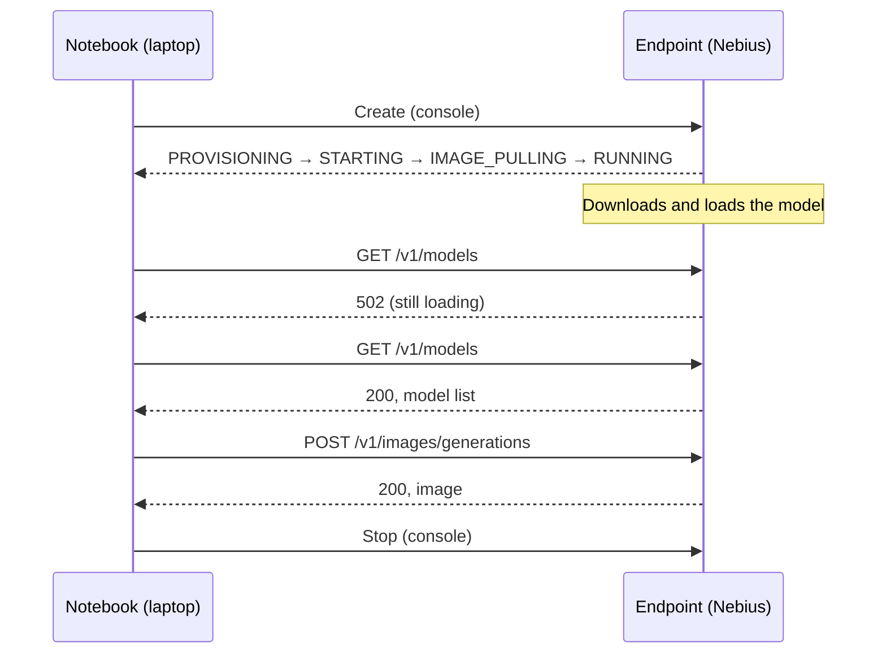

# 02 - First Media Generation in a Few Minutes

Say you want a holiday card illustration: a brass telescope glowing on snow under a starry sky. An open text-to-image model can draw it, but it needs a GPU, and you don't want to set one up. In this lesson we rent one by the second: we deploy the open model Sana as an Endpoint on Nebius Serverless AI from a ready-made template, call it from a notebook on your laptop, save the image, and stop the Endpoint. You're done when the image, four small consistency experiments and your notes are on your laptop, and the Endpoint is stopped (on the GPU path: the DevLab is deleted).

Time and cost, as an estimate: our run took `[measure: min]` from **Create** to the first image, with the account already activated, Jupyter already running and the Sana template defaults (one GPU, preemptible) `[measured: date, GPU]`. The lesson is planned to fit the course's $0.50 per-lesson credit budget. The notebook doesn't limit your spending: stopping the Endpoint does.

## Before you start

Serverless AI runs a container on a GPU without you managing VMs. The service is in Preview and has no SLA. [Serverless AI terms](https://docs.nebius.com/legal/specific-terms/serverless-ai) <!-- c:M1-209 -->

Pick one way to run this lesson:

- **Option A (default): Jupyter on your laptop + an Endpoint.** You deploy Sana as an **Endpoint**, a container that serves HTTP requests at a public URL, and call it from [code/first_image_local.ipynb](code/first_image_local.ipynb). No local GPU needed.
- **Option B: JupyterLab on a GPU.** You run the model inside a [GPU DevLab](https://docs.nebius.com/serverless/quickstart/devlabs), JupyterLab on a GPU VM, with [code/first_image_devlab.ipynb](code/first_image_devlab.ipynb). Pick it if you want the model in your own Python process.

Complete the **Setup** section of the [module README](../01-consistent-media-generation-on-serverless-gpus/README.md) once: steps 1–3 (account and credits) for both options, steps 4–5 (clone, `uv`, Jupyter) for Option A.

**What bills, in short:** an Endpoint bills while it's `RUNNING`, idle or not; a DevLab bills its GPU while it runs and its disk until you delete it. The docs describe no idle auto-stop, so the last step of every run, including a failed one, is to stop the Endpoint or delete the DevLab. [Details at the end](#what-bills). <!-- c:M1-193 c:M1-207 c:M1-209 -->

## Option A: Endpoint and notebook on your laptop

### Create the Endpoint

Each model has a template in the [Serverless AI Cookbook](https://github.com/nebius/serverless-ai-cookbook/tree/main/templates). A template's console link opens the Endpoint form with the container, GPU and settings already filled in. For a walkthrough of the form, see [Getting started with Serverless AI endpoints](https://docs.nebius.com/serverless/quickstart/endpoints). <!-- c:M1-174 -->

1. Open the [Sana template in the console](https://console.nebius.com/serverless/endpoint/create?template=sana). It sets one L40S GPU, a preemptible VM (cheaper, but Nebius can take the GPU back) and token authentication. <!-- c:M1-199 -->
2. Generate the token in the form and **copy it before you click Create**. It's shown once; if you lose it, you create a new Endpoint. Treat it like a password. [Sana template](https://github.com/nebius/serverless-ai-cookbook/blob/main/templates/endpoint-sana/README.md) <!-- c:M1-201 -->
3. Click **Create**, then copy the Endpoint's HTTPS URL from its page.

### Connect from the notebook

Open [code/first_image_local.ipynb](code/first_image_local.ipynb) and run step 1 (*Connect to your Endpoint*). Paste the URL and the token when it asks. The notebook saves them to `code/.env`, a file only you can read and Git ignores, so re-runs don't ask again. To enter them again, delete those lines and restart the kernel. The token is typed with `getpass` and never printed.

### Wait until it's ready

The console shows the Endpoint moving through `PROVISIONING → STARTING → IMAGE_PULLING → RUNNING`. [Lifecycle](https://docs.nebius.com/serverless/lifecycle) <!-- c:M1-189 c:M1-190 -->

`RUNNING` means the container is up, not that the model is loaded. On first start the server downloads about 9.7 GB of weights `[calc: sum of the fp16 file sizes on the Hub]` and loads them onto the GPU. Until then, calls may return `502 failed to connect to local service`. [Sana template](https://github.com/nebius/serverless-ai-cookbook/blob/main/templates/endpoint-sana/README.md) <!-- c:M1-215 c:M1-226 -->



<!-- visual: id=V1 | teaches=RUNNING isn't ready | shape=sequence | must-be-accurate=status names, 502 | claims=M1-189,M1-190,M1-215 -->

Step 2 of the notebook waits for you: it asks `/v1/models` every 2 seconds until the model answers, and gives up after 10 minutes. Re-running it is safe. On our first deploy the wait took `[measure: s, date]`.

### Generate the image

Step 3 posts one JSON body to `/v1/images/generations`. The token goes in the `Authorization` header. The response is a PNG, base64-encoded in `data[0].b64_json`. Change the prompt if you like; keep it free of real people, brands and known characters. Each side of `size` must be a multiple of 32.

If `REQUESTS_CA_BUNDLE` is set, `requests` uses that file instead of the public CAs. The call passes `verify=certifi.where()` so it uses the public bundle. The next cell, `ImageGenerator`, uses `urllib` and is not affected by that variable.

```python
request_data = {
    "model": "Efficient-Large-Model/Sana_1600M_1024px_diffusers",
    "prompt": prompt,
    "size": "512x512",
    "response_format": "b64_json",
}
response = requests.post(
    f"{BASE_URL}/v1/images/generations",
    headers={"Authorization": f"Bearer {TOKEN}"},
    json=request_data,
    timeout=300,
    verify=certifi.where(),
)
```

There is no seed in this request. The server picks one, so every run generates a new image. Our first request took 5.5 s `[measured: 2026-11-12]`. <!-- c:M1-211 c:M1-212 -->

`ImageGenerator` ([code/image.py](code/image.py)) posts this same body, saves the PNG, and returns the path. The cells after step 3 use it so the request stays in one place. Seed, size and steps are the defaults in `generate_image`.

<!-- visual: id=V4 | teaches=the first asset and its record | shape=before-after | must-be-accurate=image and metrics from the same run, measured tag | claims=measured -->

### Same settings, same image

Step 4 generates the same image three times, then compares the three hashes.

On one of our runs each image took about 1.7 s, measured from the notebook, network included `[measured: 2026-11-12, H100, eu-north1]`. The very first request took 5.5 s.

Then the cell compares the three hashes. Same prompt, seed and settings on the same Endpoint gave the same bytes in every run we did: 4 runs, 12 images, one hash `[measured: 2026-11-12, H100, eu-north1]`. That holds for one setup only. PyTorch doesn't promise identical results across releases or platforms, even with the same seed, so a different GPU or template image can change the bytes. [PyTorch: Reproducibility](https://docs.pytorch.org/docs/2.15/notes/randomness.html) <!-- c:M1-101 c:M1-218 -->

<!-- visual: id=V5a | teaches=same settings give the same image | shape=before-after | must-be-accurate=three images, one hash, run date | claims=measured -->

### What a prompt and a seed can't fix

Step 4 was the first of four experiments. Three more on the same Endpoint, five more images in total. Each one shows the images side by side.

1. **Leave out the seed** (step 5). Same prompt and settings, no seed: the server picks a random one, so two calls give two different images. A seed you didn't record is a setting you can't repeat. <!-- c:M1-211 c:M1-218 -->
2. **The seed is a setting** (step 6). The notebook describes a character, a small red fox with spectacles and a green scarf, and draws the same snowy scene with seed 7 and seed 8. The picture changes as much as it would for any other setting. Check the seed-7 image: if Sana skips the scarf or the spectacles even here, don't count that trait in the next experiment.
3. **Same character, new scene** (step 7). Same description, same seed, snow vs beach. Compare the two foxes and write one line in the notebook: which traits survived, which changed. On our first try with a shorter description, the fox's build, the telescope and even the art style changed between the two scenes `[measured: 2026-11-12, H100, eu-north1]`. A prompt describes a character; it doesn't hold one fixed.

The *Inspiration* cells repeat those two comparisons on four other subjects. Then *Practice* is the same three moves on a subject you choose: one scene, a new seed, a new scene. The share card uses those three images.

Then answer four questions in the notebook's *Your notes* cell, one line each: the identity note above, plus these three.

1. What must stay fixed to get the same image again?
2. Why didn't the seed keep the character the same?
3. What would you try for a product that needs the same character in every scene?

<details>
<summary>Sample answers</summary>

1. The model and its version, the server image, the GPU and library versions, and every setting: prompt, seed, size, steps, guidance, negative prompt.
2. The seed fixes the starting noise. A different prompt steers that noise to a different picture, so nothing ties the second image to the first.
3. Give the model the character itself, not only a description: reference-image editing, image-conditioned generation, or a small fine-tuned adapter (LoRA) trained on the character.

</details>

<!-- visual: id=V5 | teaches=no seed, seed as a setting, identity across scenes | shape=before-after | must-be-accurate=strips from one run; prompts and seeds in captions | claims=measured -->

### Stop the Endpoint

Do it now. In the console, open the Endpoint and click **Stop** or **Delete**, then check the status:

- **Stop** keeps the Endpoint and its URL. Compute stops billing; start it again later.
- **Delete** removes it. A new Endpoint gets a new URL and token.

[Stop and start](https://docs.nebius.com/serverless/maintenance/stop-start), [manage endpoints](https://docs.nebius.com/serverless/endpoints/manage) <!-- c:M1-194 c:M1-196 -->

You're done when:

- [ ] `runs/first-image.png` shows your image.
- [ ] You've answered the four questions in the notebook's *Your notes* cell.
- [ ] Your run folder has `share-card.png`.
- [ ] The Endpoint is `STOPPED` or deleted.

## Option B: JupyterLab on a GPU

Use this path if you want to run the same experiments, practice scenes and share card directly on a GPU without creating an Endpoint: `ImageGenerator.local()` loads Sana once into your notebook's GPU memory and watches peak VRAM. The GPU bills the whole time the DevLab runs, including while you read and type.

1. Create a DevLab from the **JupyterLab** template in the web console: [DevLabs quickstart](https://docs.nebius.com/serverless/quickstart/devlabs#web-console). Pick an L40S if it's offered `[verify: L40S available for DevLabs]`; from the CLI, always pass `--platform`, since the default is an H100. <!-- c:M1-208 -->
2. Open the DevLab's HTTPS URL, sign in with your Jupyter token, and open a **Terminal**. The JupyterLab template already has this repo at `~/work/production-ai-agents-for-media-generation` and `uv` installed. Update the repo and create the GPU environment once per DevLab:

   ```bash
   cd ~/work/production-ai-agents-for-media-generation
   git pull origin 01-draft

   uv sync --extra gpu --extra notebooks
   uv run python -m ipykernel install --user --name course-gpu --display-name "course (GPU)"
   ```

3. In JupyterLab choose **Kernel → Change kernel → course (GPU)**, then open [code/first_image_devlab.ipynb](code/first_image_devlab.ipynb) and run it top to bottom. Do not use the template's default conda kernel: its PyTorch pieces are built for different CUDA versions. The notebook loads Sana with Diffusers in fp16, with the text encoder and VAE in bf16: the model card and the Diffusers docs say they must stay in bf16 or fp32. [SanaPipeline](https://huggingface.co/docs/diffusers/api/pipelines/sana) <!-- c:M1-224 c:M1-225 -->
4. Download the `.zip` archive from the last step (`first-image.png`, `metrics.json`, comparison images, and `share-card.png`), then **delete** the DevLab: a stopped DevLab still bills its disk. [Stop and start](https://docs.nebius.com/serverless/maintenance/stop-start) <!-- c:M1-207 -->

On our L40S, Sana peaked at `[measure]` GB of GPU memory and took `[measure]` s per image.

You're done when your run archive (`first-image.png`, `metrics.json`, `share-card.png`) and notes are on your laptop and the DevLab is deleted.

## Common failures and recovery

| Symptom | Cause | Fix |
|---|---|---|
| `502` for several minutes | The server is still downloading or loading the model | Let the wait cell run. Past 10 minutes, open the Endpoint's logs in the console |
| `401` or `403` | Token missing or wrong | Delete `TOKEN` from `code/.env`, restart the kernel, and run step 1 again. Lost it? Create a new Endpoint |
| Stuck before `RUNNING`, then `ERROR` with `NotEnoughResources` | No free GPU; the platform retries for up to 30 minutes | Try again later |
| `STOPPED` with code `Preempted` | The preemptible GPU was taken back | Start the Endpoint again; it won't restart on its own |
| A charge you didn't expect | An Endpoint left `RUNNING`, or a DevLab stopped but not deleted | Stop the Endpoint; delete the DevLab |

<!-- c:M1-191 c:M1-197 c:M1-200 c:M1-201 c:M1-215 c:M1-207 -->

## What bills

A Serverless VM bills from the moment it starts until it's completely stopped; stopped time isn't charged. [Serverless AI terms](https://docs.nebius.com/legal/specific-terms/serverless-ai) <!-- c:M1-193 -->

| State | Compute | Disk | Mounted volumes, buckets |
|---|---|---|---|
| Endpoint `RUNNING`, idle or not | billed | billed | billed |
| Endpoint `STOPPED` | not billed | released | billed |
| DevLab stopped | not billed | billed | billed |

<!-- c:M1-090 c:M1-195 c:M1-207 -->
<!-- visual: id=V6 | teaches=what bills in each state, and that the meter runs from create to stop | shape=states | must-be-accurate=billed / not billed per state; no prices | claims=M1-090,M1-193,M1-195,M1-207 -->

Rates change often, so we don't print them here. Look up today's rate for your GPU and preset on [Nebius pricing](https://nebius.com/prices); the template preset is `gpu-l40s-a`, `1gpu-8vcpu-32gb`. Our own run cost about `[measure: USD, compute only, from metrics.json and the rate on <date>]`. Lesson 05 turns your `metrics.json` into a cost per image. <!-- c:M1-199 -->

Next: [03 - Containers for Generative AI](03-containers.md).

## References

Free resources to go deeper:

1. [Sana template README](https://github.com/nebius/serverless-ai-cookbook/blob/main/templates/endpoint-sana/README.md) (template docs): what the template deploys, the readiness warning and a request example.
2. [Getting started with Serverless AI endpoints](https://docs.nebius.com/serverless/quickstart/endpoints) (docs): create, wait, token auth, logs, delete.
3. [Getting started with Serverless AI DevLabs](https://docs.nebius.com/serverless/quickstart/devlabs) (docs): JupyterLab on a GPU from a template.
4. [Diffusers: Reproducibility](https://huggingface.co/docs/diffusers/using-diffusers/reusing_seeds) (framework guide): seeds, generators and the limits of determinism.
5. [SanaPipeline](https://huggingface.co/docs/diffusers/api/pipelines/sana) (API reference): running Sana in Diffusers.
6. [PyTorch CUDA semantics: asynchronous execution](https://docs.pytorch.org/docs/2.15/notes/cuda.html) (framework guide): why GPU timers need `torch.cuda.synchronize()`.
7. [OpenAI Images API reference](https://developers.openai.com/api/reference/resources/images/methods/generate) (API reference): the OpenAI-style request and `b64_json` response shape the template's server also uses.
8. [SANA: Efficient High-Resolution Image Synthesis with Linear Diffusion Transformers](https://arxiv.org/abs/2410.10629) (paper): why Sana is fast on one GPU.
9. [Kubernetes: liveness, readiness and startup probes](https://kubernetes.io/docs/concepts/configuration/liveness-readiness-startup-probes/) (concept docs): "started" vs "ready for traffic".
10. [Hugging Face Diffusion Models Course](https://huggingface.co/learn/diffusion-course/unit0/1) (free course): Diffusers basics in notebooks.
