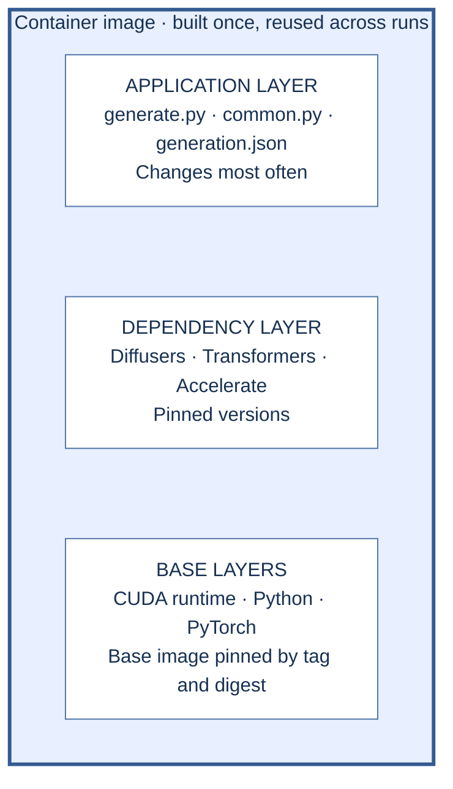
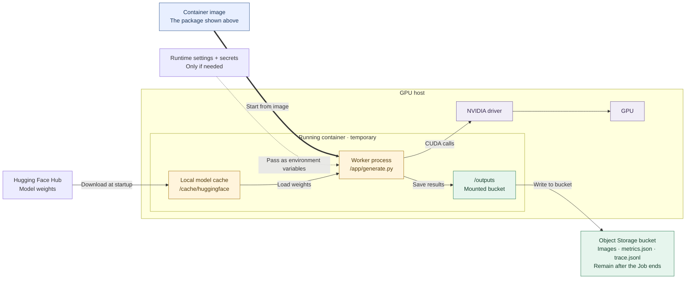

# 03 - Containers for Generative AI

Say you have a worker that generates an image with Sana in a notebook. To run it on a cloud GPU, you package it as a container image. A container image is the easiest way to reproduce your runtime environment: the GPU host runs only what's in that image, and it doesn't know about your laptop, your virtual environment or the token in your shell. In this lesson we start from what goes wrong, trace each symptom to a line in a broken Dockerfile, and fix it. You're done when you can say, for each line of [code/docker/Dockerfile.bad](code/docker/Dockerfile.bad), what goes wrong on a GPU host and how [code/docker/Dockerfile](code/docker/Dockerfile) fixes it.

Time and cost: about 20 minutes of reading. No GPU and no credits needed. You don't need Docker on your laptop for this course: it provides prebuilt images, and building locally is an optional extra at the end.

## Template or your own container?

Most of the time you don't write a Dockerfile at all.

| You want to                                                                     | Use                                                                                                                            |
| ------------------------------------------------------------------------------- | ------------------------------------------------------------------------------------------------------------------------------ |
| Serve a catalog model (Sana, Wan, Kokoro, …) behind an HTTP API                 | A [cookbook template](https://github.com/nebius/serverless-ai-cookbook/tree/main/templates): image, port and GPU are filled in |
| Run your own script once, then stop                                             | Your own image: the worker in this lesson                                                                                      |
| Change the server, add a model the templates don't have, pin your own libraries | Your own image                                                                                                                 |

**Using a cookbook template? You can skim the rest of this lesson.** Come back when you need your own worker.

## Start from a template image

You can also build on a template's image, not only use it as is. The Sana template image already has the CUDA runtime, PyTorch and the pinned Diffusers stack, so your Dockerfile only adds your code. [Sana template Dockerfile](https://github.com/nebius/serverless-ai-cookbook/blob/main/templates/endpoint-sana/Dockerfile)

```dockerfile
FROM cr.eu-north1.nebius.cloud/e00gw2b7v3pxetvpy7/sana-serve:660347b
ENV HF_HOME=/cache/huggingface
COPY common.py generate.py generation.json /app/
RUN mkdir -p /cache /outputs
CMD ["python", "/app/generate.py", "--n", "1", "--out", "/outputs/run"]
```

| You inherit | You add or change |
| --- | --- |
| CUDA runtime, PyTorch, pinned `diffusers`, `transformers`, `accelerate` | Your code and config |
| `serve.py`, `fastapi`, `uvicorn` (unused by the worker) | `CMD`: without it the container starts the template's server |
| The template's choices: you get its pins, not yours | The weights cache path and `/outputs` |

The example uses a tag to stay short; [section 1](#1-base-image-and-platform) explains pinning by digest. The rest of this lesson builds the same worker from the PyTorch base, so you see every line the template image hides.

## What goes inside the image, and what stays outside

An **image** is the package you build and reuse. A **container** is a running instance of that image. The two diagrams show the package first, then what happens when it runs.

**At build time: software is packaged in layers.**



*Read the stack from bottom to top: start with the base image, install libraries, then copy the worker code. Changing only the code lets Docker reuse the earlier layers. These are conceptual groups; the base image itself contains multiple filesystem layers.*

**At run time: the worker receives inputs, uses the host GPU, and saves results.**



*The image supplies the CUDA runtime; the host supplies the NVIDIA driver and GPU. Amber marks the worker and its temporary cache. Green follows the output path to persistent storage:* `/outputs` *is a mount point, not a second copy of the bucket.*

**Outside the image does not mean outside the running container.** Downloaded weights sit in the container's local cache, injected secrets are available to the process, and the bucket appears at `/outputs`. None of them is baked into the image. When the container is removed, its local cache is lost, but bucket outputs remain. Creating an `/outputs` directory alone does not make it persistent: whoever starts the container must mount the bucket there.

## Common failures and recovery

These are the ways a container that works on a laptop goes wrong on a GPU host. Most come from putting something in the wrong place in the picture above. Each row points to the section that fixes it.

| You see                                                           | Cause                                                   | Fix                                                      |
| ----------------------------------------------------------------- | ------------------------------------------------------- | -------------------------------------------------------- |
| The container fails right after the image pull                    | Image built for arm64                                   | [1. Base image and platform](#1-base-image-and-platform) |
| `torch.cuda.is_available()` is `False` on a GPU                   | CPU-only PyTorch, or no CUDA runtime in the image       | [1. Base image and platform](#1-base-image-and-platform) |
| CUDA errors at the first GPU call, while the image looks fine     | The image's CUDA is newer than the host driver supports | [1. Base image and platform](#1-base-image-and-platform) |
| It worked before; after a rebuild it breaks or the outputs change | Unpinned libraries                                      | [2. Dependencies](#2-dependencies)                       |
| Every code edit reinstalls all libraries                          | Code copied before the install                          | [2. Dependencies](#2-dependencies)                       |
| Push and pull take forever; the image is huge                     | Weights baked into the image                            | [3. Model weights](#3-model-weights)                     |
| Every start waits for a download                                  | Weights downloaded at start (a trade-off, not a bug)    | [3. Model weights](#3-model-weights)                     |
| A token shows up in `docker history`                              | Secret in `ENV` or `ARG`                                | [4. Secrets and stray files](#4-secrets-and-stray-files) |
| The run finishes but nothing is saved                             | Outputs written inside the container                    | [5. Outputs](#5-outputs)                                 |

## Five causes, five fixes

Every bad line below comes from one file. **Don't build it.** [code/docker/Dockerfile.bad](code/docker/Dockerfile.bad):

```dockerfile
FROM --platform=linux/arm64 python:latest
ENV HF_TOKEN=NOT_A_REAL_TOKEN
COPY . /app
WORKDIR /app
RUN pip install torch --index-url https://download.pytorch.org/whl/cpu
RUN pip install diffusers transformers
RUN python -c "from huggingface_hub import snapshot_download; snapshot_download('Efficient-Large-Model/Sana_1600M_1024px_diffusers')"
CMD ["python", "generate.py", "--out", "/tmp/results"]
```

### 1. Base image and platform

```dockerfile
# bad
FROM --platform=linux/arm64 python:latest
RUN pip install torch --index-url https://download.pytorch.org/whl/cpu

# fixed
FROM pytorch/pytorch:2.13.0-cuda13.0-cudnn9-runtime@sha256:db80a41f8428644cebcb3d75b0b62df334ab6c0e75785951eb25f48bfbd42407
```

| Bad line                 | What goes wrong                                                                                                                                                             | Fix                                           |
| ------------------------ | --------------------------------------------------------------------------------------------------------------------------------------------------------------------------- | --------------------------------------------- |
| `--platform=linux/arm64` | The GPU host is `linux/amd64`; an arm64 image doesn't start there                                                                                                           | Build for `linux/amd64`                       |
| `python:latest`          | Two problems. `latest` is a tag that moves: a rebuild next month can start from a different Python version. And it's a plain Python image, with no CUDA runtime for the GPU | A CUDA runtime base, pinned by tag and digest |
| `torch … /whl/cpu`       | CPU-only PyTorch: the GPU sits unused                                                                                                                                       | Use the PyTorch build in the CUDA base image  |

- `linux/amd64`**.** On an Apple Silicon Mac, Docker builds for arm64 unless you pass `--platform linux/amd64`. Check the platform you building for. 
- **Don't pick the newest CUDA.** Your image brings the CUDA runtime; the GPU host brings the driver. If the image's CUDA is newer than the driver supports, the container starts but fails at the first GPU call. Take the base image from a cookbook template or from this lesson (`cuda13.0`), and change it only when you know why. [NVIDIA CUDA release notes](https://docs.nvidia.com/cuda/cuda-toolkit-release-notes/index.html) 
- **Runtime, not devel.** A `-devel` image adds compilers and headers you only need if you compile CUDA code, which this course doesn't. It works, but it's a bigger image to pull.
- **Tag and digest.** The digest pins the exact base image, so a rebuild starts from the same bytes. Re-pin it on purpose, for example for a security fix.

> 💡 **On Nebius Serverless AI:** images must be `linux/amd64`. `--image` accepts `registry/path@digest`, so you can deploy the exact digest you pinned. [Nebius tutorial](https://docs.nebius.com/serverless/quickstart/endpoints), [Endpoints: manage](https://docs.nebius.com/serverless/endpoints/manage) 

### 2. Dependencies

```dockerfile
# bad: code first, then unpinned installs
COPY . /app
WORKDIR /app
RUN pip install diffusers transformers

# fixed: pinned installs first, then code
RUN pip install diffusers==0.39.0 transformers==5.13.1 
WORKDIR /app
COPY common.py generate.py generation.json /app/
```

| Bad line | What goes wrong | Fix |
| --- | --- | --- |
| `pip install diffusers transformers` | Unpinned: a rebuild can change outputs or break | Pin exact versions |
| `COPY . /app` before `pip install` | Any code edit invalidates the layers after it, so every edit reinstalls every library | Install libraries first, copy code last |

- **What the pins cover.** We pin the libraries we install by exact version. Their own dependencies can still move. For a fully repeatable build, install from a lock file that pins those too, ideally with hashes. [pip: repeatable installs](https://pip.pypa.io/en/stable/topics/repeatable-installs/)
- **Libraries first, code last.** Docker caches each layer and reuses it until something above it changes. In the bad file the code sits above the installs, and above the weights download too, so one edit to `generate.py` repeats all of them. In the fixed file the same edit rebuilds only the last layers.

> 💡 **On Nebius Serverless AI:** an Endpoint's image, command and env vars can't be changed after it is created. A rebuilt image means a new Endpoint, which is one more reason to pin. [Endpoints: manage](https://docs.nebius.com/serverless/endpoints/manage) 

### 3. Model weights

```dockerfile
# bad
RUN python -c "from huggingface_hub import snapshot_download; snapshot_download('Efficient-Large-Model/Sana_1600M_1024px_diffusers')"

# fixed: no download at build; the worker downloads into this cache at start
ENV HF_HOME=/cache/huggingface
RUN mkdir -p /cache
```

| Bad line                          | What goes wrong                                                                     | Fix                                              |
| --------------------------------- | ----------------------------------------------------------------------------------- | ------------------------------------------------ |
| `snapshot_download(...)` at build | About 9.7 GB of weights baked into the image (the sum of the fp16 files on the Hub) | Download at start into a cache, or mount storage |

Baking weights in isn't a bug: the image runs. You pay for it in size, push and pull time, and a rebuild for every model change. The fix moves that cost to start time. There are three places weights can live:

| Option                                               | Good                             | Watch out                                                                                                                                                                                                           |
| ---------------------------------------------------- | -------------------------------- | ------------------------------------------------------------------------------------------------------------------------------------------------------------------------------------------------------------------- |
| Baked into the image                                 | One artifact                     | Huge image; slow push and pull; rebuild for every model change                                                                                                                                                      |
| On a bucket or shared filesystem mounted at run time | Download once, reuse across runs | Needs a mount. The Hugging Face cache uses symlinks; on storage without symlink support it falls back to copying files, with a warning. [HF cache](https://huggingface.co/docs/huggingface_hub/guides/manage-cache) |
| Downloaded at start into a cache (our worker)        | Simplest; small image            | Every cold start downloads again                                                                                                                                                                                    |

The cache at `/cache/huggingface` is inside the container, so it's gone when the container is removed. LoRA files follow the same rules as base weights.

> 💡 **On Nebius Serverless AI:** `--volume` mounts a bucket or a shared filesystem into the container. The bucket mount doesn't fully support symlinks, which the Hugging Face cache uses, so put a shared weights cache on a filesystem. With the Sana template, an Endpoint can show RUNNING while the weights are still downloading. [`nebius ai job create`](https://docs.nebius.com/cli/reference/ai/job/create), [Sana template](https://github.com/nebius/serverless-ai-cookbook/blob/main/templates/endpoint-sana/README.md) 

### 4. Secrets and stray files

```dockerfile
# bad
ENV HF_TOKEN=NOT_A_REAL_TOKEN
COPY . /app

# fixed: no token in the Dockerfile; copy named files only
COPY common.py generate.py generation.json /app/
```

| Bad line         | What goes wrong                                                                                                           | Fix                                                                         |
| ---------------- | ------------------------------------------------------------------------------------------------------------------------- | --------------------------------------------------------------------------- |
| `ENV HF_TOKEN=…` | `ENV` and build args persist in the final image. [Docker: build secrets](https://docs.docker.com/build/building/secrets/) | Keep secrets out of the Dockerfile; pass them when the container starts     |
| `COPY . /app`    | Copies whatever is in the build context. Without a `.dockerignore` that means `.env`, local runs and notebooks            | Copy only the files the worker needs, and keep an allowlist `.dockerignore` |

**Secrets: pass them at run time.** The token lives in your shell or a local file, and Docker hands it to the container when it starts. `-e HF_TOKEN` takes the value from your shell. `-e HF_TOKEN=value` also works, but then the secret is typed into the command and lands in your shell history, so prefer the first form. Either way it never appears in the Dockerfile or the image. [Docker: set environment variables](https://docs.docker.com/reference/cli/docker/container/run/#env)

```bash
export HF_TOKEN=...                                  # in your shell, not in the Dockerfile
docker run --rm -e HF_TOKEN sana-worker:local        # value taken from the shell
docker run --rm -e HF_TOKEN=hf_xxx sana-worker:local # also valid, but the value is typed in the command
docker run --rm --env-file .env sana-worker:local    # or several from a file that stays out of git and out of the build context
```

**If a build step needs a secret, mount it for that one step.** Our worker doesn't, because it downloads nothing at build. When you do need one, a secret mount exists only during its `RUN` instruction and isn't stored in a layer. [Docker: build secrets](https://docs.docker.com/build/building/secrets/) 

```dockerfile
RUN --mount=type=secret,id=hf_token \
    HF_TOKEN=$(cat /run/secrets/hf_token) python download_private_files.py
```

```bash
docker build --secret id=hf_token,env=HF_TOKEN .
```

**Stray files: allowlist the build context.** [code/.dockerignore](code/.dockerignore) lists what may enter the build: the first line `*` excludes everything, then each `!file` lets one file back in. The last matching line wins. [Docker: build context](https://docs.docker.com/build/concepts/context/) 

```text
*
!common.py
!generate.py
!generation.json
!video.py
```

The `video.py` line belongs to the video worker, which shares this folder. `COPY . /app` in this folder would be safe only because of this file. Don't rely on that: name the files in the Dockerfile too.

> 💡 **On Nebius Serverless AI:** pass secrets with `--env-secret`; the value is read from SecretStash when the container starts. [Endpoints: manage](https://docs.nebius.com/serverless/endpoints/manage) 

### 5. Outputs

```dockerfile
# bad
CMD ["python", "generate.py", "--out", "/tmp/results"]

# fixed
RUN mkdir -p /outputs
CMD ["python", "/app/generate.py", "--n", "1", "--out", "/outputs/run"]
```

| Bad line | What goes wrong | Fix |
| --- | --- | --- |
| `--out /tmp/results` | Outputs vanish when the container exits | Write to a bucket mounted at `/outputs` |

Creating an `/outputs` directory alone does not make it persistent. Whoever starts the container must mount a bucket there. Files written to the mounted bucket remain after the container is removed.

This matters for a container that runs once and exits. A server that returns its result in the HTTP response doesn't need this.

>💡 **On Nebius Serverless AI:** mount a bucket or a shared filesystem at `/outputs` with `--volume`: `--volume <bucket>:/outputs:rw` for a bucket, `--volume <filesystem-id>:/outputs:rw` for a shared filesystem. Choose a shared filesystem if you need symlinks, which the bucket mount doesn't fully support. [`nebius ai endpoint create`](https://docs.nebius.com/cli/reference/ai/endpoint/create)

## The fixed Dockerfile

All five fixes together, [code/docker/Dockerfile](code/docker/Dockerfile):

```dockerfile
FROM pytorch/pytorch:2.13.0-cuda13.0-cudnn9-runtime@sha256:db80a41f8428644cebcb3d75b0b62df334ab6c0e75785951eb25f48bfbd42407
ENV PYTHONUNBUFFERED=1 PIP_NO_CACHE_DIR=1 PIP_BREAK_SYSTEM_PACKAGES=1 HF_HOME=/cache/huggingface
RUN pip install diffusers==0.39.0 transformers==5.13.1 accelerate==1.14.0 sentencepiece==0.2.1 protobuf==6.33.0
WORKDIR /app
COPY common.py generate.py generation.json /app/
RUN mkdir -p /cache /outputs
CMD ["python", "/app/generate.py", "--n", "1", "--out", "/outputs/run"]
```


## References

- [Docker: build secrets](https://docs.docker.com/build/building/secrets/), Docker
- [Docker: multi-platform builds](https://docs.docker.com/build/building/multi-platform/), Docker
- [Manage the huggingface_hub cache](https://huggingface.co/docs/huggingface_hub/guides/manage-cache), Hugging Face
- [How to rapidly build multi-architecture images with Buildx](https://www.docker.com/blog/how-to-rapidly-build-multi-architecture-images-with-buildx/), Docker blog (2022)
- [nvidia/container-images/cuda](https://gitlab.com/nvidia/container-images/cuda), NVIDIA
- [Slacker: Fast Distribution with Lazy Docker Containers](https://www.usenix.org/conference/fast16/technical-sessions/presentation/harter), USENIX FAST '16
- [Full Stack Deep Learning 2022, Lecture 5: Deployment](https://fullstackdeeplearning.com/course/2022/lecture-5-deployment/)
