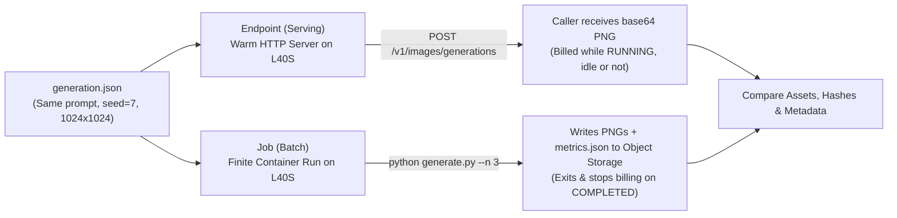
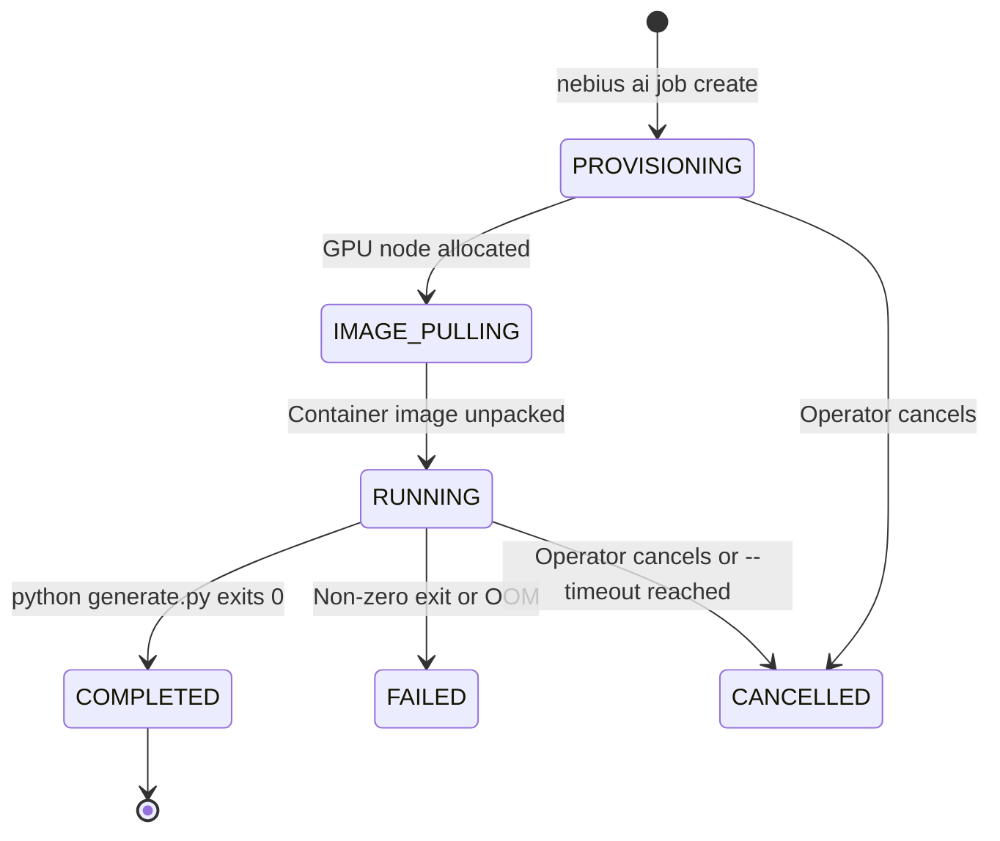

# 1.4 Serving vs Batch Inference: the Same Generation for Different Use Cases

In this lesson we run the 1.2 generation again, this time as a batch Job, store the output in Object Storage, and learn when to choose an Endpoint or a Job. You're done when the Job is COMPLETED, its asset is in your bucket, and you can say whether it matches the 1.2 asset and why.

## Serving or batch

In Lesson 1.2 we used a warm HTTP **Endpoint** to generate Emma's telescope illustration. That works well when a user or an interactive agent is waiting for an answer right now.

What if you have 200 holiday cards to generate overnight, or you want a finite GPU run that writes its outputs to a bucket and shuts itself down automatically? Leaving an Endpoint running when no requests are arriving wastes GPU budget, while a **Serverless GPU Job** starts a container, executes a script to completion, and stops billing the moment the process exits.



| Dimension | Endpoint (Serving) | Job (Batch) |
|---|---|---|
| **What starts the work?** | An HTTP request to a running server | Submitting a container command (`nebius ai job create`) |
| **Model load overhead** | Paid once when the Endpoint starts | Paid once per Job container (`load_s`), amortized over `--n` assets |
| **Where do outputs go?** | Returned in the HTTP response (`b64_json`) | Written directly to mounted Object Storage (`/outputs`) |
| **When does billing stop?** | Only when you explicitly stop or delete the Endpoint | Automatically when the container exits (`COMPLETED` / `FAILED`) |
| **Best use case** | Interactive apps and low-latency agent tool calls | Scheduled batches, dataset generation, and finite backfills |

## The same generation as a Job

In Lesson 1.2 we ran our generation cells inside a Jupyter notebook. A Serverless Job needs a standalone Python script, not a notebook, so we extract the model loading and generation loop into [code/generate.py](code/generate.py).

First, `load_pipeline(cfg)` loads the pinned Sana checkpoint onto the GPU with the exact same `fp16` / `bfloat16` recipe we used in 1.2:

```python
def load_pipeline(cfg):
    import torch
    from diffusers import SanaPipeline

    if not torch.cuda.is_available():
        raise RuntimeError("CUDA unavailable; select a GPU runtime with CUDA-enabled PyTorch")
    pipe = SanaPipeline.from_pretrained(
        cfg["model"],
        revision=cfg["model_revision"],
        variant=cfg["variant"],
        torch_dtype=torch.float16,
    ).to("cuda")
    pipe.text_encoder.to(torch.bfloat16)
    pipe.vae.to(torch.bfloat16)
    pipe.set_progress_bar_config(disable=True)
    return pipe
```

Next, `run()` loads the pipeline once, measures `load_s`, loops `n` times with the configured `seed`, records each generation's latency and peak VRAM (`peak_vram_gb`), and saves `asset-000.png`..`asset-002.png` along with `metrics.json` and `trace.jsonl`:

```python
torch.cuda.reset_peak_memory_stats()
torch.cuda.synchronize()
start = time.perf_counter()
pipe = load_pipeline(cfg)
torch.cuda.synchronize()
m["load_s"] = round(time.perf_counter() - start, 4)

for index in range(n):
    path = folder / f"asset-{index:03d}.png"
    torch.cuda.synchronize()
    start = time.perf_counter()
    image = pipe(
        prompt=cfg["prompt"],
        **cfg["params"],
        generator=torch.Generator(device="cuda").manual_seed(cfg["seed"]),
    ).images[0]
    torch.cuda.synchronize()
    m["latency_s"].append(round(time.perf_counter() - start, 4))
    peak_bytes = torch.cuda.max_memory_allocated()
    m["env"]["peak_allocated_bytes"] = peak_bytes
    m["env"]["peak_vram_gb"] = round(peak_bytes / 1e9, 3)
    image.save(path)
    m["assets"].append(asset_record(path))
```

Notice that `generate.py` loads the model **once** and generates `--n 3` images inside the same process. If we submitted 3 separate Jobs for 3 images, we would pay container startup and model load 3 times instead of once.

For the Endpoint side, [code/call_endpoint.py](code/call_endpoint.py) reads the same [code/generation.json](code/generation.json) file and calls `ImageGenerator` 3 times so both surfaces produce the exact same output structure (`asset-000.png`..`asset-002.png`, `metrics.json`, and `trace.jsonl`).

## Job lifecycle

To run `generate.py` as a Serverless Job, build and push [code/Dockerfile](code/Dockerfile) for `linux/amd64` to your Nebius Container Registry (see [Container Registry quickstart](https://docs.nebius.com/container-registry/quickstart)):

```bash
export WORKER_TAG="cr.<region>.nebius.cloud/<your-registry-id>/sana-worker:module1"
docker buildx build --platform linux/amd64 \
  -t "$WORKER_TAG" --push \
  01-consistent-media-generation-on-serverless-gpus/code

docker buildx imagetools inspect "$WORKER_TAG"
export WORKER_IMAGE="cr.<region>.nebius.cloud/<your-registry-id>/sana-worker@sha256:<your-digest>"
```

Every Job moves through a finite state machine from submission to a terminal state:



## Store Job outputs in Object Storage

Because a Job's local container disk disappears when the Job finishes, we mount an S3-compatible Object Storage bucket at `/outputs`:

1. Create a private bucket in your project following the [Object Storage quickstart](https://docs.nebius.com/object-storage/quickstart).
2. Configure a service-account access key in your local AWS CLI `default` profile ([AWS CLI setup guide](https://docs.nebius.com/object-storage/interfaces/aws-cli)) so the Nebius CLI can attach the bucket volume.

Validate the request with `--dry-run` first, then run `nebius ai job create` without `--dry-run` to launch the Job on `gpu-l40s-a`:

```bash
export BUCKET="<your-bucket-name>"
export RUN_ID="emma-$(date -u +%Y%m%dT%H%M%SZ)"

nebius ai job create \
  --name "m1-${RUN_ID}" \
  --image "$WORKER_IMAGE" \
  --platform gpu-l40s-a \
  --preset 1gpu-8vcpu-32gb \
  --on-demand \
  --timeout 1h \
  --restart-policy never \
  --volume "s3://${BUCKET}:/outputs:rw" \
  --env "WORKER_IMAGE=${WORKER_IMAGE}" \
  --env GPU_PRESET=1gpu-8vcpu-32gb \
  --container-command python \
  --args "/app/generate.py --config /app/generation.json --n 3 --out /outputs/runs/01-consistent-media-generation-on-serverless-gpus/${RUN_ID}" \
  --dry-run
```

Once the `--dry-run` output looks right, re-run the command without `--dry-run`, copy the Job ID from the response, and watch its progress and logs:

```bash
nebius ai job get "$JOB_ID"
nebius ai logs "$JOB_ID"
```

When the Job reaches `COMPLETED`, verify that the files actually landed in your bucket under `runs/01-consistent-media-generation-on-serverless-gpus/${RUN_ID}/`:

```text
runs/01-consistent-media-generation-on-serverless-gpus/<RUN_ID>/
├── asset-000.png
├── asset-001.png
├── asset-002.png
├── metrics.json
└── trace.jsonl
```

Download `asset-000.png` and `metrics.json` from the bucket and check that `status` is `"completed"` and the SHA-256 hash in `metrics.json` matches the downloaded file. Never trust a `COMPLETED` status without checking that the output files are non-empty in storage.

## Compare the Job asset with the Endpoint asset

Now open `metrics.json` from your 1.2 Endpoint run and `metrics.json` from your 1.4 Job run side by side:

| Field in `metrics.json` | Endpoint Run (`call_endpoint.py`) | Job Run (`generate.py`) |
|---|---|---|
| `config.prompt`, `seed`, `params` | Identical (`seed: 7`, `1024x1024`, `20` steps) | Identical (`seed: 7`, `1024x1024`, `20` steps) |
| `config.model_revision` | `null` (`requested_model_revision` recorded separately because the stock Endpoint API does not report its resolved Hub commit) | `"ac0da2ff55fbe434795be0dce883042e4d49e2fc"` (strictly pinned in `SanaPipeline.from_pretrained`) |
| `env.gpu`, `torch`, `diffusers` | `null` from the HTTP client | `"NVIDIA L40S"`, `"2.13.0"`, `"0.39.0"`, `peak_vram_gb: 10.908` |
| Within-run asset hashes (`asset-000`..`002`) | Identical across the 3 requests (`seed=7`) | Identical across the 3 generations (`seed=7`) |

Compare the visual images and the SHA-256 hashes between the Endpoint and the Job:

- Within the **same** Job container (or across two Jobs using the exact same `WORKER_IMAGE` digest and GPU), `seed=7` produces the exact same SHA-256 hash every time (`c4c30814...`).
- Between the **Endpoint** and the **Job**, if the SHA-256 hashes match, both containers resolved the same checkpoint and runtime stack; if they differ slightly, `metrics.json` shows you exactly why (such as an updated checkpoint commit on the unpinned template Endpoint or a different container image build).

## What bills

Understanding what accrues charges on each resource keeps your course credits safe ([Serverless AI pricing](https://docs.nebius.com/serverless/pricing-quotas)):

| Resource | When Compute Bills | When Stopped / Completed | What to Watch Out For |
|---|---|---|---|
| **Serverless Endpoint** | Every second while status is `RUNNING` (`$1.5484/h` on-demand L40S), **including idle time** | `$0/h` once stopped or deleted | An idle L40S Endpoint left `RUNNING` for 12 hours burns `~$18.58`. Always stop/delete when done. |
| **Serverless Job** | Every second from container start until `COMPLETED`, `FAILED`, or `CANCELLED` | `$0/h` automatically on terminal state | `--restart-policy` defaults to no restarts in our script so a failing script does not loop and bill repeatedly. |
| **GPU DevLab (Option B)** | Every second while the DevLab VM is running | Compute stops when stopped, but attached workspace disk continues to bill until deleted | Delete the DevLab once you have downloaded your outputs. |
| **Object Storage Bucket** | Storage volume (`~$0.0147/GiB-month` Standard) | Bills while objects remain in the bucket | A few 2 MB PNGs cost fractions of a cent per month (`~$0.000024/month` per PNG). |

## Job timeouts

Every `nebius ai job create` command in this course includes two flags that protect your budget:

1. `--restart-policy never`: If your Python script raises an exception, the Job fails immediately instead of restarting in a loop.
2. `--timeout 1h` (or the shortest duration supported by your CLI version): If a weight download hangs or a process deadlocks, the platform terminates the Job automatically at the timeout boundary. If you see a Job stuck in logs earlier than that, cancel it right away with:

```bash
nebius ai job cancel "$JOB_ID"
```

## What this means for scale

Look at what `generate.py` just did inside the Job: it paid the container startup (`225.17 s`) and model load (`39.89 s` cold / `12.85 s` warm) **once**, and then generated 3 images at `4.42 s` each.

In Module 3 (`Batch Media Generation at Scale`), we will take this exact worker pattern and fan out 200 records across 10 parallel spot GPU Jobs — where each Job loads the model once and processes a 20-record shard.

First, let's turn our startup, load, and generation timings into exact dollar figures and calculate our API breakeven in [1.5 Measuring Startup, Load and Generation Costs](05-measuring-costs.md).
