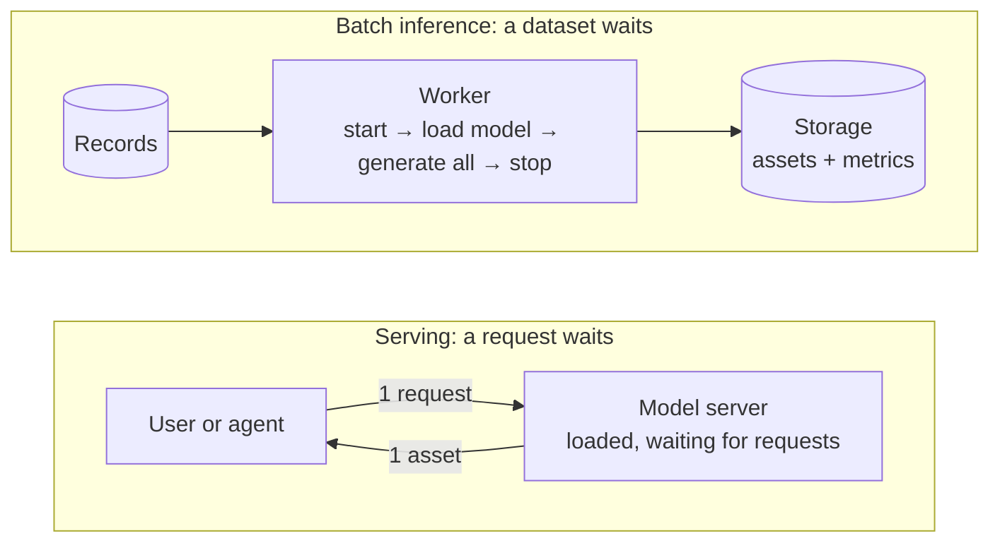
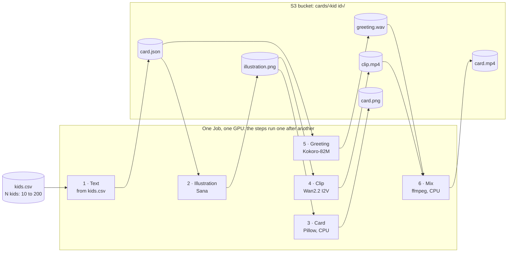
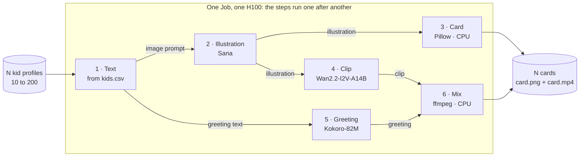
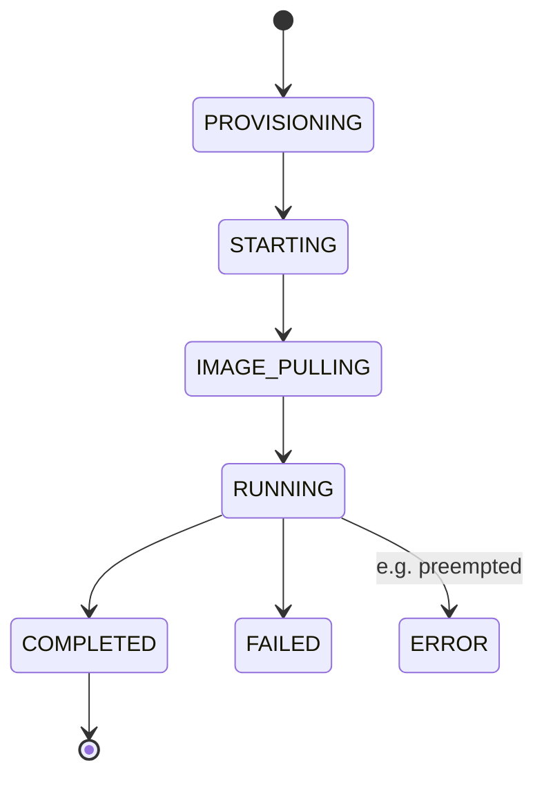

# 04 - Serving vs Batch Inference: the Same Generation for Different Use Cases

<!-- Draft v7, 2026-11-13: patterns, then the task, then one worker (code/batch_inference.py: six steps, the clip from Wan2.2 image-to-video, so an H100) run as a Job or in a DevLab. Sizing, Endpoint comparison, video Job and scenarios removed; what's left for Modules 2-4 is one closing section. Not run on a GPU yet: [measure] values come from the author run; [verify] items are checked on the first run. -->

Say Santa wants a personalized animated gift card for each of the 200,000 children on his list: an illustrated card with a wish, animated into a short clip with a spoken greeting and music. Nobody waits for any single card; all of them have to be ready before the holidays. That's a different way of running a model from a chat agent, where a person waits for one image. Keeping a model loaded to answer requests one by one is **serving**. Running a model over a whole dataset and stopping when it's done is **batch inference**. In this lesson we compare the two patterns, then build Santa's pipeline as a batch: one Job on one H100 GPU makes the cards for ten kids, step by step, and writes them to a storage bucket. Then we raise it to 200.

<!-- visual: id=V1 | teaches=serving answers a waiting request; batch inference works through a dataset and stops | shape=flow | must-be-accurate=who waits, where results go, when the model stops | claims=M1-383 -->



*Conceptual.*

How long the image step takes each way, on one GPU, with Sana at 512×512 and 20 steps:

| Images | Serving: one request at a time | Batch inference: one worker, model loaded once |
| --- | --- | --- |
| 1 | 1.21 s, network included | 0.6 s, no network |
| 10 | 12 s | 6 s |
| 200 | 4 min | 2 min |
| 200,000 | 67 h | 33 h |

Estimates of generation time only `[calc: images × the time for one image]`. Serving: one request from a laptop to a served model `[measured: 2026-11-13, L40S]`. <!-- c:M1-377 --> Batch: the model called in our own process, in a notebook on a GPU `[measured: date and GPU to confirm]`; <!-- c:M1-386 --> a batch run should be close to it: `[measure: batch run]`. Both also pay startup and model load once: `[measure]`. The two numbers come from different runs, so read the gap as an estimate of the overhead per request (network, packing the image into the response), not as a benchmark.

You're done when:

- your Job is `COMPLETED` and stopped by itself;
- every kid in the run has a folder in your bucket with the card (`card.png`) and the animated card (`card.mp4`), and you've watched Emma's;
- nothing you created is still `RUNNING`.

Time and cost: `[measure]` with the prebuilt worker image. The Job runs on an H100 and starts by downloading about 126 GB of video-model weights, so it is the most expensive run of this module: `[measure]` for ten kids on a preemptible H100. Rates: [Nebius pricing](https://docs.nebius.com/compute/resources/pricing).

## Serving vs batch inference

| | Serving | Batch inference |
| --- | --- | --- |
| Also called | Online or real-time inference | Offline inference, batch prediction |
| What starts the work | A request arrives | A dataset is ready |
| Who waits | A person or an agent, for every result | Nobody, for any single result |
| What you tune | Time per request | Assets per hour and cost per asset |
| The model is loaded | All the time, waiting between requests | For the run only |
| Where results go | Back in the response | To storage |
| How it scales | More copies of the server behind one URL | The dataset split across more workers |
| Typical use | Chat agent, editor, live preview | Campaign, catalogue, dataset, evaluation run |

AWS describes the same split: real-time inference is "ideal for online inferences that have low latency or high throughput requirements" and runs on a persistent endpoint; batch is "suitable for offline processing when large amounts of data are available upfront and you don't need a persistent endpoint". [Inference options in Amazon SageMaker AI](https://docs.aws.amazon.com/sagemaker/latest/dg/deploy-model-options.html) <!-- c:M1-383 --> Latency is the dividing line: "with batch prediction, you don't need to worry about the inference latency. With online prediction, however, inference latency is crucial." [Chip Huyen](https://huyenchip.com/2022/01/02/real-time-machine-learning-challenges-and-solutions.html) <!-- c:M1-384 -->

## The task: Help Santa to Create Christmas Gift Cards

The task comes from the [Santa Scale Challenge](https://github.com/mnrozhkov/santa-scale-challenge), a reference project for making personalized gift cards at scale. The story: Santa writes every child a card. The card gets an illustration of the gift, and then it's animated: the camera drifts slowly, snow falls, lights twinkle, and a short piece of music plays under a spoken greeting. One child, one animated card.

A record is one child. The wish, the greeting and the illustration prompt are already in the row, so this lesson does no writing and calls no language model.

```text
id,name,age,wishlist,wish,greeting,prompt
k01,Emma,7,a telescope,"Dear Emma, at 7 you are full of wonder. I heard you wished for a telescope, and my elves are already busy. Merry Christmas!","Merry Christmas, Emma! Santa heard you wished for a telescope.","A magical Christmas storybook illustration, ... a telescope ..."
```

The list is [assets/kids.csv](assets/kids.csv): 200 kids, Emma first.

We build it as a deterministic pipeline: every kid goes through the same steps in the same order. Nothing decides, judges or retries along the way; that's what an agent adds, in Module 2. [code/batch_inference.py](code/batch_inference.py) has one function per step:

| Step | Reads | Makes for Emma | Runs on |
| --- | --- | --- | --- |
| 1. Text | The row | `card.json`: the wish, the greeting, the illustration prompt | No model: it copies the row |
| 2. Illustration | The first gift | A picture of the gift on snow under a starry sky. No people and no text: it gets animated later | GPU: Sana |
| 3. Card | The illustration, the name, the wish | A 1024×1400 card, `card.png` | CPU: Pillow |
| 4. Clip | The illustration | About 5 seconds of slow camera drift, falling snow and twinkling lights | GPU: Wan2.2-I2V-A14B, image-to-video |
| 5. Greeting | The greeting text | "Merry Christmas, Emma! Santa heard you wished for a telescope." as speech | GPU: Kokoro-82M |
| 6. Mix | The clip, the greeting, a music track | The animated card with sound, `card.mp4` | CPU: ffmpeg |

`[placeholder: Emma's card.png and card.mp4 from the author run]`

One card is a notebook exercise. The challenge is the list: N kids, and nobody waits for a single card. So the pipeline works step by step, not card by card:

<!-- visual: id=V10 | teaches=one Job on one GPU runs the six steps in order; each step makes N assets, saves them to the bucket, and the next step reads them from there | shape=flow | must-be-accurate=step order, model per step, file each step writes | claims=M1-199 M1-081 M1-390 -->



*Conceptual. Each step makes its file for all N kids before the next step starts.*

Each step works through all N kids before the next one starts: it loads its model once, makes N assets and saves each one to the kid's folder in the S3 bucket. The next step reads its inputs from that folder. Steps hand over only through the bucket, so a step can be rerun or moved to another machine without touching the others.

**The limitation in this lesson:** all six steps run inside one Job (a single run that starts, does the work and stops) on one GPU, one after another. Even the card and mix steps, which need no GPU, run on the GPU machine. It's the simplest setup that works, and it wastes time in ways we can name: the GPU waits during the CPU steps, steps that don't depend on each other can't run at the same time, and the GPU has to fit the largest model: the video model needs an H100, so the small models run on an H100 too. Running steps in parallel, giving each step its own hardware and splitting the N kids across workers are optimization and scaling: Module 3. So is surviving an interruption: if this Job is preempted, you run it again from the start.

## Pick the tool: Endpoint or Job?

On Nebius Serverless AI each pattern has a tool built for it. An **Endpoint** is a long-running container that serves HTTP requests at a URL: serving. A **Job** starts, runs a script to completion, writes the results to storage and stops billing: batch inference. <!-- c:M1-308 -->

| | Endpoint | Job |
| --- | --- | --- |
| Pattern | Serving | Batch inference |
| What starts the work | An HTTP request | Creating the Job |
| Where outputs go | The HTTP response | A mounted bucket |
| When it stops billing | When you stop it: it bills while `RUNNING`, idle or not <!-- c:M1-291 c:M1-193 --> | By itself, at the end of the run <!-- c:M1-290 --> |
| Scaling | None: one VM, no scale-up under load, no scale-to-zero when idle <!-- c:M1-307 --> | One run per Job; more work = more Jobs (Module 3) |
| Best for | Someone waiting for the answer | A batch nobody waits for |

[Serverless AI overview](https://docs.nebius.com/serverless/overview) <!-- c:M1-308 -->

The pattern doesn't force the tool. You can run a batch through an Endpoint: a client loops over the list and sends one request per image. The difference is in how the two tools behave over a long run:

- **Endpoint:** for 200,000 images the client sends 200,000 requests, receives 200,000 responses and stays online for the whole run, about 67 hours at 1.21 s per request `[calc: 200,000 × 1.21 s]`. The Endpoint bills until you stop it. <!-- c:M1-377 c:M1-291 -->
- **Job:** no client. The worker generates the images, writes them to the bucket, and the Job ends by itself. <!-- c:M1-290 -->

So we run Santa's pipeline as a Job.

## Before you start

You need the Nebius CLI, an Object Storage bucket, and an S3 access key to look at the results from your laptop. Do this once.

1. Install and log in to the [Nebius CLI](https://docs.nebius.com/cli/install).
2. Create a bucket: `nebius storage bucket create --name <your-bucket>`. [Buckets](https://docs.nebius.com/object-storage/buckets/manage) <!-- c:M1-310 -->
3. Create an access key for a service account and configure the AWS CLI with it, following the [Object Storage quickstart](https://docs.nebius.com/object-storage/quickstart). The endpoint is `https://storage.<region>.nebius.cloud`, for example `https://storage.eu-north1.nebius.cloud`. <!-- c:M1-311 c:M1-312 -->
4. Set three variables in your shell:

```bash
export WORKER_IMAGE=<course santa worker>   # [placeholder: published reference]
export BUCKET=<your-bucket>
export RUN_ID=job-001
```

## The worker

[code/batch_inference.py](code/batch_inference.py) is what runs inside the Job: the whole pipeline from the task. `run()` goes through the six steps for the first `--n` kids and writes everything under `--out`:

```text
<out>/cards/k01/card.json          1. text
                illustration.png   2. Sana
                card.png           3. Pillow
                clip.mp4           4. Wan2.2
                greeting.wav       5. Kokoro
                card.mp4           6. ffmpeg
<out>/cards/k02/...
```

For each step it loads the model **once**, makes that step's file for every kid, frees the GPU and moves on. Loading once and generating many is the point of a batch: ten separate Jobs for ten kids would pay startup and every model load ten times.

<!-- visual: id=V11 | teaches=what each step hands to the next inside the one Job | shape=flow | must-be-accurate=step order, model per step, the input each step reads | claims=M1-390 -->



*Conceptual. Each step makes its file for all N kids before the next step starts; every model runs on the same H100.*

Three things to know before you run it:

- **Every file is written once and never changed.** That's what lets `--out` be a bucket mounted into the container, with no upload code. "How the results are stored" below shows how.
- **The clip step decides the GPU.** Wan2.2 image-to-video is the largest model in the pipeline: it needs an H100 and about 126 GB of weights, downloaded when the step starts. <!-- c:M1-063 c:M1-328 c:M1-390 --> `--step text --step illustration --step card --step greeting` leaves it out; that part fits an L40S.
- **The text step copies the row.** The wish, the greeting and the illustration prompt come from [assets/kids.csv](assets/kids.csv). Nothing calls a language model. The music is one track from the module's shared media, [assets/4_jingle.mp3](assets/4_jingle.mp3); add `<mood>.mp3` files next to it to get a track per mood.

It logs a line for every model load and every finished asset, so the Job's logs show where it is. `--help` lists the options: `--n`, `--out` and `--step`.

The worker image is built from [code/docker/Dockerfile](code/docker/Dockerfile), the one lesson 03 walks through, with this module's folder as the build context: the scripts come from `code/`, the kids list, the fonts and the music from `assets/`. Weights, secrets and outputs stay out; the module's [.dockerignore](.dockerignore) lets nothing else in.

## Run the Job

There are two ways to run the worker, and both end with the results in your S3 bucket:

| | Path A: a Job, submitted from your laptop | Path B: the notebook and the script, in a DevLab |
| --- | --- | --- |
| What you run | `nebius ai job create`, in a terminal or a notebook cell | [code/nb-santa-cards.ipynb](code/nb-santa-cards.ipynb) cell by cell, then `python code/batch_inference.py` in the DevLab's terminal |
| Where the script runs | In a container on a GPU VM that Nebius starts for the Job | In your DevLab's Python environment |
| How results reach S3 | The script writes to the bucket mounted at `/outputs` | The same: the bucket is mounted into the DevLab |
| When the GPU stops billing | When the Job ends <!-- c:M1-290 --> | When you stop or delete the DevLab; its disk bills until you delete it <!-- c:M1-207 --> |
| Price | Preemptible or regular, your choice | Regular only: a DevLab can't be preemptible <!-- c:M1-207 --> |
| Use it for | The batch run | Developing and debugging the worker before it goes into a Job |

Start with path B if you want to see and hear each step before paying for a whole batch; path A is the batch run.

### Path A: a Job from your laptop

**Pick the price.** The pipeline needs an H100 for the clip step. You choose how to pay for it:

| | Set | Price |
| --- | --- | --- |
| H100, preemptible (the command below) | nothing | A spot price that changes during the day and can go above the regular price <!-- c:M1-088 --> |
| H100, regular | replace `--preemptible --follows-spot-price` with `--on-demand` | The regular price; the GPU isn't taken back |

Check [today's spot price](https://docs.nebius.com/signup-billing/spot-prices) and the [pricing page](https://docs.nebius.com/compute/resources/pricing) first. We prefer a preemptible H100 when its spot price is low and one is available; if the Job can't get one, use the regular price.

One command creates the Job. Check the request first: `--dry-run` validates it without creating anything.

```bash
nebius ai job create --dry-run --name "$RUN_ID" --image "$WORKER_IMAGE" \
  --platform gpu-h100-sxm --preset 1gpu-16vcpu-200gb \
  --preemptible --follows-spot-price \
  --timeout 2h --restart-policy never \
  --volume "$BUCKET:/outputs:rw" \
  --container-command bash --args "-c 'python /app/batch_inference.py --n 10 --out /outputs/runs/01-consistent-media-generation-on-serverless-gpus/$RUN_ID'"
```

- **`--volume "$BUCKET:/outputs:rw"`** mounts your bucket into the container at `/outputs`. Whatever the script saves under `/outputs` is in S3. <!-- c:M1-281 c:M1-282 -->
- **Preemptible by default.** Jobs run on a regular VM unless you ask for preemptible; preemptible is cheaper, and Nebius can take the GPU back. If that happens the Job ends in `ERROR` and isn't retried: run it again. [Jobs: manage](https://docs.nebius.com/serverless/jobs/manage), [auto-restarts](https://docs.nebius.com/serverless/jobs/auto-restarts) <!-- c:M1-295 c:M1-296 -->
- **`--timeout 2h`** is the hard stop if anything hangs; the shortest allowed is `1h`. <!-- c:M1-293 --> The first thing the clip step does is download about 126 GB of weights onto the Job's disk (250 GiB by default), so leave room. <!-- c:M1-063 c:M1-301 --> Downloading on every run is wasteful on purpose here; Module 3 fixes it. `--timeout 4h` raises the limit for a longer run.
- **`--restart-policy never`**: a failed run fails once, it doesn't loop. <!-- c:M1-294 -->
- **`--platform` and `--preset` always**, so you know which GPU you pay for. <!-- c:M1-301 -->

`[verify on first run: --volume by bucket name, and the --args quoting]`

Then run the same command without `--dry-run`. It prints the Job's ID.

Ten kids is the default. For a larger batch in the same Job, change `--n 10` to `--n 200` (the most in this lesson) and `--timeout 2h` to `--timeout 4h`, with a new `RUN_ID`, for example `job-200`.

The models load once per Job, however long the list is: the fixed part of the run stays the same, and only the per-card part grows `[measure]`. The clips are most of it: at the 40.66 s per clip we measured for this model through an Endpoint, 200 clips are about 2.3 hours of H100 time `[calc: 200 × 40.66 s; one request from a laptop, 2026-11-13]`, so decide on 200 after you have seen what ten cost. <!-- c:M1-382 -->

**From a notebook.** The same command works in a Jupyter cell on your laptop: set the variables with `%env WORKER_IMAGE=...`, `%env BUCKET=...`, `%env RUN_ID=...`, and put `!` in front of `nebius ai job create`. `[verify on first run]`

### Path B: the notebook and the script in a DevLab

A DevLab is JupyterLab on a GPU VM. Here nothing is submitted: you call the pipeline's functions yourself, look at each result, and only then run the script. `[verify on first run: the commands in this path haven't been executed yet]`

1. Create a DevLab on an H100 with your bucket mounted at `/outputs`, the same way the Job has it. A DevLab bills at the regular price for as long as it runs, so plan the session. On an L40S (`--platform gpu-l40s-a --preset 1gpu-8vcpu-32gb`) you can do everything except the clip and the mix:

   ```bash
   nebius ai devlab create --name santa-dev --template jupyter \
     --platform gpu-h100-sxm --preset 1gpu-16vcpu-200gb \
     --volume "$BUCKET:/outputs:rw"
   ```

   `[verify on first run: --volume with a bucket name on a DevLab; the s3:// form needs a secret]` [`nebius ai devlab create`](https://docs.nebius.com/cli/reference/ai/devlab/create) <!-- c:M1-392 -->

2. Open the DevLab's URL, open a **Terminal**, and prepare the environment once per DevLab. The template already has this repo and `uv`:

   ```bash
   cd ~/work/production-ai-agents-for-media-generation
   git pull
   uv sync --extra gpu --extra notebooks
   uv pip install "kokoro>=0.9.2" ftfy imageio imageio-ffmpeg
   uv run python -m ipykernel install --user --name course-gpu --display-name "course (GPU)"
   ```

3. Open [code/nb-santa-cards.ipynb](code/nb-santa-cards.ipynb), choose the **course (GPU)** kernel and run it top to bottom. It makes Emma's card one step at a time and shows the text, the illustration, the card, the clip, the greeting and the final video. Its last cell runs the batch for three kids.

4. Run the script, the same way a Job will, with the output on the bucket mount:

   ```bash
   cd 01-consistent-media-generation-on-serverless-gpus
   uv run --no-sync python code/batch_inference.py --n 10 \
     --out /outputs/runs/01-consistent-media-generation-on-serverless-gpus/devlab-001
   ```

   It prints a line per asset and the path of the `cards` folder at the end. The files are in your bucket as soon as they are written: no upload step.

5. Delete the DevLab when you're done. It bills its GPU while it runs, including while you read and type, and a stopped DevLab still bills its disk. <!-- c:M1-207 -->

## Watch it

For a Job (path A):

```bash
nebius ai job get <job_ID>
nebius ai job logs <job_ID> --follow
```

<!-- c:M1-298 -->



*Conceptual; state names from the [lifecycle docs](https://docs.nebius.com/serverless/lifecycle).* <!-- c:M1-287 -->

The logs show the script's progress: one line when a model has loaded, one for every finished asset `[measure: times from the author run]`:

```text
12:00:01 10 kids, steps: text, illustration, card, clip, greeting, mix, out: /outputs/runs/.../job-001/cards
12:00:01 text: written by the template
12:00:01 text 1/10 k01 0.0 s
...
12:00:… illustration model loaded in … s
12:00:… illustration 1/10 k01 … s
...
12:…:… clip model loaded in … s
12:…:… clip 1/10 k01 … s
...
12:…:… mix 10/10 k10 … s
12:…:… finished: /outputs/runs/.../job-001/cards
```

## How the results are stored

How the files get to the bucket:

1. The Job command mounts the bucket: `--volume "$BUCKET:/outputs:rw"`. <!-- c:M1-281 c:M1-282 -->
2. The worker runs with `--out /outputs/runs/01-consistent-media-generation-on-serverless-gpus/$RUN_ID`.
3. `run()` creates `cards/<kid id>/` under that path, and each step saves its file there with ordinary Python and ffmpeg writes.

What ends up in the bucket (one run, `RUN_ID=job-001`):

```text
runs/01-consistent-media-generation-on-serverless-gpus/job-001/
└── cards/
    ├── k01/
    │   ├── card.json          1. text: the kid's profile, gifts, wish, mood, greeting, image prompt
    │   ├── illustration.png   2. Sana
    │   ├── card.png           3. the card image (final)
    │   ├── clip.mp4           4. Wan2.2, silent
    │   ├── greeting.wav       5. Kokoro
    │   └── card.mp4           6. clip + greeting + music (final)
    ├── k02/
    └── ...
```

- **Two finals per kid:** `card.png` and `card.mp4`. The other four files are intermediates, kept so the next step can read its inputs and so you can inspect each step.
- **Handover between steps is only through these files.** The illustration step reads the image prompt from `card.json`, the clip step reads `illustration.png`, and so on.
- **Each file is written once and never edited,** which is what makes writing straight to a bucket mount reasonable. MP4 and WAV writers jump back inside a file to finish its header; whether the mount allows that is checked on the first run `[verify on first run]`. If it doesn't, the worker writes to local disk and copies each finished file over.
- **No manifest or summary file.** The Job's logs hold the timings, and the folders are the record of what was made.

## See the results in the bucket

The files stay in the bucket after the Job's VM is deleted. <!-- c:M1-290 --> List the run:

```bash
aws s3 ls --recursive s3://$BUCKET/runs/01-consistent-media-generation-on-serverless-gpus/$RUN_ID/ \
  --endpoint-url https://storage.eu-north1.nebius.cloud
```

You should see the six files for every kid from the tree above `[verify on first run]`. Get Emma's animated card and play it:

```bash
aws s3 cp s3://$BUCKET/runs/01-consistent-media-generation-on-serverless-gpus/$RUN_ID/cards/k01/card.mp4 emma.mp4 \
  --endpoint-url https://storage.eu-north1.nebius.cloud
```

`[placeholder: Emma's card from the author run]`

## Optional: download the media

To look at all the cards, download the two finished files per kid, the card and the animated card:

```bash
aws s3 cp --recursive \
  s3://$BUCKET/runs/01-consistent-media-generation-on-serverless-gpus/$RUN_ID \
  runs/01-consistent-media-generation-on-serverless-gpus/$RUN_ID \
  --exclude "*" --include "*/card.png" --include "*/card.mp4" \
  --endpoint-url https://storage.eu-north1.nebius.cloud
```

Leave out the `--exclude` and `--include` flags to get every intermediate file too. Downloading to your laptop is internet egress; reading from the bucket inside the same region is free. [Object Storage pricing](https://docs.nebius.com/object-storage/resources/pricing) <!-- c:M1-321 -->

## Clean up

A Job stops by itself; a DevLab doesn't, so delete it if you used path B. Then delete what's left in the bucket, once for each `RUN_ID` you created (`job-001`, `job-200`, `devlab-001`):

```bash
aws s3 rm --recursive s3://$BUCKET/runs/01-consistent-media-generation-on-serverless-gpus/$RUN_ID \
  --endpoint-url https://storage.eu-north1.nebius.cloud
```

Check that nothing is still `RUNNING`:

```bash
nebius ai job list
nebius ai endpoint list
nebius ai devlab list
```

<!-- c:M1-299 c:M1-315 -->

## Common failures and recovery

| You see | Why | Fix |
| --- | --- | --- |
| `QuotaExceeded` at create | Default quotas are small on new accounts <!-- c:M1-302 c:M1-094 --> | Use one GPU; check your quotas |
| Stuck in `PROVISIONING`, then `ERROR` with `NotEnoughResources` | No capacity; Serverless keeps trying for up to 30 minutes <!-- c:M1-306 --> | `--on-demand`, another region, or later |
| `ERROR` after running a while | Preempted <!-- c:M1-296 --> | Run the Job again |
| `--timeout` rejected | Below the 1h minimum <!-- c:M1-293 --> | Use `1h` or more |
| `FAILED` right after `IMAGE_PULLING` | Wrong architecture or a private image <!-- c:M1-258 c:M1-314 --> | `linux/amd64`; a public image or your project's registry |
| `COMPLETED` but the bucket is empty | Output written outside `/outputs` | Check `--out` and the `--volume` mount |
| `CUDA out of memory` in the clip step | The video model on a GPU smaller than an H100 <!-- c:M1-328 --> | Use an H100; on an L40S run `--step text --step illustration --step card --step greeting` |
| The Job ends before the cards are done | The weights download and the clips took longer than `--timeout` | Raise `--timeout` |

## What bills

| Resource | Billed while |
| --- | --- |
| Job | Running; the VM is deleted at the end <!-- c:M1-290 --> |
| DevLab | Running, at the regular price; its disk until you delete it <!-- c:M1-207 --> |
| Endpoint | `RUNNING`, idle or not; nothing while stopped <!-- c:M1-291 --> |
| Bucket | Stored data, all the time; egress to the internet <!-- c:M1-320 c:M1-321 --> |
| Container Registry | Free <!-- c:M1-319 --> |

Rates: [Nebius pricing](https://docs.nebius.com/compute/resources/pricing), [Object Storage pricing](https://docs.nebius.com/object-storage/resources/pricing).

## What this lesson leaves out

One Job on one GPU is the simplest batch that works. Santa's list has 200,000 kids, and that needs more:

| Left out here | Why it matters at 200,000 | Where we deal with it |
| --- | --- | --- |
| Parallel workers | One GPU makes one card after another: `[measure: time per card × 200,000]` | Module 3 |
| Hardware per step | The CPU steps hold a GPU, and the GPU is sized for the largest model | Module 3 |
| Weights downloaded on every run | Each Job starts by downloading about 126 GB for the video model before it makes anything, and pays GPU time for the wait <!-- c:M1-063 --> | Module 3 (keeping weights close to the GPU) |
| Surviving an interruption | A preempted Job starts again from the first kid | Module 3 |
| Cost and limits | You want the price before the run, and a stop when it goes over | Lesson 05, then Module 3 |
| Checking the cards | The pipeline never looks at what it made, and nobody can look at 200,000 cards | Module 2 (a judge that retries), Module 4 (evaluation and tracing) |

Next: in [lesson 05](05-measuring-costs.md) we split a run into startup, model load and generation time, and turn them into a cost per asset.

## References

- [Serverless AI: jobs](https://docs.nebius.com/serverless/jobs/manage), Nebius
- [Serverless AI: lifecycle](https://docs.nebius.com/serverless/lifecycle), Nebius
- [Inference options in Amazon SageMaker AI](https://docs.aws.amazon.com/sagemaker/latest/dg/deploy-model-options.html), AWS
- [Real-time machine learning: challenges and solutions](https://huyenchip.com/2022/01/02/real-time-machine-learning-challenges-and-solutions.html), Chip Huyen (2022)
- [Full Stack Deep Learning 2022, Lecture 5: Deployment](https://fullstackdeeplearning.com/course/2022/lecture-5-deployment/)
- [Santa Scale Challenge](https://github.com/mnrozhkov/santa-scale-challenge): the pipeline this lesson adapts
- [Kokoro-82M](https://huggingface.co/hexgrad/Kokoro-82M) and [Wan2.2-I2V-A14B](https://huggingface.co/Wan-AI/Wan2.2-I2V-A14B-Diffusers), model cards
