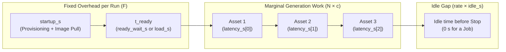

# 1.5 Measuring Startup, Load and Generation Costs

In this lesson we measure deployment startup, readiness wait, model load and request latency separately, and turn them into the marginal and total cost per asset. You're done when you have `metrics.json` with all four measurements and your cost per asset at 1, 10 and 100 assets.

## Four measurements

When a single GPU generation takes 4 minutes from clicking "Create" to seeing the first image, where did the time actually go? If you lump all 4 minutes into one number, you cannot predict what 10 or 100 assets will cost.

We split every run into four distinct measurements in `metrics.json`:

| Field in `metrics.json` | Definition | How It Is Measured | Endpoint | Job / GPU DevLab |
|---|---|---|---|---|
| `startup_s` | **Deployment startup:** Resource `created_at` → container enters `RUNNING` (includes scheduling and container image pull) | Observed status timestamps (`created_at` → `running_at`) | Yes | Yes |
| `ready_wait_s` | **Readiness wait:** Container `RUNNING` → first HTTP `200` JSON from `/v1/models` (proxy for server startup + weight download + GPU load) | Client polling in `measure_endpoint.py` | Yes | `null` |
| `load_s` | **Internal model load:** `SanaPipeline.from_pretrained(...)` → `.to("cuda")` complete | Synchronized timer in `generate.py` | `null` | Yes |
| `latency_s[]` | **Generation time (`t_gen`) per asset:** One sample per generated asset | Client HTTP timer (Endpoint) or CUDA-synchronized timer (Job/DevLab) | Yes | Yes |

Unavailable measurements are recorded as `null`, never `0`.

To record startup, readiness wait, and request latency for an **Endpoint** run, pass the UTC timestamps you observed when creating the Endpoint (`CREATED_AT`) and when it reached `RUNNING` (`RUNNING_AT`) to [code/measure_endpoint.py](code/measure_endpoint.py):

```bash
uv run python 01-consistent-media-generation-on-serverless-gpus/code/measure_endpoint.py \
  --created-at "2026-11-16T10:00:00Z" \
  --running-at "2026-11-16T10:03:00Z" \
  --n 3
```

For a **Job** (or after you stop your Endpoint and want to record `billable_s`), attach `created_at`, `running_at`, and `finished_at` to `metrics.json` with [code/measure_job.py](code/measure_job.py):

```bash
uv run python 01-consistent-media-generation-on-serverless-gpus/code/measure_job.py \
  "$METRICS_PATH" \
  --created-at "2026-11-16T10:00:00Z" \
  --running-at "2026-11-16T10:03:45Z" \
  --finished-at "2026-11-16T10:04:38Z"
```

## Billable interval

Alongside those four measurements, `measure_job.py` computes `billable_s` — the total wall-clock interval from resource creation to termination (`finished_at - created_at`).



Two rules keep your time and cost accounting accurate:

1. **Image pull is inside `startup_s`:** During a Job start, pulling the container image (`127.13–148.06 s` on L40S) happens before the container enters `RUNNING`. Never add image pull time on top of `startup_s`.
2. **Idle time inflates `billable_s` on Endpoints:** A Job exits as soon as `Asset 3` is saved (`idle_s = 0`). An Endpoint stays `RUNNING` until you stop it; every minute you spend inspecting images in your notebook before clicking Stop adds to `billable_s`.

## Cold vs warm

Let's look at the measured phase breakdown for **Sana 1.6B** (`1024x1024`, 20 steps, `seed=7`) on `gpu-l40s-a` (`1gpu-8vcpu-32gb`) `[measured: 2026-11-02, gpu-l40s-a, 1gpu-8vcpu-32gb, eu-north1]`:

| Phase | Cold Cache Job | Warm Cache Job (Shared Filesystem) | Share of 1-Asset Cold Run |
|---|---|---|---|
| **Startup (`startup_s`)** | `225.17 s` | `237.13 s` | `83.6%` |
| **Model load (`load_s`: fetch + GPU load)** | `39.89 s` (`26.60 s` fetch + `13.29 s` load) | `13.09 s` (`0.24 s` fetch + `12.85 s` load) | `14.8%` |
| **Generation (`t_gen`, median of 3 runs)** | `4.42 s` | `4.37 s` | `1.6%` |
| **Total wall time for 1 asset** | `269.48 s` | `254.59 s` | `100.0%` |

When you generate **one** image on a cold worker, **98.4% of the wall time (`265.06 s`) is spent getting the container and model ready**, and only **1.6% (`4.42 s`) is spent rendering the image**. Once the model is warm in GPU memory, each additional image takes just `4.42 s`.

## Cost per asset

To turn these measurements into dollars, look up the hourly price for your GPU preset on the [Nebius Compute pricing page](https://docs.nebius.com/compute/resources/pricing). For `gpu-l40s-a` (`1gpu-8vcpu-32gb` on-demand), the rate is **$1.5484 per hour**, which gives a per-second rate of:

```text
rate = $1.5484 / 3600 = $0.00043011 per second
```

Let `t_ready` be `ready_wait_s` for an Endpoint or `load_s` for a Job/DevLab, and let `t_gen` be the median of `latency_s[]`.

### Marginal compute cost

The **marginal compute cost** `c` is the GPU cost of generating one additional asset when the model is already loaded in VRAM:

```text
c = rate × t_gen
```

For Sana on L40S (`t_gen = 4.418 s`):

```text
c = ($1.5484 / 3600) × 4.418 s = $0.001900 per image (~0.19 cents)
```

Never call `c` the "total cost per asset" on its own — it ignores the cost of starting the resource and loading the model.

### Fixed cost of a run

The **fixed cost of a run** `F` is the GPU cost of startup, readiness/model load, and any idle time during the run:

```text
F = rate × (startup_s + t_ready + idle_s)
```

For our cold Sana Job (`startup_s = 225.17 s`, `t_ready = 39.89 s`, `idle_s = 0 s`):

```text
F = ($1.5484 / 3600) × (225.17 + 39.89) s = $0.114005 per run (~11.4 cents)
```

### Total run cost per asset

When a single run starts once and generates `N` assets sequentially, the fixed cost `F` is amortized across all `N` assets:

```text
total_cost_per_asset(N) = F / N + c
```

And if a commercial per-call API charges `p` dollars per asset for the same model and settings, self-hosting breaks even at `N` assets in a single run when `F / N + c <= p`:

```text
N = ceil(F / (p - c))    (for p > c; 0 if p <= c)
```

> **Assumptions:** This formula assumes **one shared startup per run**, **sequential generation**, and **no uncounted idle gaps** (`idle_s` explicitly included in `F`).

Instead of a separate CLI module, we can express this entire cost model as a simple Python function (`calculate_cost` in [code/common.py](code/common.py)):

```python
import math
import statistics


def calculate_cost(
    startup_s: float,
    ready_s: float,
    latency_s: list[float],
    price_per_hour: float,
    counts: tuple[int, ...] = (1, 10, 100),
    idle_s: float = 0.0,
    api_price: float | None = None,
) -> dict:
    rate = price_per_hour / 3600.0
    t_gen = statistics.median(latency_s)
    marginal = rate * t_gen
    fixed = rate * (startup_s + ready_s + idle_s)
    breakeven = None
    if api_price is not None:
        breakeven = max(1, math.ceil(fixed / (api_price - marginal))) if api_price > marginal else 0
    return {
        "marginal_compute_usd": marginal,
        "fixed_run_usd": fixed,
        "projected_compute_usd_per_asset": {str(n): fixed / n + marginal for n in counts},
        "breakeven_assets": breakeven,
    }
```

## Worked example: Sana, Endpoint vs Job

Let's run `calculate_cost(...)` on our measured Sana L40S numbers (`price_per_hour = 1.5484`, `t_gen = 4.418 s`) and compare three scenarios against a typical per-call image API priced at `p = $0.04` per `1024x1024` image:

1. **Cold Job (`startup_s = 225.17 s`, `load_s = 39.89 s`, `idle_s = 0 s`)**
2. **Warm-Cache Job (`startup_s = 237.13 s`, `load_s = 13.09 s`, `idle_s = 0 s`)**
3. **Interactive Endpoint left idle for 10 minutes (`startup_s = 225.17 s`, `ready_wait_s = 39.89 s`, `idle_s = 600 s`)**

```python
from common import calculate_cost

cold_job = calculate_cost(
    startup_s=225.17,
    ready_s=39.89,
    latency_s=[4.418, 4.465, 4.371],
    price_per_hour=1.5484,
    counts=(1, 10, 100),
    idle_s=0.0,
    api_price=0.04,
)
print(cold_job)
```

Here are the results side by side:

| Metric | Cold Job (`idle_s = 0`) | Warm-Cache Job (`idle_s = 0`) | Endpoint + 10 min Idle (`idle_s = 600`) | Per-Call API (`p = $0.04`) |
|---|---|---|---|---|
| **Marginal cost `c`** | `$0.00190` | `$0.00190` | `$0.00190` | `$0.04000` |
| **Fixed run cost `F`** | `$0.11401` | `$0.10762` | `$0.37207` | `$0.00000` |
| **Total cost / asset at `N = 1`** | `$0.11591` | `$0.10952` | `$0.37397` | `$0.04000` |
| **Total cost / asset at `N = 10`** | `$0.01330` | `$0.01266` | `$0.03911` | `$0.04000` |
| **Total cost / asset at `N = 100`** | `$0.00304` | `$0.00298` | `$0.00562` | `$0.04000` |
| **Breakeven `N` vs `$0.04` API** | **`3` assets** | **`3` assets** | **`10` assets** | — |

Look at what the numbers tell us:

- At **`N = 1` asset**, a per-call API (`$0.04`) is almost 3x cheaper than spinning up a dedicated GPU container (`$0.1159`), because you pay `~$0.114` of startup and load for just one image.
- By **`N = 3` assets** in a single batch Job, self-hosting on L40S breaks even with the `$0.04` API (`$0.11401 / 3 + $0.00190 = $0.03990 < $0.04`).
- By **`N = 100` assets**, the fixed startup cost shrinks to `$0.00114` per image, bringing the total cost per image down to **`$0.00304` (~0.3 cents) — more than 13x cheaper than the per-call API**.
- However, if you leave an interactive Endpoint sitting **idle for just 10 minutes (`600 s`)**, you add `$0.25807` of idle compute to `F`, pushing your breakeven from `3` assets to `10` assets.

## Practice: your own N and idle time

Open Python or a notebook cell and load your own `metrics.json` from Lesson 1.2 or 1.4:

```python
import json
from pathlib import Path
from common import calculate_cost

m = json.loads(Path("runs/01-consistent-media-generation-on-serverless-gpus/<your-run>/metrics.json").read_text())
ready_s = m["ready_wait_s"] if m["mode"] == "endpoint" else m["load_s"]

# 1. Zero idle time:
print(calculate_cost(m["startup_s"], ready_s, m["latency_s"], price_per_hour=1.5484, counts=(1, 10, 100), idle_s=0, api_price=0.04))

# 2. Add 10 minutes (600 s) of idle time before stopping:
print(calculate_cost(m["startup_s"], ready_s, m["latency_s"], price_per_hour=1.5484, counts=(1, 10, 100), idle_s=600, api_price=0.04))
```

You now have every number needed to submit [Homework 1: GPU Media Worker](../cohorts/2026/homework/01-consistent-media-generation-on-serverless-gpus/homework.md) and draft your one-page [Capstone Proposal](../projects/proposal-template.md).

Double-check the Nebius console one last time to confirm you have **zero `RUNNING` Endpoints, DevLabs, or Jobs**. In [Module 2: Multi-Agent Media Workflows](../02-multi-agent-media-workflows/01-agent-loop.md), we will put an LLM agent in the control plane and give it these GPU models as tools.
