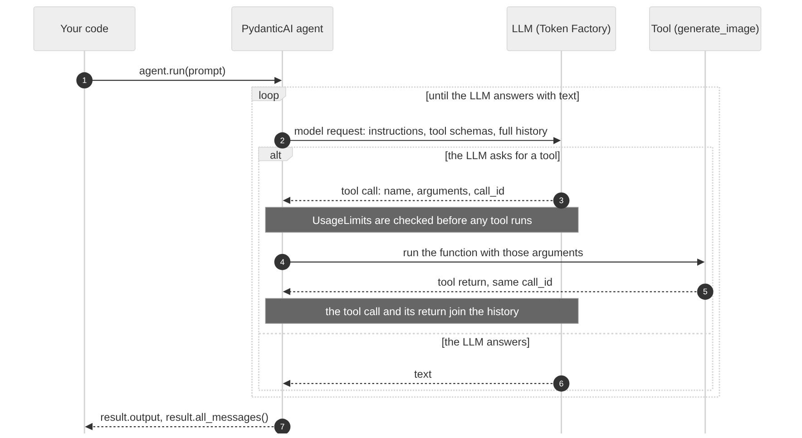

# 2.1 The Agent Loop: Deep Dive

Say you have a one-paragraph brief for a short video ad: a desk lamp, a person working from home, dusk. You want an agent that reads the brief and makes the first keyframe image. In this lesson you build that agent with [PydanticAI](https://pydantic.dev/docs/ai/) on Nebius Token Factory, then open up the loop the framework runs for you.

<p align="center">
  
</p>

## What you will learn

* Read the loop an agent framework runs: model request → tool call → tool result → next request, until the model answers with text
* Play the LLM yourself with a Python function, then swap in a real LLM without changing the agent
* See what goes over the wire on each turn: the tool schemas and the whole history, every time
* Step through a run node by node with `agent.iter()`
* Stop a runaway loop with `UsageLimits`, and know what those limits don't count
* Save the conversation so a new process can continue it
* Write a trace with one event per model request and tool call
* Choose between agent, workflow and hybrid for a media task

## Outcome

You're done when:

* the agent produces one image from one brief,
* `events.jsonl` shows every model request and tool call in order,
* you can say whether your Homework 2 brief needs an agent, a workflow or a hybrid, and why.

Time: about 30 minutes.
Cost: free in `"fake"` mode. A few cents of tokens in `"fake-gpu"` mode [measure].

## Before you start

* Complete the **Setup** section of the [module README](README.md) once.
* For `"fake-gpu"` mode: a Token Factory API key. The notebook asks for it once and saves it to `code/.env`.

## Run the lesson

Open [`code/nb-agent-loop.ipynb`](code/nb-agent-loop.ipynb) in Jupyter and run it top to bottom. Every explanation, exercise and expected output is in the notebook.

The mode cell at the top chooses the LLM:

| `MODE` | LLM | Image tool | Cost |
| --- | --- | --- | --- |
| `"fake"` | A Python function plays the LLM | Placeholder PNG | Free, no network |
| `"fake-gpu"` | A real LLM on Token Factory | Placeholder PNG | A few cents of tokens |

`"fake-gpu"` means the GPU is fake, not the LLM. Start with `"fake"`, then switch to `"fake-gpu"`: edit the mode cell and run it again, then rerun the cells from "Swap in the real LLM" down. No kernel restart needed.

The notebook covers, in order:

1. **Start with the finished result:** a saved trace of the module's full pipeline, loaded from `assets/`
2. **How the agent loop works:** the diagram above, step by step
3. **Agent, workflow or hybrid**
4. **A minimal agent:** be the LLM, then swap in the real LLM with one raw API call and then through PydanticAI, then what goes over the wire
5. **Step through a run with `agent.iter()`**
6. **Stop conditions** with `UsageLimits`
7. **Where state lives:** `messages.json`
8. **Picking an LLM for tool calling**
9. **Trace events:** `events.jsonl` and `check_trace.py`

## Where the results are

Every run writes a folder `code/runs/02-multi-agent-media-workflows/<run_id>/` with:

* `events.jsonl`: one event per model request and tool call
* `messages.json`: the saved conversation
* `keyframe-seed<N>.png`: the placeholder keyframes

Check a saved trace from a terminal:

```bash
cd 02-multi-agent-media-workflows/code
uv run python check_trace.py runs/02-multi-agent-media-workflows/<run_id>/events.jsonl
```

## Files used

| File | What it does here |
| --- | --- |
| [`code/nb-agent-loop.ipynb`](code/nb-agent-loop.ipynb) | The lesson |
| [`code/models.py`](code/models.py) | `Brief` and the pinned Token Factory model ID (`LLM`) |
| [`code/tracing.py`](code/tracing.py) | `Tracer`, `run_traced()`, `summarize()`, `save_messages()` |
| [`code/check_trace.py`](code/check_trace.py) | Checks a trace against the field contract |
| [`code/fake.py`](code/fake.py) | `block_real_models()` and the placeholder PNG |
| [`code/tools.py`](code/tools.py) | `settings()` for the API key, `token_factory_model()` |
| [`assets/brief.yaml`](assets/brief.yaml) | The ad brief |
| [`assets/worked-trace/`](assets/worked-trace/) | The saved trace for "Start with the finished result" |

## Next steps

* Answer for your Homework 2 brief: agent, workflow or hybrid, and why.
* Try another Token Factory model: change `LLM` in `code/models.py` and run the "Swap in the real LLM" cells again.
* Next lesson: [2.2 Tools and Structured Outputs](02-tools.md).

<!-- nav:start -->
[← Previous: 05 - Measuring Startup, Load and Generation Costs](../01-consistent-media-generation-on-serverless-gpus/05-measuring-costs.md) · [Next: 2.2 Tools and Structured Outputs →](02-tools.md)
<!-- nav:end -->
