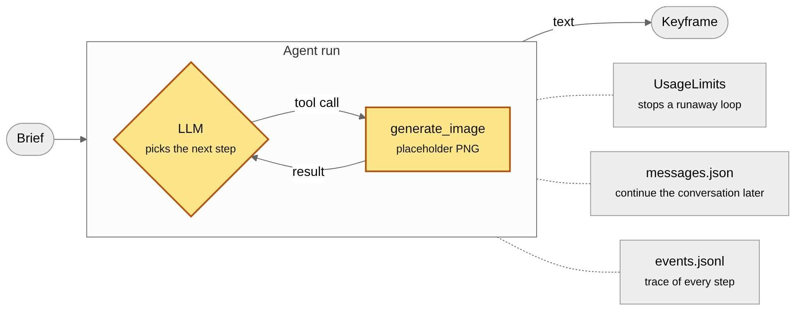

# 2.1 The Agent Loop: Deep Dive

Say you have a one-paragraph brief for a short video ad: a desk lamp, a person working from home, dusk. You want an agent that reads the brief and makes the first keyframe image. In this lesson you build that agent with [PydanticAI](https://pydantic.dev/docs/ai/), then open up the loop the framework runs for you.

The question for this lesson: **who chooses the next step, and who runs it?**

<p align="center">
  
</p>

## What you will learn

Core path:

* Read the loop an agent framework runs: model request → tool call → tool result → next request, until the model answers with text
* Play the LLM yourself with a Python function, and read every message it receives
* Step through a run node by node with `agent.iter()`
* Stop a runaway loop with `UsageLimits`, and know what those limits don't count
* Save the conversation so a new process can continue it
* Write a trace with one event per model request and tool call, and say who decided each step: code or the model

Optional:

* Swap in a real LLM: one raw API call, then the same model through PydanticAI
* Use another model or another OpenAI-compatible API

## Outcome

You're done when:

* the agent produces one image from one brief,
* `events.jsonl` shows every model request and tool call in order,
* you can say whether your Homework 2 brief needs an agent, a workflow or a hybrid, and why.

Time: about 30 minutes for the core path.
Cost: free in `"fake"` mode. A few cents of tokens in `"real-llm"` mode [measure].

## Before you start

* Complete the **Setup** section of the [module README](README.md) once.
* For `"real-llm"` mode only: an API key for Token Factory, or for any OpenAI-compatible API (see [Use another LLM](#use-another-llm)). The notebook asks for it once and saves it to `code/.env`.

## Run the lesson

Open [`code/nb-agent-loop.ipynb`](code/nb-agent-loop.ipynb) in Jupyter and run it top to bottom. Every explanation, exercise and expected output is in the notebook.

The mode cell at the top chooses the LLM:

| `MODE` | LLM | Image tool | Cost |
| --- | --- | --- | --- |
| `"fake"` | A Python function plays the LLM | Placeholder PNG | Free, no network |
| `"real-llm"` | A real LLM: Token Factory by default, or any OpenAI-compatible API | Placeholder PNG | A few cents of tokens |

The whole core path runs in `"fake"`. The image tool is fake in both modes. To try the real LLM, edit the mode cell and run it again, then rerun the cells from "Swap in the real LLM" down. No kernel restart needed.

The notebook covers, in order:

1. **Start with the finished result:** one line per stage of a full module run, loaded from `assets/`
2. **How the agent loop works:** the diagram above, step by step
3. **Agent, workflow or hybrid**
4. **A minimal agent:** be the LLM, read the messages it receives. Optional: swap in the real LLM
5. **Step through a run with `agent.iter()`**
6. **Stop conditions** with `UsageLimits`
7. **Where state lives:** save `messages.json` and continue the conversation
8. **Picking an LLM for tool calling** (optional)
9. **Trace events:** `events.jsonl`, `metrics.json` and the contract check
10. **The finished run, event by event**, and **your turn:** who decided each step?

### Use another LLM

The agent works with any OpenAI-compatible API whose model supports tool calling. Token Factory is the default.

To switch, set `LLM` in the notebook's "Choose the LLM" cell (this notebook only), or in [`code/models.py`](code/models.py) (every lesson and script):

```python
LLM = LLMSpec(model="<model id>", base_url="https://api.openai.com/v1", api_key_env="OPENAI_API_KEY")
```

* `model`: the model ID on that API
* `base_url`: the API's address
* `api_key_env`: the name of the key in `code/.env`. The notebook asks for the key once and saves it there.

## Where the results are

Every run writes a folder `code/runs/01-agent-loop/<run_id>/` with:

* `events.jsonl`: one event per model request and tool call
* `metrics.json`: the totals of the trace, and `contract_problems` from the contract check (empty when the trace passes)
* `messages.json`: the saved conversation
* `keyframe-seed<N>.png`: the placeholder keyframes

## Files used

| File | What it does here |
| --- | --- |
| [`code/nb-agent-loop.ipynb`](code/nb-agent-loop.ipynb) | The lesson |
| [`code/models.py`](code/models.py) | `Brief`, and `LLM`: the model ID, base URL and API key name of the agent's LLM |
| [`code/tracing.py`](code/tracing.py) | `Tracer`, `run_traced()`, `summarize()`, `check()`, `write_metrics()`, `save_messages()`, `repo_path()` |
| [`code/fake.py`](code/fake.py) | `block_real_models()` and the placeholder PNG |
| [`code/tools.py`](code/tools.py) | `llm_api_key()` and `llm_model()`: the API key and the PydanticAI model for an `LLM` spec |
| [`assets/brief.yaml`](assets/brief.yaml) | The ad brief |
| [`assets/worked-trace/`](assets/worked-trace/) | The saved trace for "Start with the finished result" |

## Next steps

* Answer for your Homework 2 brief: agent, workflow or hybrid, and why.
* Optional: try another model or another OpenAI-compatible API. Change `LLM` and run the "Swap in the real LLM" cells again.
* Next lesson: [2.2 Tools and Structured Outputs](02-tools.md).

<!-- nav:start -->
[← Previous: 05 - Measuring Startup, Load and Generation Costs](../01-consistent-media-generation-on-serverless-gpus/05-measuring-costs.md) · [Next: 2.2 Tools and Structured Outputs →](02-tools.md)
<!-- nav:end -->
