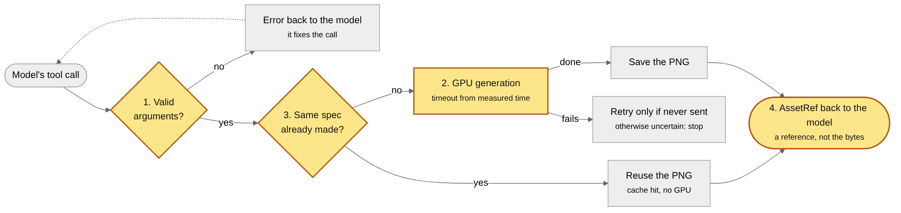

# 2.2 Tools and Structured Outputs

An agent that makes ad keyframes will, sooner or later, call its image tool with a size the model doesn't support, stop waiting before the image is done, or ask for the same image twice. Each of those can cost GPU time for nothing. In this lesson you design the image tool so none of them does.

The question for this lesson: **what makes a tool call safe to fail and cheap to repeat?**

  

The path of one tool call. The numbers are the notebook's sections.

## What you will learn

* Read the JSON schema a model gets from a tool's signature and docstring, and write the docstring for the model
* Tell three kinds of failure apart: invalid arguments, never sent, and uncertain, and what each one costs
* Set a tool timeout that doesn't pay for the same image twice
* Reuse a finished generation with a spec hash, and know what the cache doesn't cover
* Return a reference to an asset, not its bytes
* Get a typed `Plan` from an LLM step, and handle output that doesn't fit the schema

## Outcome

You're done when:

* the model fixes an invalid call after one validation retry,
* a second identical `generate_image` call is a cache hit: no extra generation cost,
* your own tool passes the check at the end of the notebook.

Time: about 30 minutes.
Cost: free in `"fake"` mode. A few cents of tokens in `"real-llm"` mode [measure]. No GPU in this lesson.

## Before you start

* Complete the **Setup** section of the [module README](README.md) once.
* For `"real-llm"` mode only: an API key for Token Factory, or for any OpenAI-compatible API, in `code/.env`. The notebook asks for it if it's missing. To change the LLM, see the "Choose the LLM" cell or `LLM` in `code/models.py`.

## Run the lesson

Open [`code/nb-tools.ipynb`](code/nb-tools.ipynb) in Jupyter and run it top to bottom. Every explanation, exercise and expected output is in the notebook.

The mode cell at the top chooses the LLM:

| `MODE` | LLM | Image backend | Cost |
| --- | --- | --- | --- |
| `"fake"` | A scripted model: Python code that sends fixed replies | Placeholder PNG | Free, no network |
| `"real-llm"` | A real LLM, for the validation and plan demos: Token Factory by default, or any OpenAI-compatible API | Placeholder PNG | A few cents of tokens |

The image backend is fake in both modes. To switch, edit the mode cell and run it again. No kernel restart needed.

Each section of the notebook answers one question:

1. **Can this request run?** Print the schema the model receives. An invalid size is rejected before the tool runs, and the model fixes it.
2. **What happens when a call fails?** Three kinds of failure. A timeout below the generation time sends two GPU requests and gets no image.
3. **Have we already made it?** A second identical call is a cache hit. Four experiments show what counts as the same request.
4. **What should the next step get?** A reference to the PNG, not its bytes. A typed `Plan`, and what happens when the model's output doesn't fit.
5. **Your turn:** a tool with a constrained argument, checked against expected counts.

## Where the results are

Every demo writes its own folder `code/runs/02-tools/<run_id>/` with:

* `events.jsonl`: model requests and tool calls, with `cache_hit`, `t_gen_s` and `cost_usd`
* `keyframe-<first 12 characters of the spec hash>.png`: the placeholder keyframes

The notebook's store has no bucket, so nothing is uploaded.

## Files used

| File | What it does here |
| --- | --- |
| [`code/nb-tools.ipynb`](code/nb-tools.ipynb) | The lesson |
| [`code/tools.py`](code/tools.py) | `generate_image`, `spec_hash()`, `AssetRef`, `ToolDeps`, `Store`, `SanaEndpoint`, `llm_model()` |
| [`code/models.py`](code/models.py) | `Brief`, `Plan` and the model specs, including `LLM` |
| [`code/fake.py`](code/fake.py) | `scripted_model()`, `call()`, `PlaceholderImages`, `block_real_models()` |
| [`code/tracing.py`](code/tracing.py) | `Tracer`, `run_traced()`, `last_tool_return()` |
| [`assets/brief.yaml`](assets/brief.yaml) | The ad brief |

## Next steps

* Homework 2 needs a cache hit on a second identical GPU call, with the keyframe's content hash in the key. `spec_hash()` is the starting point.
* Homework 2's judge must handle a reply that doesn't parse. "When the model's output doesn't fit" shows the mechanism.
* Next lesson: [2.3 GPU Workloads as Agentic Tools](03-gpu-tools.md).

<!-- nav:start -->
[← Previous: 2.1 The Agent Loop: Deep Dive](01-agent-loop.md) · [Next: 2.3 GPU Workloads as Agentic Tools →](03-gpu-tools.md)
<!-- nav:end -->
