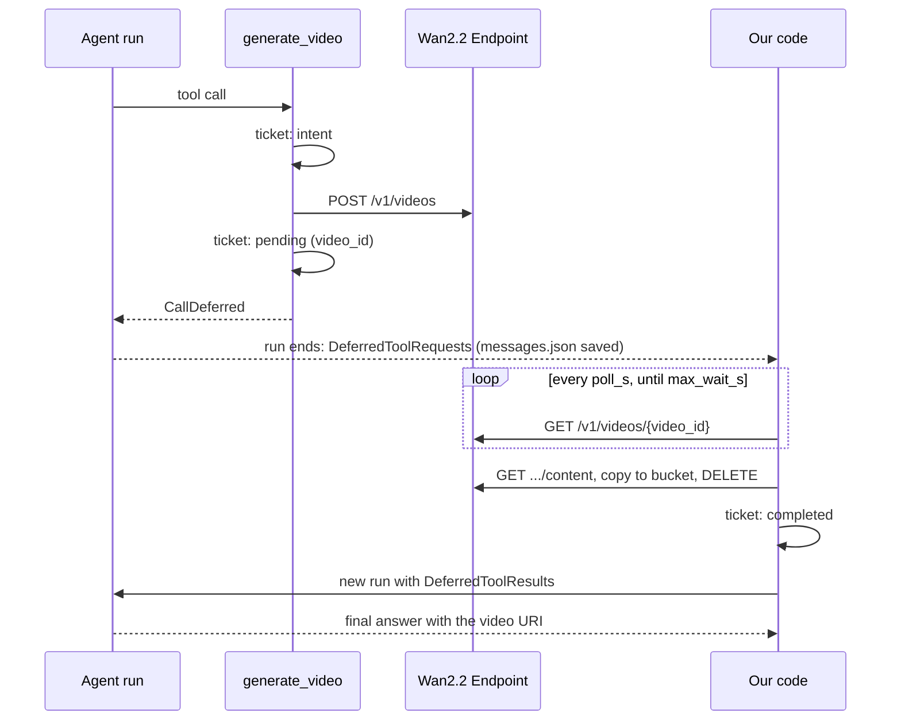
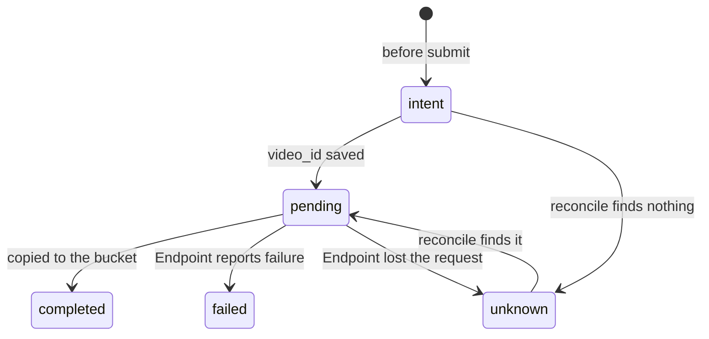

# 2.4 Long-running Tools: Submit, Poll, Resume

You have a keyframe for a lamp ad and want a 5-second clip from it. Image-to-video takes minutes, not seconds, and the agent that asked for it can crash, be killed or time out while it renders. Restart it naively and it submits the video again: you pay for two. In this lesson we turn video generation into a long-running tool: it submits, writes a ticket, ends the agent run, and our code polls and resumes the run when the video is ready. You're done when you kill the agent while the video is pending, resume it with the run ID, and the trace shows one video generation.

Before you start: complete the **Setup** section of the [module README](../02-multi-agent-media-workflows/README.md) once.

Code: [`code/video_tool.py`](code/video_tool.py), one file with the deferred video tool, the ticket and a `resume` command. Everything in "Break it on purpose" runs offline with `--fake`: a scripted model and a placeholder Videos API that keeps "rendering" while the agent is dead.

Cost of the live run: the [Wan2.2-I2V-A14B](https://github.com/nebius/serverless-ai-cookbook/blob/main/templates/endpoint-wan22-i2v-a14b/README.md) Endpoint on a preemptible H100, plus one video. Our run: startup [measure], `t_gen` [measure] per video, $[measure] [calc: metrics.json × rate on the run day]. Stop the Endpoint at the end.

## Why a blocking tool call fails

One video takes minutes [measure]. A tool that waits for it inside the call hits the tool timeout, and PydanticAI treats a timeout as a retryable failure (2.2): the retry submits a second video while the first still renders. Raising the timeout to minutes only moves the problem: now the whole agent sits on an open call, and a crash in those minutes loses track of the video.

So a long call becomes two: submit now, collect the result later.

## Submit, defer, poll, resume

PydanticAI has a mechanism for exactly this, [deferred tools](https://pydantic.dev/docs/ai/tools-toolsets/deferred-tools/). A tool raises `CallDeferred`; the run ends with `DeferredToolRequests` instead of an answer; later, a new run continues the conversation with `DeferredToolResults`.



The tool, in short: hash the spec, look up the ticket, submit if there is none, then defer:

```python
    if ticket is None:
        stamp = now()
        ticket = Ticket(
            spec_hash=key,
            run_id=deps.tracer.run_id,
            tool_call_id=ctx.tool_call_id,
            deployment_id=deps.videos.workload_id,
            created_at=stamp,
            updated_at=stamp,
        )
        submit(ticket, deps, motion_prompt, keyframe, seed)
    else:
        ticket.tool_call_id = ctx.tool_call_id  # a new call now waits for the same request
        ticket.save(deps.store.folder)
        if ticket.state in ("intent", "unknown"):
            reconcile(ticket, deps)
    deps.tracer.emit("tool_call", "generate_video", request_id=ticket.request_id, **event)
    raise CallDeferred(metadata={"spec_hash": key})
```

`drive()` runs the agent, and while the run ends with deferred calls, it answers them from the tickets and starts the next run. Waiting costs no LLM turns, and no tool call stays open while the video renders. Polling has a deadline, `max_wait_s`: past it, the ticket stays `pending` and the run stops with `poll_timeout`. `video_tool.py resume <run_id>` continues later; to give up instead, delete the video on the Endpoint (`DELETE /v1/videos/{video_id}`).

Default deadline: 1200 s live [proposed: 2 × the measured p95 of submit → `completed`, [measure]], 10 s with `--fake`.

## The Videos API on the Wan2.2 Endpoint

The template serves video through the vLLM-Omni [Videos API](https://docs.vllm.ai/projects/vllm-omni/en/stable/serving/videos_api/), an OpenAI-style async API:

| Route | What it does |
| --- | --- |
| `POST /v1/videos` | Submit: multipart form with `prompt`, the keyframe as `input_reference`, size, frames, seed, and `user` |
| `GET /v1/videos/{video_id}` | Status: `queued`, `in_progress`, `completed` |
| `GET /v1/videos/{video_id}/content` | Download the MP4 once `completed` |
| `DELETE /v1/videos/{video_id}` | Delete the job and its stored output |
| `GET /v1/videos` | List stored videos: used to reconcile |

`VideosAPI` in `video_tool.py` wraps the five calls. The failure status name and the list response shape on the template's pinned image (`vllm/vllm-omni:v0.24.0`): [verify]. The code treats any status other than `queued`, `in_progress` and `completed` as a failure and logs it.

Every video is deleted from the Endpoint right after its copy to the run folder (and bucket): the Endpoint's storage isn't where results live.

## The IDs that survive a restart

After a restart, one ID can't tell you where to look:

- **Endpoint ID** (`deployment_id`): which server.
- **`video_id`** (`request_id`): which request on that server.
- **Tool call ID** (`tool_call_id`): which pending call in the conversation waits for this video, so a resume hands the result to the right call.
- **Course run ID** (`run_id`): stays the same across pause and resume. PydanticAI gives every resumed run a new run ID of its own; the trace records it as `framework_run_id` but doesn't key on it.

## The ticket and its states

The agent's memory dies with the process. The ticket doesn't: `tickets/<spec_hash>.json` in the run folder.

```python
class Ticket(BaseModel):
    """tickets/<spec_hash>.json in the run folder."""

    spec_hash: str
    run_id: str  # the course run ID, the same before and after a resume
    tool_call_id: str | None  # the tool call that waits for this video
    backend: Literal["endpoint", "job"] = "endpoint"
    deployment_id: str  # which server: the Endpoint ID
    request_id: str | None = None  # which request: the video_id
    state: Literal["intent", "pending", "completed", "failed", "unknown"] = "intent"
```



Two writes matter: `intent` **before** the submit, and `video_id` **right after** it returns:

```python
def submit(ticket: Ticket, deps: VideoDeps, motion_prompt: str, keyframe: Path, seed: int) -> None:
    """intent -> submit -> pending. The request_id is saved right after the submit returns."""
    ticket.save(deps.store.folder)
    ticket_event(deps, ticket, "intent")
    maybe_kill("after-intent")
    params = {**WAN_I2V.params, "seed": seed}
    video = deps.videos.create(
        motion_prompt, keyframe.read_bytes(), user=ticket.spec_hash, params=params
    )
    ticket.submit_attempts += 1
    maybe_kill("after-submit")
    ticket.request_id, ticket.state = video["id"], "pending"
    ticket.save(deps.store.folder)
    ticket_event(deps, ticket, "pending")
```

The spec hash is sent as the request's `user` field. That's what lets us find a request whose `video_id` we never saved.

## Three cases on resume

"Retry" means three different things here, and only one of them is safe to automate:

| Ticket on resume | What the code does | Possible extra cost |
| --- | --- | --- |
| `completed` | Reuse the asset in the bucket | None |
| `pending` (`video_id` saved) | Poll it. Never submit | None |
| `intent` or `unknown` | List the Endpoint's videos and match the spec hash. Found: `pending`. Not found: stop with `needs_reconcile` | None: a person decides |

```python
def reconcile(ticket: Ticket, deps: VideoDeps) -> None:
    """Find the request by its spec hash (sent as `user`): found -> pending, else stop."""
    found = [v for v in deps.videos.list() if v.get("user") == ticket.spec_hash]
    if not found:
        ticket.state = "unknown"
        ticket.save(deps.store.folder)
        ticket_event(deps, ticket, "unknown", reasons=["no request with this spec hash"])
        raise NeedsReconcile(ticket.spec_hash)
```

Why stop instead of resubmitting? `intent` with no match can mean "never sent" or "sent, and the Endpoint lost it". Both look the same from here; one resubmit is free, the other is a duplicate you pay for. The run stops, the trace says why, and you decide. Whether `GET /v1/videos` returns `user` on the pinned image: [verify]. If it doesn't, reconcile can't match and every uncertain ticket stops.

An extension, not the main path: resubmit automatically while `submit_attempts < max_submits` (default 1, persisted in the ticket), with the possible duplicate cost flagged in the trace (`possible_duplicate`).

## What this guarantees

With one process per ticket:

- a completed request is reused;
- a known pending request is resumed without a new submission;
- an uncertain one stops for you to decide.

Not covered: two workers on the same ticket (Module 3), and an Endpoint restart that loses a pending request: it stops as uncertain, and you pay for the lost run. No "exactly once": that would need the Endpoint itself to deduplicate requests.

## Break it on purpose

A resume path nobody tested fails on the day it's needed. `--kill-at` kills the process with no cleanup at a restart boundary; `resume` continues it. All offline:

```bash
cd 02-multi-agent-media-workflows/code

uv run python video_tool.py run --fake --kill-at pending
uv run python video_tool.py resume <run_id> --fake

uv run python video_tool.py run --fake --kill-at after-submit
uv run python video_tool.py resume <run_id> --fake

uv run python video_tool.py run --fake --max-wait-s 1
uv run python video_tool.py resume <run_id> --fake
```

| Run | Ticket events in the trace | Stop reason | Video requests |
| --- | --- | --- | --- |
| Kill while `pending`, resume | `intent`, `pending`, `completed` | `done` | 1 |
| Kill after submit, before the `video_id` is saved, resume | `intent`, `reconciled`, `completed` | `done` | 1 |
| Deadline passed, then resume | `intent`, `pending` (`poll_timeout`), then `completed` | `poll_timeout`, then `done` | 1 |

Check each run's `metrics.json`: `attempts.video` counts distinct video requests in the trace, and `contract_problems` should be empty. The scripted resume trace is required evidence in Homework 2.

The full matrix (kill after `intent`, two restarts while pending, an Endpoint restart while pending) runs as maintainer tests.

Then once live: start the Wan2.2 Endpoint from its [template](https://console.nebius.com/serverless/endpoint/create?template=wan22-i2v-a14b), and run with a real keyframe:

```bash
uv run python video_tool.py run --keyframe keyframe.png --kill-at pending --gpu-price-per-hour <USD/h>
uv run python video_tool.py resume <run_id> --gpu-price-per-hour <USD/h>
```

Our run: [measure: one `POST /v1/videos` in the trace, `t_gen_s`, clip length and resolution]. Then stop the Endpoint in the console and check `nebius ai endpoint list`.

## Also try: the video tool as a Job

A Job runs only as long as its work. Same ticket, with the Job ID as the request ID; the Job writes the video to the bucket and stops itself. The trade-off: every Job loads the model weights again. [placeholder: the Job variant lands after the Endpoint path is validated; it needs an image-to-video worker image.]

| | Endpoint (default) | Job |
| --- | --- | --- |
| Request ID | `video_id` | Job ID |
| Status | `GET /v1/videos/{video_id}` | Job state: `QUEUED` → `RUNNING` → `COMPLETED` or `FAILED` |
| Agent dies | The request keeps running | The Job keeps running |
| Endpoint restarts | The request may be gone: `unknown` | n/a |

## Why deferred tools

Deferred tools end the run cleanly and resume it with the result, so the agent never holds an open call. PydanticAI matches results to calls by tool call ID, but says nothing about idempotency: the ticket is that layer. For MCP clients, which can't defer, the same steps would be two plain tools, `submit_video` and `get_video` (not built here).

## Notes

- Production systems add durable execution engines (Temporal, DBOS, Prefect) that journal every step, not just the video ([PydanticAI: durable execution](https://pydantic.dev/docs/ai/durable-execution/overview/)).
- MCP has an experimental Tasks extension for long-running tool calls ([AAIF](https://aaif.io/blog/handle-long-running-mcp-tool-calls-with-the-mcp-tasks-extension)). [verify: status in the Python SDK]
- Polling vs callbacks: the Videos API has no callback; polling with a deadline is the simple, restartable option.

Next: [2.5 Planner, Generator, Reviewer: the Judge Loop](05-judge-loop.md), which decides whether a keyframe is good enough to pay for its video.

<!-- nav:start -->
[← Previous: 2.3 GPU Workloads as Agentic Tools](03-gpu-tools.md) · [Next: 2.5 Planner, Generator, Reviewer: the Judge Loop →](05-judge-loop.md)
<!-- nav:end -->
