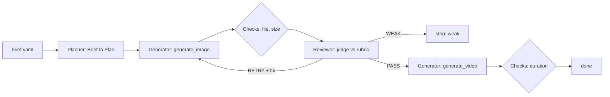

# 2.5 Planner, Generator, Reviewer: the Judge Loop

The first keyframe for a lamp ad shows the person and the desk, but the lamp is cut off at the edge. An agent that accepts its first output would now pay for a 5-second video of the wrong thing. In this lesson we write a versioned rubric from the brief, then build a loop that judges each keyframe against it and regenerates instead of accepting the first output, and that stops cleanly, before the GPU call, when it can't pass. You're done when the judge returns `RETRY` on the fixture, the loop recovers to `PASS`, and every judge event in `events.jsonl` carries the rubric version. Also check: the judge passes the good fixture, and a scripted over-budget request makes no GPU call.

Before you start: complete the **Setup** section of the [module README](../02-multi-agent-media-workflows/README.md) once.

Code: [`code/nb-judge.ipynb`](code/nb-judge.ipynb) to write the rubric and try the judge on two fixtures; [`code/review_loop.py`](code/review_loop.py), the end-to-end loop that Homework 2 builds. Rubric and fixtures in [`assets/`](assets/). Everything in "Break it on purpose" runs offline with `--fake`.

Cost of the live run: judge tokens, up to 3 Sana keyframes, one video. Our run: $[measure] marginal, $[measure] session spend [calc: metrics.json × rates on the run day].

## Roles: planner, generator, reviewer



An agent that plans, generates and grades its own work tends to pass itself. So three roles with typed handoffs:

- **Planner:** `Brief` → `Plan` (2.2). A typed call in a fixed stage.
- **Generator:** the only role that chooses tools: `generate_image` and `generate_video`.
- **Reviewer:** a separate judge call, with its own prompt and its own vision model.

The stages are fixed in code; this is the hybrid from 2.1. "One agent or two" below compares it with a second agent doing the review.

## Rubric v1: criteria from the brief

"Is it good?" has no answer without criteria. [`assets/rubric.yaml`](assets/rubric.yaml) has 3 to 5 of them, and each one reads a **field** of the brief, not the text of one brief:

```yaml
  - id: must_show
    brief_field: must_show
    question: Is every item in must_show clearly visible?
    must_have: true
    scope: keyframe
    pass_example: all listed items are in frame and recognisable
    fail_example: one item is missing, cut off or hidden
```

So the same rubric judges the lesson brief, the Homework 2 brief and, in Module 3, each record mapped to `Brief`. Each criterion has a pass and a fail example, a score anchor (0, 0.5 or 1), `must_have`, and a scope:

- `keyframe`: the judge decides from the image.
- `video_only` (the action happens in the clip): the judge never sees the video. You check it by watching the video once.

The rubric has a `version`. Change a criterion, bump it: every verdict in the trace says which rubric made it. How far to trust the rubric is 4.1, where you compare its verdicts with human labels.

## Typed judge output: PASS, RETRY, WEAK

Free-text feedback can't drive a loop, and valid JSON can still hold an inconsistent decision ("all criteria fail, verdict PASS"). So the judge model returns scores, reasons and a fix, and **code** decides the verdict:

```python
def map_verdict(reply: JudgeReply, rubric: Rubric, judge_model: str) -> Verdict:
    """Can't assess a keyframe criterion -> WEAK; a must-have below 1 -> RETRY; else PASS."""
    keyframe = {c.id: c for c in rubric.criteria if c.scope == "keyframe"}
    results = [r for r in reply.criteria if r.id in keyframe]
    if len(results) < len(keyframe) or not all(r.assessable for r in results):
        verdict = "WEAK"
    elif any(keyframe[r.id].must_have and r.score < 1 for r in results):
        verdict = "RETRY"
    else:
        verdict = "PASS"
```

| Verdict | Means | The loop |
| --- | --- | --- |
| `PASS` | All keyframe criteria met | Opens the video gate. It means "allowed to generate the video", not "the video meets the brief" |
| `RETRY` | A must-have criterion fails | New keyframe with the judge's fix (new seed, a prompt suffix). Counts as an attempt |
| `WEAK` | A criterion can't be judged from the keyframe | Stop for review; keep the keyframe and reasons. Never reaches the video |

## When the judge reply doesn't parse

A vision model sometimes answers in prose or breaks the JSON. The judge call uses `output_type=str` and parses the reply itself, so you can see this happen. An unparseable reply is re-asked up to `JUDGE_PARSE_RETRIES = 2` times [proposed: one format slip plus one more; a third failure points to the prompt or the model]. Those are judge calls, not attempts. Still unparseable: stop with `judge_unparseable`. It never counts as `PASS`.

## Attempt caps and the budget guard

How do you stop an agent from regenerating bad results and burning GPU credits? Three guards, all checked before the paid call:

```python
# Caps live in code, not in the prompt
KEYFRAME_ATTEMPTS = 3
VIDEO_ATTEMPTS = 2
```

- **Attempt caps:** 3 keyframes, 2 videos [proposed: the video cap matches the Homework 2 limit]. At the cap without `PASS`: `attempts_exhausted`, no video.
- **A retry must change the spec.** An unchanged retry would be a cache hit (2.2) and the same image would get the same verdict:

```python
            if (prompt, seed) == last_spec:  # the same spec again would be a cache hit
                return stop("unchanged_retry")
```

- **Budget guard:** before each paid generation, reserve its estimated cost (`rate × t_gen` from your measurement); after it, settle the real cost. Not enough left: `budget_exhausted`, before the GPU call. The state lives in `budget.json` in the run folder, so a resumed run keeps its reservations. It's an application guard, not a billing ceiling: Nebius bills what the Endpoint runs, whatever this file says.

```python
            estimate = gpu_cost(image_gpu_price, keyframe_s)
            if not guard.reserve("keyframe", estimate):
                return stop("budget_exhausted")
```

`UsageLimits` (2.1) caps the LLM side; this caps the GPU side. Session spend (Endpoint startup, readiness wait, idle time, teardown) is a separate number, reported next to the marginal cost per video and never added to it.

## Runtime gates

A judge call on a missing or wrong-size file wastes tokens. Deterministic checks run first; the judge runs only on a keyframe that passed them:

| Check | Who | Covers | Doesn't cover |
| --- | --- | --- | --- |
| Deterministic | Code | File exists, 832×480; after the video, its duration (with `ffprobe`) | Content |
| Image judgement | Vision model | Keyframe vs brief | Motion, temporal artifacts |
| Human playback | You | The final video, one sentence | Scale; not in any metric |

The video gate is a runtime gate too. The `generate_video` tool doesn't exist for the model until a keyframe gets `PASS`, and disappears again at the video cap:

```python
async def video_gate(ctx: RunContext[VideoDeps], tool_def: ToolDefinition) -> ToolDefinition | None:
    """generate_video exists for the model only after PASS and under the video cap."""
    tickets = list((ctx.deps.store.folder / "tickets").glob("*.json"))
    if ctx.deps.video_gate_open and len(tickets) < VIDEO_ATTEMPTS:
        return tool_def
    return None
```

A cheap image-text similarity score between the checks and the judge is a third layer; it's in 4.1.

## Prove the judge with two fixtures

A live run may pass on the first attempt and never exercise the loop. And a judge that always says `RETRY` would pass a test that only uses a bad keyframe. So two fixtures, each with its expected verdict in a label file: [`assets/fixtures/`](assets/fixtures/).

- `bad_keyframe.png`: breaks `must_show` on purpose. Expected `RETRY`.
- `good_keyframe.png`: meets the brief. Expected `PASS`.

A hand-written label can be wrong too: look at each image and check that the label matches what is visibly there before you trust it. `nb-judge.ipynb` shows both images next to their verdicts. With the pinned judge model, our run: bad [measure: 5 of 5 `RETRY`], good [measure: 5 of 5 `PASS`].

Then the loop with the bad fixture as attempt 1:

```bash
cd 02-multi-agent-media-workflows/code
uv run python review_loop.py --fake --fixture ../assets/fixtures/bad_keyframe.png
```

```text
Attempt 1: RETRY ['scripted: a must_show item is missing']
Attempt 2: PASS []
Stop: done. Trace: runs/05-judge-loop/<run_id>/events.jsonl
```

## Break it on purpose

The stop paths are what protects your credits, and a happy-path run never takes them. `--fault` injects one failure into the scripted run:

```bash
uv run python review_loop.py --fake --fault always-retry
```

| `--fault` | Injected | Stop reason | GPU image calls | Videos |
| --- | --- | --- | --- | --- |
| `always-retry` | The judge says `RETRY` every time | `attempts_exhausted` | 3 | 0 |
| `weak` | A criterion can't be assessed | `weak` | 1 | 0 |
| `tight-budget` | A budget below one keyframe [illustrative prices] | `budget_exhausted` | 0 | 0 |
| `unparseable` | The judge answers in prose, 3 times | `judge_unparseable` | 1 | 0 |
| `unchanged-retry` | `RETRY` with a fix that changes nothing | `unchanged_retry` | 1 | 0 |

Each run ends with one `run_end` event carrying its stop reason. These traces are the offline failure checklist in Homework 2: no credits needed.

## Metrics per run: judge tokens and cost per verdict

`metrics.json`, next to `events.jsonl`, adds up the trace:

- `accept_rate`: keyframes with `PASS` ÷ keyframes judged. Fixture runs are flagged `fixture_run` and left out.
- `rejected_share`: generation time of keyframes without `PASS` ÷ generation time of all GPU work in the run.
- `judge_calls` and `cost_by_step.judge`: what the reviewer costs. A judge call writes one `judge` event, with its tokens, and no `model_request` event, so its tokens are charged once.
- `marginal_cost_usd`: the sum of `cost_usd` over the run, split in `cost_by_step`.

Our live run: [measure: attempts, accept rate, judge tokens and cost per verdict, cost by step].

## One agent or two: read the handoff

The module title promises multi-agent. Here's what a second agent adds, with no new GPU calls: the planner gets a tool, `ask_reviewer`, that runs the judge as a separate agent and returns a typed `Verdict`.

```bash
uv run python review_loop.py --two-agents
```

```text
Two agents: 3 planner requests, 2 handoffs, 2 judge calls.
```

In the trace, find the handoff: a `tool_call` named `ask_reviewer`, then the reviewer's `judge` event, then the planner's next request. Compared with the single loop, each verdict costs one more planner request and one tool call. One scripted run shows the extra calls; it can't show a quality difference.

## Also try: human approval before the video

Video is the most expensive step. `--approve-video` makes the video tool ask a person first: the tool raises `ApprovalRequired`, the run ends with `DeferredToolRequests`, and you see the `PASS` keyframe and answer yes or no. It's the same mechanism as 2.4, with a person instead of a poller. A "no" ends the run with `video_denied` and no video request.

```bash
uv run python review_loop.py --approve-video --image-gpu-price <USD/h> --video-gpu-price <USD/h>
```

## Notes

- The judge model is pinned in `models.py` (`JUDGE`): [verify: T9, the Token Factory vision model and its price].
- Judge calibration against human labels, a pairwise judge and video-level evals: 4.1.
- Prompt injection through brief fields: 4.4.

Next: Module 3, [3.1 Batch Generation with Serverless Jobs](../03-batch-media-generation-at-scale/01-batch-jobs.md), runs this loop over many briefs.

<!-- nav:start -->
[← Previous: 2.4 Long-running Tools: Submit, Poll, Resume](04-long-running-tools.md) · [Next: 3.1 Batch Generation with Serverless Jobs →](../03-batch-media-generation-at-scale/01-batch-jobs.md)
<!-- nav:end -->
