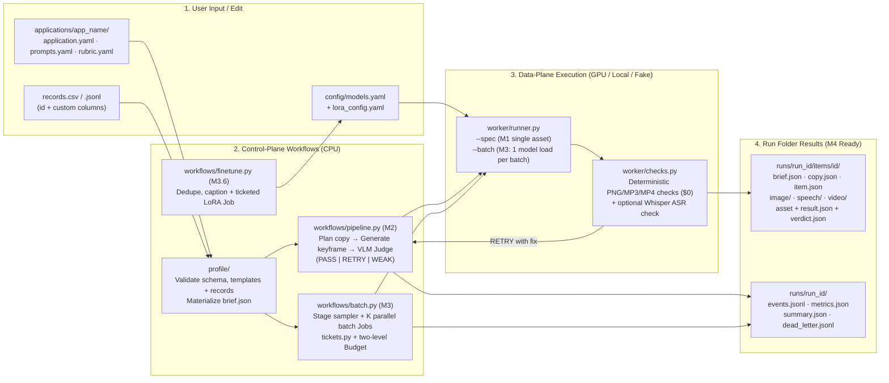

<p align="center">
  
</p>

# Personalized Media Factory (`examples/mediafactory`)

A general-purpose reference implementation for **Production AI Agents for Generative Media** (Modules 1–4 and Capstone).

A record and a brief go in; an agent plans the copy, generates an image plus voice or video on serverless GPUs, judges the keyframe (regenerating on `RETRY` and stopping before video on `WEAK`), checkpoints every item with persisted async tickets, and fans out across parallel Spot GPU Jobs with a measured cost per accepted asset.

See [`SPEC.md`](SPEC.md) for the normative architecture and contracts.

---

## Architecture & Workflow



---

## Package structure

```text
examples/mediafactory/
├── SPEC.md                        # Normative specification (M1–M4 contracts)
├── README.md                      # Quickstart and application customization guide
├── config/
│   ├── models.yaml                # Role -> model, pinned revision, GPU placement, policy caps
│   └── lora_config.yaml           # Lesson 3.6 style LoRA training Job template
├── data/
│   ├── kids.csv                   # 200 records for Module 3 (id, name, age, wishlist)
│   └── kids_10.csv                # First 10 rows of kids.csv
├── applications/
│   ├── storybook/                 # Module 3 default: 200 image+speech, 10 sampled video (seed 42)
│   ├── product_ad/                # Module 2 default: Byte Brew coffee video ad + product catalog
│   └── _template/                 # Starter application folder to copy for capstones
└── src/mediafactory/
    ├── cli.py                     # `mediafactory` CLI (doctor, worker, run, batch, finetune, teardown)
    ├── config.py                  # models.yaml loader and role/placement resolver
    ├── ops.py                     # doctor checks and teardown
    ├── core/                      # Pure contracts, cost math, trace events, FUSE-safe storage
    ├── profile/                   # application.yaml, prompts.yaml, rubric.yaml, CSV/JSONL loader
    ├── worker/                    # Single-spec (--spec) & model-reusing batch (--batch) worker
    └── workflows/                 # Agent/judge pipeline, parallel batch fan-out, tickets, LoRA finetune
```

---

## Quickstart

From the repository root:

```bash
uv sync --extra dev
```

### 1. Check configuration and application profiles (`doctor`)

```bash
uv run mediafactory doctor --app examples/mediafactory/applications/storybook
uv run mediafactory doctor --app examples/mediafactory/applications/product_ad
```

### 2. Dry-run planning (default — zero network calls, zero spend)

Running `run`, `batch`, `worker`, or `finetune` with no mode flag validates schemas and templates and prints the execution plan and cost ceiling:

```bash
uv run mediafactory run --app examples/mediafactory/applications/product_ad
uv run mediafactory batch --app examples/mediafactory/applications/storybook --jobs 10
```

### 3. Offline walkthroughs (`--fake`)

`--fake` runs the full control plane (planner, judge retry loop, persisted tickets, two-level budget, batch model reuse, and M4 run-folder output) using deterministic fixtures stamped `fake: true`:

```bash
# Module 2 single-record / small-catalog flow (Byte Brew coffee ad):
uv run mediafactory run \
  --app examples/mediafactory/applications/product_ad \
  --run-id m2-demo \
  --fake

# Module 3 parallel batch flow (200 records over 10 batch Jobs, 10 sampled videos):
uv run mediafactory batch \
  --app examples/mediafactory/applications/storybook \
  --jobs 10 \
  --run-id m3-demo \
  --fake
```

Inspect `runs/m3-demo/summary.json`, `runs/m3-demo/metrics.json`, `runs/m3-demo/events.jsonl`, and `runs/m3-demo/items/<id>/`.

### 4. Style LoRA fine-tuning workflow (Lesson 3.6)

```bash
# Dry-run the LoRA training Job command and cost cap:
uv run mediafactory finetune submit \
  --config examples/mediafactory/config/lora_config.yaml \
  --dataset runs/finetune-data
```

---

## Adapting for your Capstone

1. Copy `examples/mediafactory/applications/_template` to `examples/mediafactory/applications/<your_app>`.
2. Edit `application.yaml` (your record columns, style presets, stages, and budget), `prompts.yaml`, and `rubric.yaml`.
3. Validate with `uv run mediafactory doctor --app examples/mediafactory/applications/<your_app>`.
