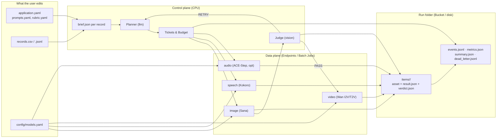

# Personalized Media Factory — specification

**A general-purpose example: one brief and a table of records in, image plus voice or video out, at a measured cost per accepted asset.**

| | |
|---|---|
| **Document** | `examples/mediafactory/SPEC.md` |
| **Revision** | 0.2 — revised after M1–M4 alignment review |
| **Status** | Draft. Design only. The folder today holds sample records (`data/kids.csv`, `data/kids_10.csv`). This document is what an implementation is checked against. |
| **Audience** | Course engineers building the example, and learners who copy it for a personal or business use. |
| **Reference shape** | `.DEV/alex-santa-scale-challenge/src/santa` plus the M1–M4 contracts in this repo (`01-consistent-media-generation-on-serverless-gpus` through `04-evaluation-observability-production`). |
| **Course fit** | The factory in the course README: a brief goes in, an agent writes the text, GPU models make an image plus voice or video, a check sends weak assets back, and the run scales from 1 to 1,000+ records with a cost per accepted asset. |

## 1. What this example is

A learner points the factory at three things they own:

1. **An application** — the job the media does (a storybook card, a product ad, a lesson clip, a listing). It declares the record columns, the voice of the copy, the visual and motion style, which stages to run (and whether an expensive stage runs on a deterministic sample), and the rubric.
2. **Records** — a CSV or JSONL file. One row is one personalized asset set. The only column the engine requires is `id`.
3. **Models** — named in `config/models.yaml`, one block per role, with pinned model revisions and explicit GPU placement.

Running it produces, per record, the copy, the media files, a `result.json` beside each file, per-item checkpoints and tickets, and a run folder (`events.jsonl`, `metrics.json`, `summary.json`, `dead_letter.jsonl`) that Module 4 can evaluate offline without regenerating a single asset.

The bundled **storybook** application reads `data/kids.csv` (`id`, `name`, `age`, `wishlist`, 200 rows). By default it matches Homework 3: copy + image + voice for all records, and image-to-video for a fixed-seed 10-record sample. A product ad, a real-estate listing, or a training clip is another application folder, not a fork of the engine.

## 2. What stays fixed, and what the user changes

| Fixed in the engine | Changed per application or deployment |
|---|---|
| Closed request, result, ticket, and run-folder schemas | Record columns beyond `id` |
| Role names the code calls (`llm`, `image`, `video`, `speech`, `audio`, `judge`) | Which stages an application enables or samples |
| Adapter selection by role | Model id, pinned revision, endpoint URL, GPU platform and preset |
| Content-addressed idempotency key over resolved inputs | Prompt templates, style presets, and voice tags |
| Per-record and per-run budgets (`reserve / commit / release`) | Rubric criteria, pass threshold, and attempt caps |
| Single-spec worker (M1) and model-reusing batch worker (M3) | Output composition (card, ad, clip) |
| Persisted async tickets (`intent → submitted → completed \| failed`) | On-demand vs preemptible placement |
| Dry-run by default; live spend only with `--confirm-create` | Fallback policy (`off` for graded runs, `auto` for demos) |

Code asks for a **role**. It does not name a model, a brand, a child, or a product. Those live in YAML.

## 3. Concepts

**Application.** A directory the user can copy. It contains `application.yaml`, `prompts.yaml`, and `rubric.yaml`. See §6.

**Record.** One JSON object with a non-empty string `id` and whatever fields the application declared. Loaded from CSV or JSONL. Unknown columns are kept and available under `record.<col>`. A blank `id`, a duplicate `id`, or a missing required column writes one row to `dead_letter.jsonl` and continues the batch.

**Brief.** The input the course describes: a task, one record, and constraints. Materialized as `items/<id>/brief.json` before any model call:

- `application` — `{name, version}`
- `task` — instruction string from `application.yaml`
- `record` — the validated row
- `style` — the resolved style preset object for this record
- `stages` — stages active for **this** record (after applying any stage `sample` rule)
- `constraints` — per-role dimensions/durations and `record_budget_usd`

**Style.** Named presets inside `application.yaml`: `visual`, `negative`, `motion`, `voice`, `music`. A record may select a preset via the configured style column; otherwise `styles.default` applies. Style text is data concatenated into prompts; the engine never invents a look.

**Role.** A capability the pipeline can call. Bindings live in `config/models.yaml`.

| Role | Produces | Course default model | Default placement | Notes |
|---|---|---|---|---|
| `llm` | Copy and prompts (JSON) | Nebius Token Factory (`openai/gpt-oss-120b`) | Token API | Plans the asset. Validated against `copy_schema`. |
| `image` | Still image (PNG) | `Efficient-Large-Model/Sana_1600M_1024px_diffusers` | `gpu-l40s-a` / `1gpu-8vcpu-32gb` | Keyframe. First GPU asset. |
| `speech` | Voice-over (MP3) | `hexgrad/Kokoro-82M` | `gpu-l40s-a` / `1gpu-8vcpu-32gb` | Speaks `speech_text`. Optional Whisper check in M4 / worker. |
| `video` | Clip (MP4) | `Wan-AI/Wan2.2-I2V-A14B-Diffusers` (M2/M3 default); `Wan-AI/Wan2.2-TI2V-5B-Diffusers` (L40S profile) | `gpu-h100-sxm` / `1gpu-16vcpu-200gb` (14B) or `gpu-l40s-a` / `1gpu-8vcpu-32gb` (5B) | Gated on image `PASS` when `video_from: image`. Sampled to 10 records in HW3. |
| `audio` | Music bed (MP3) | `ACE-Step/acestep-v15-xl-turbo-diffusers` | `gpu-l40s-a` / `1gpu-8vcpu-32gb` | Optional Phase-2 role. Driven by `music_tag`, not spoken script. |
| `judge` | Verdict JSON | Token Factory vision model (`moonshotai/Kimi-K3`) | Token API | Scores an image against `brief.json` + `rubric.yaml`. |

`speech` and `audio` stay separate roles. One is a voice saying this record's script; the other is an instrumental bed chosen by style tag.

**Asset request (`spec.json`).** One closed request for one asset: role, model, pinned revision, resolved prompt, optional `negative_prompt` and `voice`, optional typed `input_image` (`{uri, sha256, mime}` for image-to-video), seed, size, duration, fps/frames, placement, pricing, and output prefix (§7.1).

**Batch file (`batch.jsonl`).** A newline-delimited list of `GenerationSpec` objects assigned to one GPU Job in batch mode. Items in a batch file are grouped by `(role, model, model_revision, lora_sha256)` so the batch worker loads each model **once** per container lifecycle and renders all assigned records sequentially (§5, §8.1).

**Ticket (`tickets/<call_id>.json`).** Durable state for any long-running Endpoint or Job call (`intent → submitted → completed | failed`). Written before submission, updated with the provider `workload_id` immediately after submission, and reconciled on resume before any retry (§8.2).

## 4. Architecture

Three planes, matching the course:

- **Control plane (CPU).** Load the application, validate records, materialize briefs, call the LLM planner, reserve budget, dispatch GPU tools (via Endpoints or parallel batch Jobs), run the judge, write `events.jsonl` and `summary.json`.
- **Data plane (GPU).** Image, speech, video, and optional audio. Warm Endpoints for interactive/agent loops (M1–M2); Spot batch Jobs with in-container model reuse for scale runs (M1, M3).
- **Artifacts.** S3-compatible Object Storage (or local `runs/` directory). Every asset, `result.json`, ticket, verdict, and run-level report lives here.



Stage order for an application:

1. **Plan (`llm`).** Turns `brief.json` into structured JSON validated against `copy_schema` (`copy`, `image_prompt`, `speech_text`, `motion_prompt`, `music_tag`), saved to `items/<id>/copy.json`.
2. **Image (`image`) + Judge (`judge`).** Generates the keyframe (`items/<id>/image/asset.png` + `result.json`). If `judge` is enabled, scores the keyframe against `rubric.yaml` and writes `items/<id>/image/verdict.json`.
   - `PASS`: mark image accepted and unlock downstream stages that depend on it.
   - `RETRY`: feed `verdict.fix` back to the planner/prompt and regenerate with attempt `a + 1` (new deterministic seed), up to `max_image_attempts`.
   - `WEAK`: stop this record (`status: "rejected_weak"`); never escalate to video.
3. **Speech (`speech`) and optional Audio (`audio`).** Synthesize voice-over from `copy.speech_text` (and optional music bed from `copy.music_tag`). When `gate_speech_on_image_pass: true` (default), speech runs only after image `PASS`.
4. **Video (`video`).** Runs only for records selected by the stage's `sample` rule (all records if `sample` is omitted) **and** only after image `PASS` when `video_from: image`. Passes the winning keyframe's `{uri, sha256, mime}` in `spec.input_image`.
5. **Compose (`compose`, optional Phase 2).** CPU-only `ffmpeg` mux of video + speech (+ audio) into `items/<id>/composed/asset.mp4`.

## 5. Package map and execution modes

Santa module on the left, factory module on the right:

| Santa (`src/santa`) | Factory (`examples/mediafactory/src/mediafactory`) | What changes |
|---|---|---|
| `spec.py` | `core/spec.py` | Closed `GenerationSpec`. Adds `model_revision`, `lora_adapter`, `input_image`, `negative_prompt`, `voice`, `fps`, `frames`. `prompt` is always resolved before writing `spec.json`; `brief_ref` is provenance metadata. |
| `result.py` | `core/result.py` | Closed `ResultReport`. Adds `fake: bool`, `cache_hit: bool`, and links to shared worker `worker_run_id` when produced in a batch Job. |
| — | `core/events.py` | Closed `TraceEvent` schema and `events.jsonl` writer (M2 & M4.3 waterfall). |
| `cost.py` | `core/cost.py` | Marginal (`c = r × t_gen`) and fixed (`F = r × (startup_s + t_ready + idle_s)`) formulas from Lesson 1.5; thread-safe `Budget` with `reserve / commit / release`. |
| `storage.py` | `core/storage.py` | FUSE-safe `staged_write`; content-addressed cache lookup; S3 / local run-folder reader. |
| `schemas.py`, `prompts.py` | `profile/application.py` | Removed holiday schemas from engine. Loads `application.yaml`, `prompts.yaml`, `rubric.yaml`, and validates `{placeholder}` templates and `copy_schema`. |
| — | `profile/records.py` | CSV/JSONL loader, ID uniqueness & required-column validation, `dead_letter.jsonl` writer, `brief.json` builder. |
| `models.py` | `worker/adapters.py` | One adapter class per API shape (`Chat`, `Images`, `Speech`, `Video`, `Judge`) plus `FakeAdapter` for `--fake`. |
| `worker.py`, `job.py` | `worker/runner.py` | Unified GPU/local/fake worker and Job entrypoint (`python -m mediafactory.worker.runner`): supports `--spec <path>` (M1) and `--batch <path>` (M3, 1 model load per role). |
| `asr.py` | `worker/checks.py` | Deterministic media checks (PNG/MP4/MP3 headers, dimensions, duration) at `$0`, plus optional Whisper ASR check (recorded with its compute/API cost). |
| — | `workflows/tickets.py` | Persistent async ticket state machine (`intent → submitted → completed \| failed`) and reconciliation before retry (Lesson 2.4). |
| — | `workflows/pipeline.py` | Single-record planner → generator → judge loop (M2). |
| — | `workflows/batch.py` | Manifest builder, deterministic stage sampler, batch partitioner, K-Job launcher, poll/reconcile loop, `summary.json` aggregator (M3). |
| — | `workflows/finetune.py` + `config/lora_config.yaml` | Lesson 2.3 & 3.6 style LoRA workflow: `prepare_dataset` (dedupe, VLM captions, style-word check, contact sheet), `start_finetune` / `get_status` (ticketed Nebius GPU Job with `--timeout`). |
| `config.py` + `config/models.yaml` | `config.py` + `config/models.yaml` | Roles, pinned revisions, GPU placement, fallbacks (`off` by default), policy caps. |
| `doctor.py`, `teardown.py` | `ops.py` | Prerequisite checks (`doctor`) and resource cleanup (`teardown`). |
| `cli.py` | `cli.py` | CLI entry point is `mediafactory`. |
| `mux.py` | `worker/compose.py` | Optional Phase-2 CPU mux (`ffmpeg`). |

Suggested tree:

```text
examples/mediafactory/
├── SPEC.md
├── README.md
├── config/
│   ├── models.yaml                # roles, pinned revisions, placement, policy
│   └── lora_config.yaml           # AI Toolkit / LoRA training Job template (Lesson 3.6)
├── data/
│   ├── kids.csv                   # storybook sample, 200 rows
│   └── kids_10.csv                # first 10 rows
├── applications/
│   ├── _template/                 # starter profile to copy for capstones
│   ├── storybook/                 # M3 default: 200 image+speech, 10 sampled video
│   └── product_ad/                # M2 default: coffee/product video ad from brief
└── src/mediafactory/
    ├── __init__.py
    ├── cli.py                     # Typer CLI: doctor, worker, run, batch, finetune, teardown
    ├── config.py                  # models.yaml loader & role/placement resolver
    ├── ops.py                     # doctor checks & teardown
    ├── core/                      # Pure contracts, cost math & storage (0 GPU/SDK imports)
    │   ├── __init__.py
    │   ├── spec.py
    │   ├── result.py
    │   ├── events.py
    │   ├── cost.py
    │   └── storage.py
    ├── profile/                   # Application YAML, prompts, rubric & records
    │   ├── __init__.py
    │   ├── application.py
    │   └── records.py
    ├── worker/                    # Data plane: single-spec & batch worker, adapters, checks
    │   ├── __init__.py
    │   ├── adapters.py
    │   ├── runner.py              # also `python -m mediafactory.worker.runner` Job entrypoint
    │   └── checks.py
    └── workflows/                 # Control plane: agent loop, batch fan-out, tickets, finetune
        ├── __init__.py
        ├── tickets.py
        ├── pipeline.py
        ├── batch.py
        └── finetune.py
```

## 6. Application profile

An application directory is the unit a user copies when the factory should serve a different purpose.

### 6.1 `application.yaml`

Example (`applications/storybook/application.yaml` — matches Homework 3 out of the box):

```yaml
name: storybook
version: 1
task: >
  Write a short illustrated holiday card for this child. The picture shows their
  wish as a single hero object. The voice reads the card aloud.

records:
  path: ../../data/kids.csv
  required: [id, name, age, wishlist]

styles:
  default: warm
  column: style                 # optional record column; falls back to default
  presets:
    warm:
      visual: "storybook illustration, soft warm light, centered hero object, no text"
      negative: "people, faces, letters, logos, watermarks, signatures"
      motion: "slow camera drift, gentle twinkling light, keep the hero object centered"
      voice: "af_heart"
      music: "warm"

stages:
  - name: plan
  - name: image
    judge: true
  - name: speech
    gate_on_image_pass: true
  - name: video
    from: image                 # image | prompt
    gate_on_image_pass: true
    sample:                     # HW3 rule: 10-record deterministic sample
      n: 10
      seed: 42

constraints:
  image: {width: 1024, height: 1024, steps: 20, guidance: 4.5}
  speech: {duration_s: 15.0}
  video: {width: 832, height: 480, duration_s: 5.0, fps: 24, frames: 121, steps: 30}
  record_budget_usd: 1.50
  run_budget_usd: 25.00
  pass_rate_floor: 0.70

copy_schema:
  fields:
    copy: {type: string, min_length: 10, max_words: 55}
    image_prompt: {type: string, min_length: 10, max_words: 120}
    speech_text: {type: string, min_length: 10, max_words: 55}
    motion_prompt: {type: string, min_length: 10, max_words: 80}
```

Validation rules for `application.yaml`:

- Closed schema (`extra="forbid"`).
- `name` matches `^[a-z][a-z0-9_]{0,40}$`.
- `stages` is an ordered list of distinct stage objects from `plan`, `image`, `speech`, `audio`, `video`, `compose`.
- `video` with `from: image` requires `image` earlier in `stages`.
- `compose` requires `video` and at least one of `speech` or `audio`.
- `sample` (`{n: int >= 1, seed: int >= 0}`) selects `min(n, len(valid_records))` record IDs deterministically by sorting valid record IDs and sampling with `random.Random(seed)`.
- `records.required` MUST include `id`.
- `copy_schema.fields` maps each field name to `{type: "string" | "enum", min_length?: int, max_words?: int, values?: list[str]}`. Every stage that consumes a planner field checks at load time that the field is declared in `copy_schema.fields`.

### 6.2 `prompts.yaml` and template context

Templates use Python `str.format_map` over a **closed namespace**. Allowed placeholders:

| Placeholder | Source |
|---|---|
| `{task}` | `application.yaml → task` |
| `{record.<col>}` and `{<col>}` | Every column in `records.required` |
| `{style.visual}`, `{style.negative}`, `{style.motion}`, `{style.voice}`, `{style.music}` | Active style preset for the record |
| `{style_names}` | Comma-separated list of preset names in `styles.presets` |
| `{fix}` | Empty string on attempt 1; judge `fix` string on `RETRY` attempts |

 Referencing any undeclared placeholder fails `mediafactory doctor` and `application.py` at load time before any model is called.

```yaml
system: >
  You write structured media plans. Reply with one JSON object matching the requested fields and no markdown.

plan: >
  Task: {task}
  Recipient: {name}, age {age}. Wishlist: {wishlist}.
  Visual style: {style.visual}
  Avoid: {style.negative}
  Motion style: {style.motion}
  Prior reviewer fix to apply (if any): {fix}

  Return JSON with keys:
  - copy: warm 2-3 sentence message under 55 words addressing {name}.
  - image_prompt: single hero object from the wishlist in {style.visual}, avoiding {style.negative}.
  - speech_text: the exact copy to read aloud.
  - motion_prompt: subtle animation of the hero object with {style.motion}.
```

### 6.3 `rubric.yaml`

Criteria reference brief fields. The judge returns a closed JSON object `{verdict: "PASS" | "RETRY" | "WEAK", score: int (0..100), reasons: list[str], fix: str}` saved to `items/<id>/image/verdict.json`.

```yaml
rubric_version: "v1"
pass_score: 70
weak_score: 35
criteria:
  - id: subject
    text: "The image clearly shows the hero object requested for record.wishlist."
  - id: style
    text: "The visual style matches style.visual and contains nothing from style.negative."
  - id: no_text
    text: "The image contains no readable text, letters, watermarks, or logos."
```

## 7. Contracts

### 7.1 `spec.json` — one asset generation request

Closed schema (`extra="forbid"`). Unlike a mutable reference, `spec.json` always contains the **resolved** prompt and parameters so that hashing the spec uniquely identifies the work.

| Field | Type | Required | Meaning |
|---|---|---|---|
| `spec_version` | `1` | no (default `1`) | Contract version. |
| `role` | `"image" \| "video" \| "speech" \| "audio"` | **yes** | Target modality. |
| `model` | `str` | **yes** | Model repository / ID. |
| `model_revision` | `str \| null` | no | Pinned 40-hex commit SHA when running open-weights in a Job; `null` only for unpinned remote APIs. |
| `prompt` | `str` | **yes** | Resolved generation prompt (for `speech`, the exact text to speak). |
| `negative_prompt` | `str \| null` | no | Negative prompt for `image` / `video`. |
| `voice` | `str \| null` | no | Voice preset ID for `speech` (e.g. `"af_heart"`). |
| `lora_adapter` | `{uri: str, sha256: str, scale: float, trigger_word: str \| null} \| null` | no | Optional style LoRA weights produced by `mediafactory finetune` (Lesson 3.6), referenced from `styles.presets.<name>.lora`. |
| `input_image` | `{uri: str, sha256: str, mime: str} \| null` | required for I2V | Reference keyframe for image-to-video. `sha256` is 64-hex of the image bytes. |
| `brief_ref` | `str \| null` | no | Relative path to `items/<id>/brief.json` (provenance metadata; not a substitute for `prompt`). |
| `record_id` | `str` | **yes** | Record `id` this asset belongs to. |
| `attempt` | `int >= 1` | no (default `1`) | Generation attempt number for this `(record_id, role)`. |
| `seed` | `int` (`0..2^32-1`) | no (default `0`) | Reproducibility seed. |
| `size` | `{width: int, height: int} \| null` | no | Pixel dimensions (`64..4096`, multiples of 32). |
| `steps` | `int \| null` (`1..200`) | no | Inference steps. |
| `guidance` | `float \| null` (`0..30`) | no | Classifier-free guidance scale. |
| `duration_s` | `float \| null` (`0 < d <= 600`) | no | Clip length (`video`, `audio`) or upper bound (`speech`). |
| `fps` | `int \| null` (`1..120`) | no | Video frame rate. |
| `frames` | `int \| null` (`1..1200`) | no | Video frame count. |
| `platform` | `str` | **yes** | GPU platform ID (role-aware default from `models.yaml`). |
| `preset` | `str` | **yes** | GPU preset ID (role-aware default from `models.yaml`). |
| `pricing` | `{mode: "on-demand" \| "preemptible", spot_pricing_policy_id: str \| null}` | no | Billing mode. |
| `output_prefix` | relative POSIX path | **yes** | e.g. `runs/<run_id>/items/<id>/image`. |

**Idempotency / cache key (`spec_hash`).** Computed as the SHA-256 of the canonical JSON of:
`(role, model, model_revision, lora_adapter.sha256, lora_adapter.scale, prompt, negative_prompt, voice, input_image.sha256, seed, size, steps, guidance, duration_s, fps, frames)`.
Changing the prompt, seed, model revision, LoRA adapter, or keyframe bytes produces a new `spec_hash` and invalidates the cache.

### 7.2 `result.json` — per-asset provenance and marginal cost

Written next to the asset (`<output_prefix>/result.json`).

| Field | Meaning |
|---|---|
| `result_version` | `1`. |
| `status` | `"ok" \| "failed" \| "skipped"`. |
| `fake` | `bool`. `true` only when produced by `--fake` test mode; `false` on real runs. |
| `cache_hit` | `bool`. `true` when satisfied from an existing matching `spec_hash`. |
| `spec_hash` | 64-hex SHA-256 idempotency key (§7.1). |
| `spec` | Exact `GenerationSpec` executed (embedded). |
| `worker_run_id` | ID of the Endpoint or batch Job that produced the asset (links to `metrics.json` for shared startup/load `F`). |
| `model` | `{repo, revision, digest}` — `null` when unknown, never guessed. |
| `asset` | `{key, sha256, bytes, mime, width, height, duration_s}`. |
| `measurements` | `{startup_s, image_pull_s, load_s, gen_s, peak_vram_gb}`. For a batch worker, `gen_s` and `peak_vram_gb` are per-asset; `startup_s` and `load_s` are recorded once on the worker's `metrics.json` so fixed overhead `F` is never multiplied by N. Unmeasured fields are `null`, never `0`. |
| `cost` | `{rate_usd_per_hour, marginal_compute_usd, pricing_mode, basis}` where `marginal_compute_usd = (rate_usd_per_hour / 3600) * gen_s` (`0.0` on a cache hit). |
| `checks` | `{deterministic: {ok, errors}, speech_check: {transcript, wer, ok, cost_usd} \| null}`. |

### 7.3 Run folder contract (Module 2, 3, and 4 compatible)

Every `run` or `batch` execution writes `runs/<run_id>/` with the exact files expected by Modules 2–4:

```text
runs/<run_id>/
├── application.json              # resolved application.yaml + prompts.yaml + rubric.yaml + models.yaml snapshot
├── manifest.jsonl                # one resolved brief.json per valid record
├── dead_letter.jsonl             # invalid records or exhausted/failed items with error class & reason
├── events.jsonl                  # chronological trace of every LLM, tool, check, judge, and budget event
├── metrics.json                  # worker/endpoint lifecycle measurements (startup_s, load_s, latency_s[], billable_s, F)
├── summary.json                  # M3/M4 run rollup: counts, costs, p50/p95, pass rate, kill/resume proof
├── batches/
│   └── batch-<k>-<role>.jsonl    # per-Job batch inputs and job ticket metadata
└── items/<id>/
    ├── brief.json
    ├── copy.json
    ├── item.json                 # record ledger: status, attempts, verdicts, total marginal cost_usd
    ├── tickets/
    │   └── <call_id>.json        # intent -> submitted -> completed | failed
    ├── image/
    │   ├── asset.png
    │   ├── result.json
    │   └── verdict.json          # cached judge verdict (reused offline by Module 4)
    ├── speech/
    │   ├── asset.mp3
    │   ├── result.json
    │   └── transcript.json       # cached ASR transcript when speech check ran (reused by Module 4)
    └── video/
        ├── asset.mp4
        └── result.json
```

**`events.jsonl` schema (aligns with M2 & M4.3 waterfall):**
Every event line is a closed JSON object with:
- `schema_version`: `1`
- `event_id`: unique ID
- `parent_event_id`: `str | null` (links tool calls and retries to the record/step that spawned them)
- `timestamp`: UTC ISO-8601 (`YYYY-MM-DDTHH:MM:SS.ffffffZ`)
- `run_id`: run identifier
- `record_id`: `str | null` (`null` for run-level lifecycle events)
- `kind`: `"llm" | "gpu_tool" | "judge" | "check" | "ticket" | "budget" | "lifecycle"`
- `name`: stage or tool name (`"plan"`, `"image"`, `"judge"`, `"speech"`, `"video"`, `"deterministic_check"`, `"asr_check"`, etc.)
- `call_id`: idempotency `spec_hash` or tool call ID
- `workload`: `"endpoint" | "job" | "token_factory" | "local" | null`
- `workload_id`: provider job/endpoint/request ID or `null`
- `attempt`: `int >= 1`
- `status`: `"ok" | "retry" | "failed" | "cache_hit" | "refused"`
- `verdict`: `"PASS" | "RETRY" | "WEAK" | null`
- `t_gen_s`: `float | null` (execution time for this step)
- `cost_usd`: `float` (marginal cost charged to this event; see §8.3)
- Judge events additionally carry: `rubric_version`, `judge_model`, `score`, `reasons`.

**`summary.json` schema (aligns with M3 HW3 & M4.4 dashboard):**
- `schema_version`: `1`, `run_id`, `application`, `fake`: `bool`
- `records`: `{total, valid, completed_accepted, rejected_weak, dead_lettered, video_sampled}`
- `jobs`: `{requested_parallel, peak_parallel, total_submitted, preempted_or_killed}`
- `cost`:
  - `marginal_gpu_usd`: sum of `marginal_compute_usd` across all GPU generations (including rejected attempts)
  - `fixed_gpu_overhead_usd`: sum of `F = r × (startup_s + load_s + idle_s)` across all Jobs/Endpoints
  - `llm_and_judge_usd`: sum of Token Factory / API costs for `llm`, `judge`, and `asr_check`
  - `total_run_usd`: `marginal_gpu_usd + fixed_gpu_overhead_usd + llm_and_judge_usd`
  - `observed_wall_proxy_usd`: sum of `r × billable_s` across Jobs (reported beside `total_run_usd`, never added to it)
  - `cost_per_accepted_asset_usd`: `total_run_usd / completed_accepted`
  - `rejected_gpu_share`: `t_gen` of rejected GPU attempts ÷ `t_gen` of all GPU attempts
  - `saved_vs_on_demand_usd`: `(on_demand_rate - spot_rate) × total_billable_hours`
- `latency_s`: per-role `{p50, p95, count}`
- `quality`: `{judge_pass_rate, first_attempt_pass_rate, rubric_version}`
- `resume_proof`: `{items_completed_before_resume, items_regenerated_after_resume, tickets_reconciled}`

## 8. Batch reuse, async recovery, and cost accounting

### 8.1 Parallel batch execution with model reuse

In `batch` mode over $N$ records and $K$ parallel Jobs:

1. **Plan and role batches.** Once copy is planned, `workflows/batch.py` partitions pending `GenerationSpec` items for a role into $K$ batch files (`batches/batch-<k>-<role>.jsonl`).
2. **One model load per batch Job.** Inside each GPU Job, `python -m mediafactory.worker.runner --batch <path>` groups items by `(role, model, model_revision, lora_sha256)`, loads the pipeline onto CUDA **once** (recording `load_s` once in the batch worker's `metrics.json`), and iterates through each item:
   - Before generating item $i$, it checks whether `items/<id>/<role>/result.json` already exists with `status == "ok"` and matching `spec_hash`. If so, it emits a `cache_hit` event and skips generation.
   - Otherwise it renders the asset, runs deterministic media checks, and atomically writes `asset.<ext>` and `result.json` via `staged_write`.
3. **Why this matters.** Across $N = 200$ records and $K = 10$ Jobs, startup and model load are paid $K = 10$ times (`10 × F + 200 × c`), never $200$ times (`200 × F + 200 × c`).

### 8.2 Async tickets and crash/kill recovery

Every long-running tool call (an async Video Endpoint request in M2 or a Serverless GPU Job in M1/M3) uses a persisted ticket in `items/<id>/tickets/<call_id>.json` (or `batches/batch-<k>-<role>-ticket.json`):

1. **Write `intent` before submit.** Record `{call_id, spec_hash, state: "intent", created_at}` to storage before making the network call.
2. **Save `workload_id` immediately after submit.** Update the ticket to `{state: "submitted", workload_id, endpoint_or_job_id, submitted_at}`.
3. **Reconcile before retry.** On `--resume <run_id>`:
   - If `result.json` is already `ok` with the current `spec_hash`, skip (`items_regenerated_after_resume` stays `0`).
   - If a ticket is in `submitted`, query the provider (`GET /v1/videos/{id}` or `nebius ai job get <id>`). If still running, attach and poll; if completed, download/verify the artifact and mark `completed`; only if terminal failed/cancelled, create a new attempt.
   - If a ticket is in `intent` (crash occurred in the narrow window between `intent` write and `workload_id` save), probe the provider by deterministic job/request name (`mf-<run_id>-<call_id[:12]>`) before submitting a new workload.

### 8.3 Cost and budget accounting contract

1. **What costs money vs what costs `$0`:**
   - **GPU generation (`image`, `speech`, `video`, `audio`):** marginal cost `c = (rate_usd_per_hour / 3600) * t_gen_s` charged on the `gpu_tool` execution event.
   - **Worker fixed overhead (`F`):** `F = (rate_usd_per_hour / 3600) * (startup_s + t_ready_s + idle_s)` recorded in `metrics.json` and aggregated in `summary.json → cost.fixed_gpu_overhead_usd`. Never added into per-item `c`, and never added on top of `r × billable_s`.
   - **LLM planner and VLM judge (`llm`, `judge`):** `prompt_tokens × price_in + completion_tokens × price_out`, charged on each `llm` or `judge` event (including judge retries on unparseable JSON).
   - **Speech ASR check (`asr_check`):** charged at its actual Whisper Endpoint/Job compute or API rate when enabled.
   - **Deterministic file checks, status polls, and cache hits:** cost `$0.0` (`cost_usd: 0.0`).
2. **Two-level budget (`record_budget_usd` and `run_budget_usd`):**
   - `Budget` tracks `spent` and `reserved` under a lock for both the active record and the whole run.
   - Before any paid call, the caller computes an upper-bound estimate (using configured `estimate_<role>_seconds` × hourly rate, or `max_tokens` × token rate) and calls `reserve(record_id, estimate_usd)`.
   - If `spent + reserved + estimate_usd` exceeds either `record_budget_usd` or `run_budget_usd`, `reserve` raises `BudgetExceeded`, logs a `budget` refusal event with `cost_usd: 0.0`, and halts the record (or run) without launching the workload.
   - When the call finishes, `commit(record_id, actual_usd)` replaces the reservation with the measured cost; on launch failure before billing, `release(record_id)` frees the reservation.

### 8.4 Style Fine-Tuning Workflow (Lesson 2.3 & Lesson 3.6)

`src/mediafactory/workflows/finetune.py` and `config/lora_config.yaml` unify the four Lesson 3.6 scripts (`prepare_dataset.py`, `lora_config.yaml`, `train_lora_job.sh`, `finetune_tool.py`) into the factory:

1. **Dataset preparation (`mediafactory finetune prepare --images <dir> --trigger <word>`):**
   - Deduplicates training images by SHA-256 content hash, generates captions via the `judge`/`vlm` role (or `--fake` captions), flags captions that leak the style trigger word so the LoRA learns the visual style on the trigger rather than the caption words, and renders `contact_sheet.png` + `dataset_manifest.json`.
2. **Ticketed LoRA training Job (`mediafactory finetune submit --config config/lora_config.yaml` / `start_finetune` & `get_status`):**
   - Renders the AI Toolkit LoRA config (`base_model`, `model_revision`, `rank`, `steps`, `learning_rate`, `sample_prompts`, `output_uri`), writes a persisted ticket (`tickets/finetune-<id>.json` in `intent → submitted`), and builds/submits a Nebius GPU Job with an explicit `--timeout`.
3. **Using the LoRA in an application:**
   - Any style preset in `application.yaml` can attach `lora: {uri, sha256, scale, trigger_word}`. The planner/spec builder propagates `lora_adapter` into `spec.json`, includes `lora_adapter.sha256` in `spec_hash`, and groups batch items by `(role, model, model_revision, lora_sha256)` so the worker loads the base model + LoRA adapter once per batch Job.

## 9. Execution modes and CLI

Four explicit execution modes keep dry-run planning, automated testing, local hardware execution, and paid cloud execution separate:

| Mode | Flag | What runs | Cost / Fake marker |
|---|---|---|---|
| **Dry-run plan** | *(default — no flag)* | Validates config, application, templates, and records; resolves batch plan and prints predicted wall time and cost cap. | Creates no files in `items/`, makes zero network calls. |
| **Fake test mode** | `--fake` | Runs the full control plane with a scripted planner/judge and tiny valid deterministic PNG/MP3/MP4 fixtures. | Marks `fake: true` in `result.json`, `metrics.json`, and `summary.json`. For CI and offline code walkthroughs only; rejected by homework verifiers. |
| **Local execution** | `--local` | Runs real model inference on the local host (CPU/MPS/CUDA). | `fake: false`. Fails fast with a clear error if required weights or local runtime dependencies are missing. |
| **Live cloud execution** | `--confirm-create` | Calls configured Token Factory + Endpoints or submits Nebius Serverless AI Jobs. | `fake: false`. Enforces single-flight leases, tickets, and budgets. |

CLI surface:

```text
mediafactory doctor [--app applications/storybook]
mediafactory worker --spec path/to/spec.json [--fake | --local | --confirm-create]
mediafactory worker --batch path/to/batch.jsonl [--fake | --local | --confirm-create]
mediafactory run --app applications/storybook --records data/kids_10.csv [--run-id <id>] [--fake | --local | --confirm-create]
mediafactory batch --app applications/storybook --records data/kids.csv --jobs 10 [--run-id <id>] [--resume] [--fake | --confirm-create]
mediafactory finetune prepare --images path/to/images --trigger "storybook_style" --out runs/finetune-01 [--fake | --confirm-create]
mediafactory finetune submit --config config/lora_config.yaml --dataset runs/finetune-01 [--fake | --confirm-create]
mediafactory finetune status --ticket runs/finetune-01/ticket.json
mediafactory teardown [--dry-run]
```

## 10. Sample applications

### 10.1 Storybook (`applications/storybook` — Homework 3 default)

| | |
|---|---|
| Records | `data/kids.csv` (200 rows: `id`, `name`, `age`, `wishlist`) and `data/kids_10.csv` (first 10 rows) |
| Stages | `plan` → `image` (with `judge`) → `speech` (all 200 rows) → `video` (`from: image`, sampled to `n: 10, seed: 42`) |
| Default models | `Sana_1600M` (L40S), `Kokoro-82M` (L40S), `Wan2.2-I2V-A14B` (H100 default; `Wan2.2-TI2V-5B` on L40S selectable via `--profile l40s`) |
| Music / Compose | Disabled by default to match HW3; can be enabled in `stages` for Phase-2 exploration |

### 10.2 Product ad (`applications/product_ad` — Homework 2 default)

| | |
|---|---|
| Records | `applications/product_ad/records.csv` (`id`, `product`, `audience`, `format`, `shot`, `must_show`, `must_not`); row 1 is the Module 2 Byte Brew coffee brief |
| Stages | `plan` → `image` (with `judge` + fixture recovery support) → `video` (`from: image`, long-running ticketed call) |
| Rubric | Checks `must_show` presence, `must_not` absence, and no readable text |

### 10.3 Starter template (`applications/_template` — Capstone seed)

Minimal profile with a 2-row CSV, commented `application.yaml`, `prompts.yaml`, and `rubric.yaml` for learners starting their capstone proposal in Module 1.

## 11. Requirements

Identities are stable. A withdrawn requirement is marked withdrawn and its ID is not reused.

### Engine and contracts

- **FR-01.** The engine MUST run a new application directory with no Python changes when the application uses shipped roles and adapters.
- **FR-02.** A record MUST be required only to have a unique non-empty `id` plus the columns listed in `records.required`. Invalid rows MUST be written to `dead_letter.jsonl` without aborting valid rows.
- **FR-03.** `application.yaml`, `spec.json`, `result.json`, and `verdict.json` MUST use closed schemas (`extra="forbid"`).
- **FR-04.** Validating `application.yaml`, `prompts.yaml`, `records`, or `spec.json` MUST import no `torch`, `diffusers`, or cloud SDK.
- **FR-05.** `prompts.yaml` placeholders MUST be validated at load time against the closed template namespace (§6.2). Undeclared placeholders MUST fail before any model call.
- **FR-06.** `spec.json` MUST carry resolved prompts, `model_revision`, and (for image-to-video) a typed `input_image` (`{uri, sha256, mime}`). The cache/idempotency key (`spec_hash`) MUST be computed over all generation-affecting fields including `input_image.sha256`.
- **FR-07.** `worker/runner.py` MUST support both single-spec execution (`--spec`) and batch execution (`--batch`). In batch mode, the worker MUST load each `(role, model, model_revision, lora_sha256)` pipeline once per process and reuse it across all specs in the batch.

### Reliability, recovery, and accounting

- **FR-08.** Every long-running Endpoint or Job call MUST persist a ticket (`intent` before submit, `workload_id` immediately after submit) and reconcile open tickets on resume before launching new work.
- **FR-09.** Resuming a run (`--resume --run-id <id>`) MUST skip any item whose `result.json` has `status == "ok"` and a matching `spec_hash`, resulting in `0` regenerated items for already-completed work.
- **FR-10.** Video MUST NOT start for a record whose image verdict is `RETRY` or `WEAK` when `video.from == "image"`, or for a record not selected by `video.sample`.
- **FR-11.** Both `record_budget_usd` and `run_budget_usd` MUST be enforced via thread-safe `reserve / commit / release` before dispatching paid calls.
- **FR-12.** Marginal compute cost (`c = r × t_gen`), fixed worker overhead (`F = r × (startup_s + t_ready + idle_s)`), and paid LLM/judge/ASR check costs MUST be accounted separately in `summary.json` without double counting. Only deterministic checks, status polls, and cache hits have `cost_usd == 0.0`.
- **FR-13.** Every run MUST write `events.jsonl` (with `timestamp`, `run_id`, `record_id`, `parent_event_id`, `t_gen_s`, `cost_usd`), `metrics.json`, `summary.json`, `dead_letter.jsonl`, and per-item cached `verdict.json` / `transcript.json` so Module 4 scripts can evaluate the run folder offline.
- **FR-14.** Default CLI invocation MUST be a side-effect-free dry run. `--fake` MUST mark all outputs `fake: true`. `--local` MUST run real local inference or fail clearly if unavailable. Live cloud spend MUST require `--confirm-create`.

## 12. Out of scope

- Foundation model pretraining (LoRA style fine-tuning as a ticketed Job from Lesson 3.6 *is* supported via `workflows/finetune.py`).
- A web UI, kiosk, or hosted gallery.
- Holiday- or Santa-specific Python classes inside `src/mediafactory`.
- Diffusion math, CUDA kernels, Kubernetes, RAG.

## 13. Acceptance criteria and implementation order

### Phase 1 (Core M1–M4 path: `llm`, `image`, `judge`, `speech`, sampled `video`)

The implementation passes Phase 1 when automated tests and dry runs verify all seven criteria:

1. **Zero-code application swap.** Running `applications/storybook` and `applications/product_ad` exercises different record schemas, prompt templates, stage graphs, and rubrics without modifying `src/mediafactory/`.
2. **Single model load per batch worker.** A batch worker given 20 specs for the same `(role, model, model_revision)` calls the model loader exactly once and the generator 20 times, recording `load_s` once in `metrics.json` and per-item `gen_s` in each `result.json`.
3. **Mid-flight ticket recovery.** Simulating a process kill after ticket state `submitted` (and after `intent`) and resuming with `--resume` reconciles the existing `workload_id` instead of launching a duplicate video or Job.
4. **Zero-regeneration resume.** Cancelling a multi-Job batch run at ~50% completion and resuming with the same `run_id` completes the remaining items with `items_regenerated_after_resume == 0`.
5. **Content-addressed cache invalidation.** Re-running with an identical spec is a cache hit (`cost_usd == 0.0`); changing the prompt, seed, `model_revision`, or `input_image.sha256` invalidates the cache and triggers a new generation.
6. **Concurrent budget enforcement.** Parallel workers sharing a `Budget` respect both `record_budget_usd` and `run_budget_usd` under contention, accounting for failed/retried attempts and emitting `refused` events when the cap is reached.
7. **Module 4 offline compatibility.** A completed run folder contains `events.jsonl`, `metrics.json`, `summary.json`, `dead_letter.jsonl`, and cached `verdict.json` / `transcript.json` with all fields required to build the M4.1 `evals.json` and M4.3 per-record cost/time waterfall without network calls.

### Phase 2 (Optional extensions)

- `audio` role (ACE-Step music generation from `music_tag`).
- `compose` stage (CPU `ffmpeg` muxing of video + speech + music bed).
- Automatic fallback (`MEDIAFACTORY_FALLBACK=auto`) for interactive demos.
